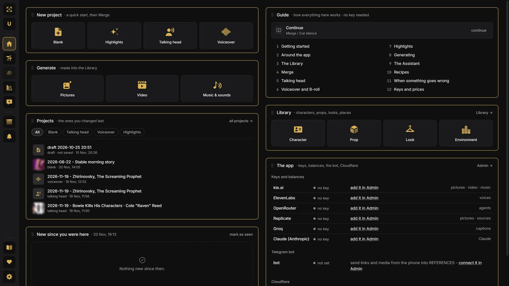
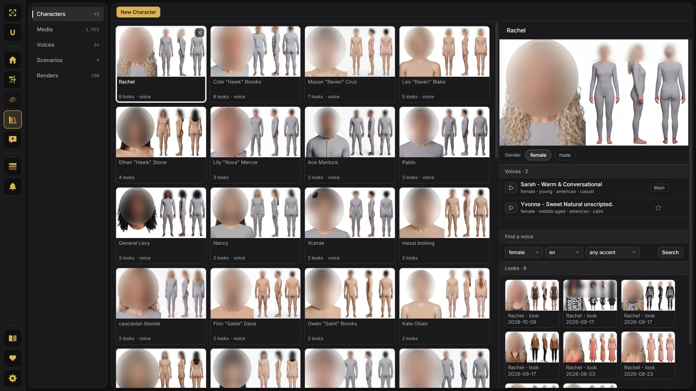
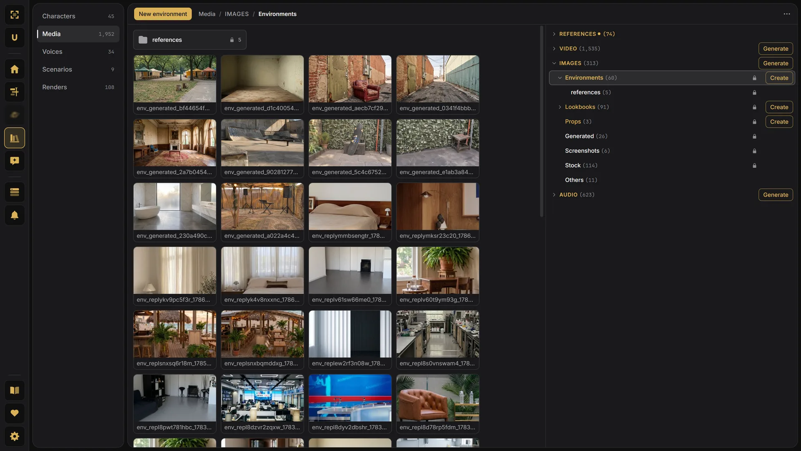

# UGC Studio

**English** · [Русский](README.ru.md)

**An open-source desktop app for AI UGC video: characters, scripts, talking heads, B-roll, captions, highlights and a
timeline editor — from an idea to a finished mp4.**

Version 0.9: usable, still in development. Windows only for now.

> **The code and the first build are on their way.** This page comes first, so you know what is coming. Star or watch
> the repository to be told when they are out.



## Who it is for

People who work with free short-video traffic — TikTok, Reels, YouTube Shorts — and need many videos, fast, each one
different. Think of CapCut, HeyGen and Opus Clip in one window, with no subscription and no markup: you pay only for
the AI tokens you use, straight to the services. Everything else — editing, cutting, captions, effects, face tracking,
rendering — runs on your computer and costs nothing.

## What you can do

### Characters, outfits and places

- **Create characters** — a portrait and a 4K character sheet (front, side, back), with ElevenLabs voices bound to
  each.
- **Dress them** — the outfit generator makes new looks of the same person.
- **Move them** — the environment generator makes the places they stand in.
- **Products** — a picture and a description of what you advertise; the AI writers take it into account.


*The Characters shelf. Faces are blurred in this screenshot.*

### Scripts in someone's voice

- **Long scripts for talking heads**, with hooks of forty kinds.
- **A narrator from a reference** — give it samples (a YouTube video, a text) and the scripts take that person's
  style and delivery.
- **Sources** — a link or a file is downloaded, transcribed and broken into topics to write about.

### Talking head

A script becomes a talking-head video line by line: mood and voice (ElevenLabs), frames with your character in its
place, clips (Kling Avatar or OmniHuman 2.0), then the timeline with captions. Change a line — only that line is
made again.

### Voiceover with B-roll

A script read in a voice, with stock B-roll (Pixabay) found and laid under every sentence by itself. Don't like a
piece? Pick another in one click.

### Highlights: long videos into shorts, almost for free

A podcast, an interview, a lecture or a stream becomes up to 20 vertical shorts:

- the AI finds the moments worth a short, by the kind of video — auto, podcast / interview, true crime / bodycam,
  documentary, lecture, or the whole video in parts;
- the 9:16 frame follows the faces or the speaker (MediaPipe, on your computer), with punch-ins on key lines;
- captions in your style, background music by mood, a title on top;
- every short rendered in one press.

You pay for the transcription (Groq, about $0.11 an hour — or nothing with Whisper on your computer) and the AI's
words. Cutting, framing and rendering are free.

### Timeline editor

- Video, audio, subtitle and text lanes; drag in anything from the Library or from Explorer.
- **Cut silence** with one key; cut a stretch out of every lane at once; merge clips.
- Crop, picture-in-picture, opacity, blend modes, color correction, pitch.
- **47 effects in 8 groups and 27 patterns** to make every video unique.
- **Captions**: transcribed automatically, styled with presets and animations in 100+ fonts, placed on the preview,
  with TikTok / Shorts / Instagram safe zones; an .srt beside every render.
- A render queue; NVENC when you have an NVIDIA card.

### Generation in one place

- **Pictures** — Nano Banana 2, Seedream 4.5, GPT Image, Grok Imagine.
- **Video and B-roll** — Seedance 2.0 / 2.5, Kling motion control, Grok Imagine. A full B-roll generator is in
  development.
- **Music and sounds** — Suno, ElevenLabs music, Video to Music, sound effects; 445 built-in sound effects and a
  search of free sounds online.
- With the AI writer on, every request stops for your look before any money is spent.

### Library and references

- One media tree — REFERENCES, IMAGES, VIDEO, AUDIO — with folders inside folders.
- **Your Telegram bot**: send a link from YouTube, Instagram or TikTok from your phone, and the post lands in
  REFERENCES — even while the app is closed (with a Cloudflare key).
- Cut fragments out of any video, save its sound, use a piece on the timeline.



### And also

- **Assistant** — ideas for your videos and answers about the app, with a built-in guide of twelve chapters
  ([read it here](public/guide/01-getting-started.md)).
- **Alerts** — every paid generation is written down at the press and never paid twice.
- **3D Studio** (in development) — clay blockout scenes for Seedance's reference clips.
- **Updates** download by themselves; one press on **Update** installs them.

## What it costs

The app is free. You pay the AI services directly, at their prices (autumn 2026; the app shows the price before every
paid press):

| What | Price |
|---|---|
| A picture | $0.02 – $0.09 |
| A second of video | $0.012 (Grok, 480p) – $0.79 (Seedance 2.5, 1080p) |
| A second of a talking head | $0.04 (Kling Avatar, 720p) – $0.08 (1080p) |
| Music — two tracks | $0.06 (Suno) |
| Transcription | $0.11 an hour (Groq), or free on your computer |
| Editing, cutting, captions, effects, face tracking, rendering | free |

For example, a 30-second talking head on Kling Avatar 720p costs about $1.20 for the clips, a few cents for the
frames, plus the ElevenLabs characters of the reading. All prices: [Keys and prices](public/guide/12-keys-and-prices.md).

## Keys

You bring your own keys; they stay on your computer and go only to their services. Enter them on **Admin → API keys**.

| To use | You need |
|---|---|
| Pictures and video chats | kie.ai or Replicate; Cloudflare to attach your pictures or clips |
| Talking head | ElevenLabs, kie.ai, Cloudflare and an AI key for the writers |
| Voiceover | ElevenLabs, Pixabay (free) and an AI key |
| Highlights | An AI key; Groq, or the speech model on your computer |
| New Character | Replicate and Cloudflare |
| Music and sounds | kie.ai (Suno) or ElevenLabs |
| References from Telegram | Your Telegram bot |

"An AI key" is any one of kie.ai, Replicate or Claude. A place that needs a key you have not entered is closed and
says which key it needs.

## Your data stays yours

- The library is a folder on your disk. No account, no sign-in, no cloud of ours.
- The app's server listens only on your own computer (127.0.0.1).
- Moving the folder moves everything: projects, media, settings.

## Download and run

1. Download the latest zip from [Releases](https://github.com/aferist777/ugc-app/releases) *(coming soon)*.
2. Unpack it anywhere and run **UGC Studio.exe**. The app is not code-signed, so Windows may say "Windows protected your
   PC" — press **More info → Run anyway**.
3. Enter your keys on **Admin → API keys** and open **Guide** in the top strip.

Windows 10 or 11, 64-bit. ffmpeg, yt-dlp, Whisper, MediaPipe, the sound effects, patterns and fonts are inside.

### From source

For developers: Node.js 24 and Git.

```
git clone https://github.com/aferist777/ugc-app.git
cd ugc-app
npm install
npm start
```

`npm install` also downloads the tools the app uses (yt-dlp, Whisper, MediaPipe models, the built-in sounds and
patterns). Updates from source come with `git pull`.

## Content and safety

The app turns the models' own safety checkers off wherever a model allows it. What you generate and publish is your
responsibility — follow the terms of the services you use and the laws where you live.

## About

Made alone in 10 months together with Claude Code.

For the last ten years I have been automating things and writing scripts, but this is the first project I publish: the
earlier ones were local and of little use to anyone else — and only now did I find the courage to show something.

## Contact

- Telegram: [@ferra69](https://t.me/ferra69)
- Email: workingbeast13@gmail.com
- [Issues](https://github.com/aferist777/ugc-app/issues) for bugs, [Discussions](https://github.com/aferist777/ugc-app/discussions)
  for ideas and questions.

Pull requests are not accepted for now — please write an Issue instead.

## Support

If the app saves you money, you can [buy me a coffee](https://www.donationalerts.com/r/fellows).

## License

Copyright (C) 2026 aferist777. UGC Studio is free software under the GNU Affero General Public License, version 3 or
(at your option) any later version — [LICENSE](LICENSE). It comes with no warranty.

The libraries, models, fonts, sounds and patterns the app uses are listed with their licenses in
[THIRD_PARTY_NOTICES](THIRD_PARTY_NOTICES.md) and in the app on **Admin → Thanks**.
