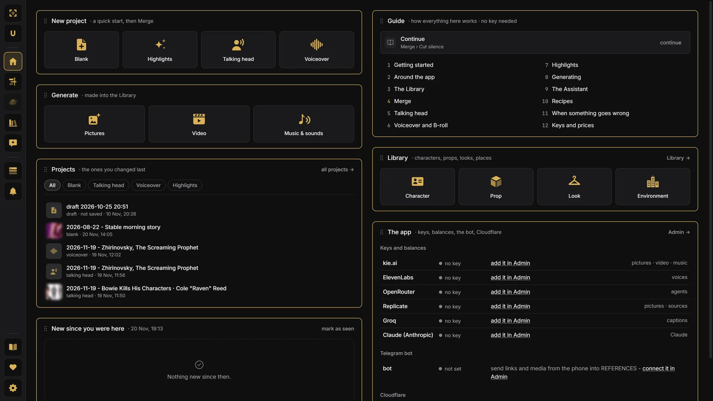
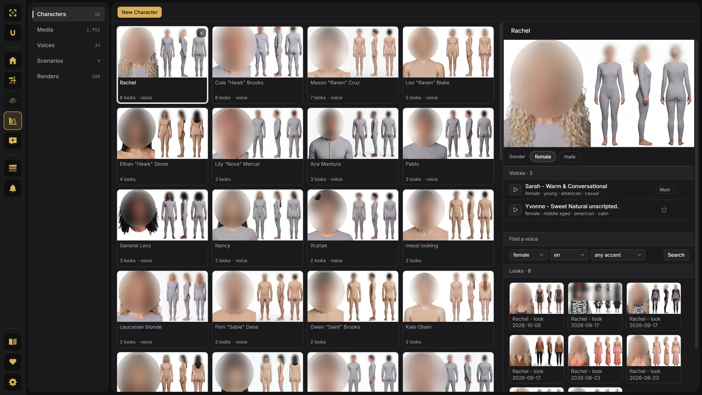
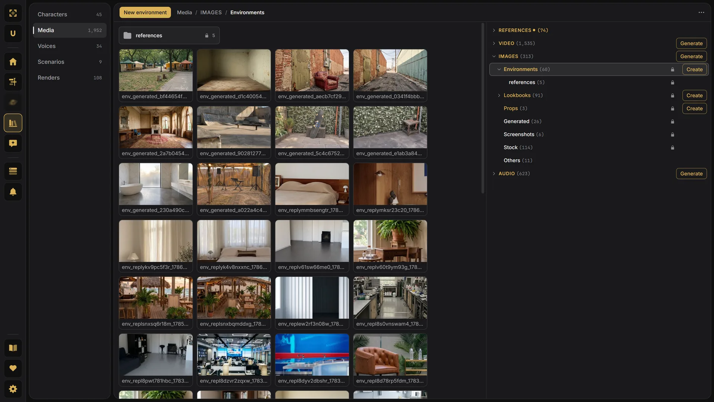

# UGC Studio

[English](README.md) · **Русский**

**Открытое приложение для ПК для ИИ-видео в формате UGC: персонажи, сценарии, говорящие головы, B-roll, субтитры,
нарезка highlights и монтаж на таймлайне — от идеи до готового mp4.**

Версия 0.9: уже рабочая, ещё дорабатывается. Пока только Windows.



## Для кого

Для тех, кто работает с условно-бесплатным трафиком — TikTok, Reels, YouTube Shorts — и кому нужно много роликов,
быстро и каждый не похожий на другой. Это CapCut, HeyGen и Opus Clip в одном окне — без подписок и переплат: вы
платите только за токены, напрямую сервисам. Всё остальное — монтаж, нарезка, субтитры, эффекты, слежение за лицом,
рендер — идёт на вашем компьютере и ничего не стоит.

## Что можно делать

### Персонажи, одежда и места

- **Создать персонажа** — портрет и лист персонажа в 4K (спереди, сбоку, сзади), к каждому — голоса ElevenLabs.
- **Переодеть** — генератор одежды делает новые образы того же человека.
- **Перенести** — генератор окружений делает места, где он стоит.
- **Товары** — картинка и описание того, что вы рекламируете; ИИ-писатели это учитывают.


*Полка персонажей. Лица на снимке размыты.*

### Сценарии чужим голосом

- **Длинные сценарии для говорящей головы**, с хуками сорока видов.
- **Рассказчик по референсу** — дайте ему образцы (ролик с YouTube, текст), и сценарии возьмут стиль и подачу нужного
  человека или персонажа.
- **Источники** — ссылка или файл скачиваются, расшифровываются и раскладываются на темы.

### Говорящая голова

Сценарий превращается в ролик говорящей головы строка за строкой: настроение и голос (ElevenLabs), кадры с вашим
персонажем на его месте, клипы (Kling Avatar или OmniHuman 2.0), затем таймлайн с субтитрами. Переделать одну
строку — остальные остаются как были.

### Озвучка с B-roll

Сценарий, прочитанный голосом, и под каждой фразой — стоковые B-roll (Pixabay), найденные и разложенные сами. Не
нравится кусок — другой выбирается одним нажатием.

### Highlights: из длинного видео — короткие, почти бесплатно

Подкаст, интервью, лекция или стрим превращается в до 20 вертикальных роликов:

- ИИ находит моменты, достойные ролика, по виду видео — авто, подкаст / интервью, true crime / bodycam,
  документалка, лекция или всё видео частями;
- кадр 9:16 следит за лицами или за говорящим (MediaPipe, на вашем компьютере), с приближениями на ключевых фразах;
- субтитры в вашем стиле, фоновая музыка по настроению, заголовок сверху;
- все ролики рендерятся одним нажатием.

Платно только расшифровка (Groq, около $0,11 за час — или бесплатно, Whisper на вашем компьютере) и слова ИИ. Нарезка,
кадр и рендер — бесплатно.

### Таймлайн

- Дорожки видео, звука, субтитров и текста; перетаскивается что угодно из Библиотеки или из Проводника.
- **Вырезать тишину** одной клавишей; вырезать отрезок сразу со всех дорожек; склеить клипы.
- Обрезка кадра, картинка в картинке, прозрачность, режимы наложения, цветокоррекция, высота звука.
- **47 эффектов в 8 группах и 27 паттернов** — для уникализации каждого ролика.
- **Субтитры**: распознаются сами, оформляются пресетами и анимациями в 100+ шрифтах, ставятся прямо на превью, с
  безопасными зонами TikTok / Shorts / Instagram; рядом с каждым рендером — .srt.
- Очередь рендера; NVENC, если у вас видеокарта NVIDIA.

### Генерация в одном месте

- **Картинки** — Nano Banana 2, Seedream 4.5, GPT Image, Grok Imagine.
- **Видео и B-roll** — Seedance 2.0 / 2.5, Kling motion control, Grok Imagine. Полноценный генератор B-roll — в
  разработке.
- **Музыка и звуки** — Suno, музыка ElevenLabs, музыка под видео, звуковые эффекты; 445 встроенных звуков и поиск
  свободных звуков в сети.
- С включённым ИИ-писателем каждый запрос останавливается на ваш просмотр, прежде чем тратить деньги.

### Библиотека и референсы

- Одно дерево медиа — REFERENCES, IMAGES, VIDEO, AUDIO — с папками в папках.
- **Ваш Telegram-бот**: отправьте с телефона ссылку с YouTube, Instagram или TikTok — пост ляжет в REFERENCES, даже
  когда приложение закрыто (с ключом Cloudflare).
- Вырезать фрагменты из любого видео, сохранить его звук, положить кусок на таймлайн.



### А ещё

- **Ассистент** — идеи для роликов и ответы о приложении, со встроенной книгой из двенадцати глав
  ([читать здесь](public/guide/01-getting-started.md), по-английски).
- **Alerts** — каждая платная генерация записывается в момент нажатия и никогда не оплачивается дважды.
- **3D Studio** (в разработке) — сцены-болванки для референсных клипов Seedance.
- **Обновления** скачиваются сами; ставятся одним нажатием на **Update**.

## Сколько стоит

Приложение бесплатное. Вы платите ИИ-сервисам напрямую, по их ценам (осень 2026; приложение показывает цену перед
каждым платным нажатием):

| Что | Цена |
|---|---|
| Картинка | $0,02 – $0,09 |
| Секунда видео | $0,012 (Grok, 480p) – $0,79 (Seedance 2.5, 1080p) |
| Секунда говорящей головы | $0,04 (Kling Avatar, 720p) – $0,08 (1080p) |
| Музыка — два трека | $0,06 (Suno) |
| Расшифровка | $0,11 за час (Groq) или бесплатно на вашем компьютере |
| Монтаж, нарезка, субтитры, эффекты, слежение за лицом, рендер | бесплатно |

Например, 30 секунд говорящей головы на Kling Avatar 720p — около $1,20 за клипы, несколько центов за кадры и
символы ElevenLabs на чтение. Все цены — в главе [Keys and prices](public/guide/12-keys-and-prices.md).

## Ключи

Ключи ваши; они остаются на вашем компьютере и уходят только своим сервисам. Вводятся на **Admin → API keys**.

| Чтобы пользоваться | Нужно |
|---|---|
| Чатами картинок и видео | kie.ai или Replicate; Cloudflare — чтобы прикладывать свои картинки и клипы |
| Говорящей головой | ElevenLabs, kie.ai, Cloudflare и ключ ИИ для писателей |
| Озвучкой | ElevenLabs, Pixabay (бесплатно) и ключ ИИ |
| Highlights | Ключ ИИ; Groq или модель речи на вашем компьютере |
| New Character | Replicate и Cloudflare |
| Музыкой и звуками | kie.ai (Suno) или ElevenLabs |
| Референсами из Telegram | Ваш Telegram-бот |

«Ключ ИИ» — любой из kie.ai, Replicate или Claude. Место, которому нужен ещё не введённый ключ, закрыто и говорит,
какой ключ нужен.

## Ваши данные — ваши

- Библиотека — папка на вашем диске. Ни учётной записи, ни входа, ни нашего облака.
- Сервер приложения слушает только ваш компьютер (127.0.0.1).
- Перенесли папку — перенесли всё: проекты, медиа, настройки.

## Скачать и запустить

1. Скачайте **UGC-Studio-0.9.0-win32-x64.zip** из [последнего выпуска](https://github.com/aferist777/ugc-app/releases/latest).
2. Распакуйте его в свою папку — не в ту, что синхронизирует OneDrive: библиотека дорастает до гигабайт — и запустите
   **UGC Studio.exe**. Приложение без цифровой подписи, поэтому Windows может сказать «Система Windows защитила ваш
   компьютер» — нажмите **Подробнее → Выполнить в любом случае**.
3. Введите ключи на **Admin → API keys** и откройте **Guide** в верхней полосе.

Windows 10 или 11, 64-бит. ffmpeg, yt-dlp, Whisper, MediaPipe, звуки, паттерны и шрифты — внутри.

### Из исходников

Для разработчиков: Node.js 24 и Git.

```
git clone https://github.com/aferist777/ugc-app.git
cd ugc-app
npm install
npm start
```

`npm install` заодно скачивает инструменты приложения (yt-dlp, Whisper, модели MediaPipe, встроенные звуки и
паттерны). Обновление из исходников — `git pull`.

## Содержимое и безопасность

Приложение выключает собственные фильтры безопасности моделей везде, где модель это позволяет. За то, что вы
генерируете и публикуете, отвечаете вы — соблюдайте условия сервисов и законы своей страны.

## Об авторе

Сделано в одиночку за 10 месяцев вместе с Claude Code.

Последние десять лет я посвятил автоматизации и созданию скриптов, но публикуюсь впервые: прежние проекты были
локальными и мало кому применимыми — да и смелость что-то показать появилась только сейчас.

## Связь

- Telegram: [@ferra69](https://t.me/ferra69)
- Почта: workingbeast13@gmail.com
- [Issues](https://github.com/aferist777/ugc-app/issues) — об ошибках, [Discussions](https://github.com/aferist777/ugc-app/discussions)
  — идеи и вопросы.

Правки кода (pull requests) пока не принимаются — напишите, пожалуйста, Issue.

## Поддержать

Если приложение экономит вам деньги, можно [угостить меня кофе](https://www.donationalerts.com/r/fellows).

## Лицензия

Copyright (C) 2026 aferist777. UGC Studio — свободная программа под GNU Affero General Public License версии 3 или
(по вашему выбору) любой более поздней — [LICENSE](LICENSE). Без каких-либо гарантий.

Библиотеки, модели, шрифты, звуки и паттерны, которыми пользуется приложение, перечислены с их лицензиями в
[THIRD_PARTY_NOTICES](THIRD_PARTY_NOTICES.md) и в самом приложении на **Admin → Thanks**.
