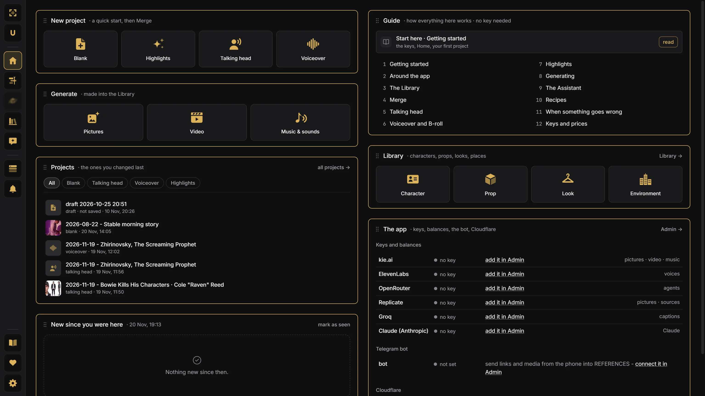
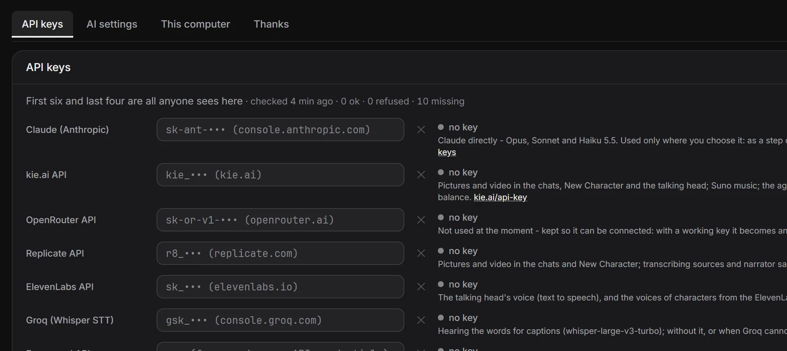
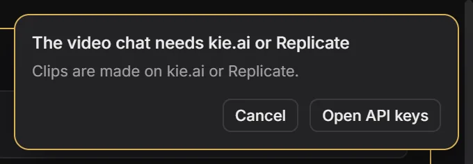
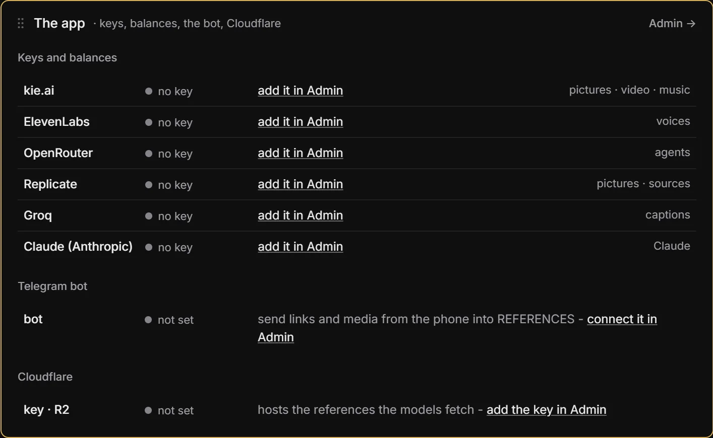
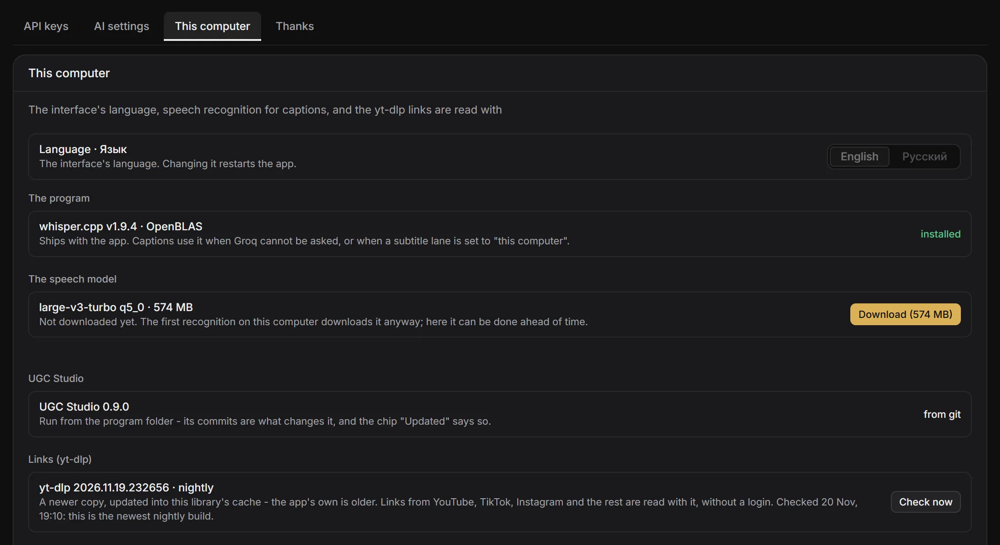

# Getting started

UGC Studio makes UGC ads and short vertical videos - TikTok, Shorts, Reels - on your own computer. This chapter is what
to do on the first day: open the app, give it its keys, and find your way to the first video.

## What UGC Studio does

- **Talking heads** - a character of yours speaks your script in a place, line by line: its voice, its frames, a
  speaking clip for every line.
- **Voiceovers** - your script read in a voice, with stock B-roll found for every sentence.
- **Highlights** - a long video (a podcast, a stream, a lecture) cut into vertical shorts, with captions, music and a
  frame that follows the speaker.
- **Anything else** - pictures, clips, music and sounds made by the app's generators, and your own files, edited on a
  timeline with captions and effects, rendered into one video.

The app does the editing and rendering itself, on this computer. The generating - pictures, video, voices, music, the
agents that write prompts - is done by AI services you pay for with your own keys. Every paid step says its price before
anything is paid.

## The first start

**UGC Studio.exe** opens the app in its own window, filling the screen. **F11** (or the button at the right end of the top
strip) switches to full screen and back.

Everything the app makes or keeps is in its **library** - a folder named `library` beside the program. Projects,
characters, pictures, clips, music, renders, the app's lists and backups all live there, and nothing is written anywhere
else. To move your work to another computer, copy that folder.

Only one window of the app can be open on one library. Closing it while a render is running asks first.

This guide is there from the first start, before any key is added: the **Guide** block on Home - first in the right
column - and **Guide** at the right end of the top strip, on every page. Its window opens over the page and remembers
where you stopped.

## The keys

A key is how a service knows the work is yours and bills you for it. Keys are entered on **Admin → API keys** (Admin is the
gear at the right end of the top strip): paste a key, press **Save**, and the app asks the service whether the key works - a green line under it means yes, a red one says
why not. **Check again** asks every service anew. A key is shown as its first six and last four characters only.

What each key does:

| Key | What it is for | Without it |
|---|---|---|
| **kie.ai** | The main one: pictures and video in the chats, the talking head's frames and clips, environments and lookbooks, Suno music, the agents that write prompts | Most generation stops; Replicate can stand in for some of it |
| **Replicate** | New Character (the portrait, then its 4K sheet); pictures and video as a second way in; the agents; transcribing sources | No New Character; the chats go through kie.ai only |
| **ElevenLabs** | Voices - the talking head and the voiceover read their scripts with it; music from a description, Video to Music, sound effects | No talking head or voiceover - nothing is read |
| **Claude (Anthropic)** | Claude as one of the agents (AI settings), and the Assistant | Other agents answer |
| **Groq** | Hearing the words for captions, fast | This computer hears them (free, slower - see below) |
| **Cloudflare** | One key for R2 - the place the models fetch your reference pictures and clips from; also keeps your Telegram bot's messages while the app is closed | The models cannot be given a reference - no talking head, no New Character |
| **Pixabay** | Free stock videos and photos - the voiceover's B-roll | No voiceover |
| **Freesound** | Free sound effects online (SFX → find online…) | No online search |
| **Telegram bot token** | Your own bot: send it links, photos and videos from your phone - they arrive in REFERENCES | No bot; REFERENCES is locked |
| **OpenRouter** | Not used at the moment | - |

Start with **kie.ai**, **ElevenLabs** and **Cloudflare** - with those three the generators, talking heads and the agents
work. New Character also needs **Replicate**, a voiceover **Pixabay**, highlights **Groq** or the free speech model on this
computer (see below), REFERENCES the **Telegram bot**.

### A place without its key

A part of the app that needs a key you have not added stays closed until you add it. A generator's window - the pictures
or video chat, music and sounds, New environment, New lookbook, New Character, New prop, the Assistant, SFX's **find
online…** - does not open: a popup in the top right corner says which key it needs and why. A talking head's or a
voiceover's setup is blurred under a lock; highlights do not start; REFERENCES is locked without the bot. Inside an open
chat, attaching a picture or a clip waits for the Cloudflare key, and the writer for an AI key.

**Open API keys** in the popup opens Admin with the fields it needs lit in gold; **← Back** there returns you to where
you were. Where one of several keys will do - kie.ai or Replicate, any key of the agents' ladder - the popup names them
all. Highlights and captions can also hear the words on this computer for free: the popup's **This computer** leads to
the speech model. A key its service refused counts as none; the popup says why it was refused.

### Cloudflare, step by step

Under the Cloudflare field there is an instruction: make an API token in your Cloudflare account, paste it, **Save**.
The app then finds your account, finds or makes a bucket and tries an upload - each step gets its tick. R2 asks for a
card once, though what the app keeps there is small and short-lived.

### The Telegram bot

Make a bot with **@BotFather** in Telegram, paste its token, then send the bot the code the app shows - from then on the
bot listens to you only.

## First steps

The **First steps** block on Home lists what is still to do - each line with its button - and ticks it off when it is
done: this chapter read, the three main keys, the bot, the first character, the first talking head, the speech model.
**hide** puts it away once you no longer need it.

**The app** block shows every key with what it does - "no key · add it in Admin" until it is there - and its balance where
the service tells one: kie.ai's credits, ElevenLabs' characters left.

## Hearing speech on this computer

Captions need the words that are spoken. With a Groq key they are heard by Groq in seconds. Without one - or when Groq
cannot be asked - this computer hears them, for free, with **whisper**. Its speech model (574 MB) is downloaded once - the
first time you ask this computer to hear, or ahead of time on **Admin → This computer** (or the line in First steps); what
hears by itself never downloads it. Merge also offers it once, the first time you open it.

The same page keeps **yt-dlp** - what downloads videos by a link - up to date, and says which version of the app you
have. Its first row, **Language · Язык**, switches the app between **English** and **Русский** - the app restarts to
take it (**Restart now?**), and the guide follows.

## Updates

When a new version of the app is ready, a gold chip **Update …** appears in the top strip, left of Alerts. Press it to
see what is new and **Restart and update**: the app closes, the new version opens on the same library. **Admin → This
computer → Check now** asks at once; otherwise the app asks by itself a minute after it starts and every six hours.

Before the first start of a new version the app copies every list of your library into `library\backups`.

## Where to go next

- **Around the app** - the top strip, Home, the windows, Alerts and the Queue.
- **Merge** - the editor every project ends up in.
- **Talking head**, **Voiceover**, **Highlights** - one chapter each.
