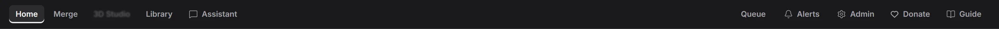
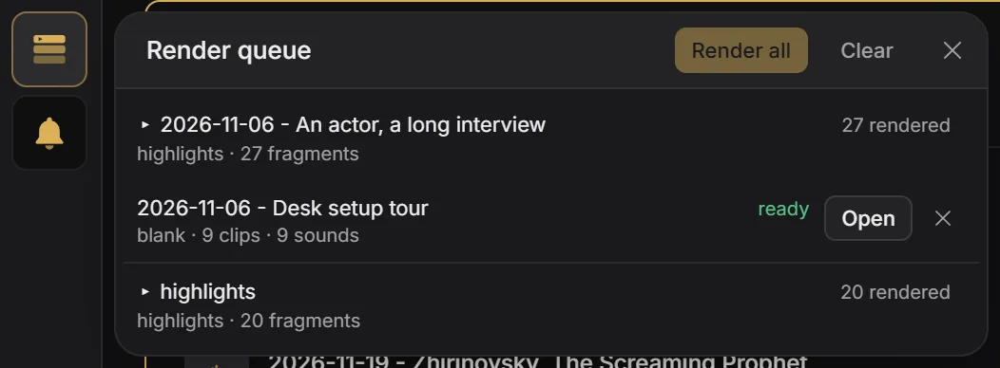

# Around the app

Four pages, one strip on top of each, and windows that open over them. This chapter is the map: where things are and how
the parts of the app behave everywhere.

## The top strip

Every page has the same strip.

- **Home** - the start page: quick starts, the generators, your latest projects, your keys.
- **Merge** - the editor: every project, its timeline and its render.
- **3D Studio** - blurred: it is still being built.
- **Library** - everything the app keeps: characters, media, voices, scenarios, renders.
- **Assistant** - a chat with an AI: **Ideas** to brainstorm videos and prompts, **Help** to ask how to do something here.
- On the right: **Queue** (renders waiting to run), the wait (how long the work in flight still takes), **Alerts** (every
  generation), **Donate** (a page to thank the app's author), **Guide** (this book - on every page, with no key needed),
  and last the gear of **Admin** (keys and settings; its name shows under the pointer). An **Update …** chip appears there
  when a new version is ready.
- At the far right, in full screen: minimise, into a window, quit.

The page you are on is lit.

## Home

Home is made of blocks:

- **New project** - quick starts: **Blank**, **Highlights**, **Talking head**, **Voiceover**. Each opens a small window -
  the name and format, the video, the script, the voice - and makes the project when you press its button; the project
  then opens in Merge.
- **Generate** - **Pictures**, **Video**, **Music & sounds**: the generators' windows open right over Home. What they make
  goes into the Library.
- **Library** - **Character**, **Prop**, **Look**, **Environment**: the makers of what your videos are built from.
- **Projects** - the five you changed last of each kind; the pointer resting on one shows its card.
- **Guide** - this book. **Start here** opens Getting started; once you have read, **Continue** opens the book where you
  stopped. A press on one of its parts below opens that chapter.
- **First steps** and **The app** - what is left to set up, and your keys with their balances (see Getting started).
- **New since you were here** - what was made while you were away.

Drag a block by its head to put it anywhere; **Reset layout** at the bottom puts every block back.

## Windows

The app's windows open over the page and darken it, so it is clear what has your attention.

- **Escape** closes the window on top; so do its ✕ and a press on the darkened page around it.
- The big windows - the chats, the sound window, New Character, the Assistant, the Guide - are moved by their head and
  stretched by their edges and corners. Each remembers its size and place. A double press on the head puts it back.
- While a window is open, the page's own keys (Space, Delete, Ctrl+Z) do nothing - typing in a window never plays the
  timeline underneath.
- A thing made in a chat can be dragged out of its window onto the page - the windows step aside while you drag.

## Alerts - everything being generated

Every paid generation - a picture, a clip, a talking head's frames and clips, music, sounds, a character, an environment,
a lookbook, a long video turned into highlights - is a row of **Alerts** from the moment you press its button.

- A running row says its stage ("drawing the place…", "rendering") and how long is left; the strip's wait sums them up.
- The work belongs to the app, not to the page: leave the page, close the window - the result is still downloaded and
  filed where it belongs.
- A finished row has **open** - it leads to the place the result went, the file outlined.
- A failed row says why in words and has **retry**. A row that "may have been paid for" is never asked again by itself.
- **Clear** forgets the finished rows; what is still running stays.

When something finishes, a popup in the corner says so.

## Queue - renders waiting

**Add to queue** in Merge's render window puts a render in the **Queue** instead of starting it.

**Render all** runs the waiting renders one after another. A finished row has **Open** (the video in the Library's
viewer), a failed one **retry**, and ✕ takes a row out of the queue; **Stop** stops the one running, **Clear** forgets
the finished ones. A highlights project is one row for all its fragments, opened with ▸.

## Messages in the corner

The app speaks in popups at the top right.

- **An error** stays until you close it with its ✕ (or press its button, when it has one). The same error twice is one
  popup with "×2".
- **News** - something finished, something saved - goes away by itself.

Nothing is said in a box in the middle of the page, and nothing interrupts what you are doing.

## Keys everywhere

| Key | What it does |
|---|---|
| Escape | Close the window or menu on top; let go of what is picked |
| F11 | Full screen and back |
| Enter | Send, in the chats and the Assistant (Shift+Enter - a new line) |
| Ctrl+Z / Ctrl+Y | Undo / redo, in Merge and in the captions' text |

Merge has keys of its own - see its chapter.
