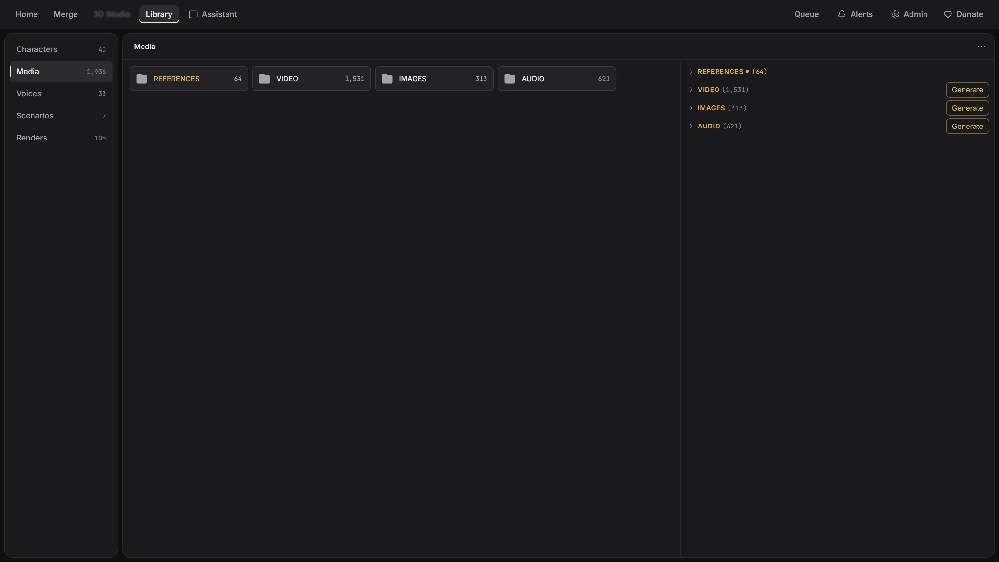
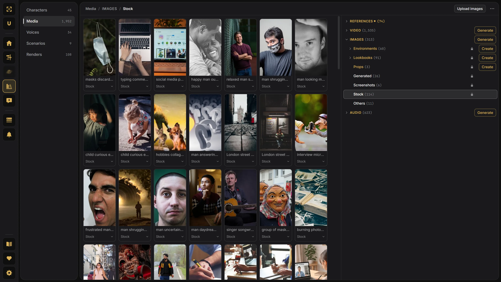
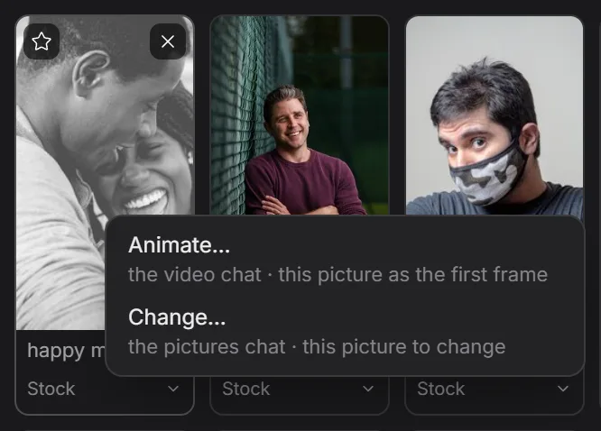
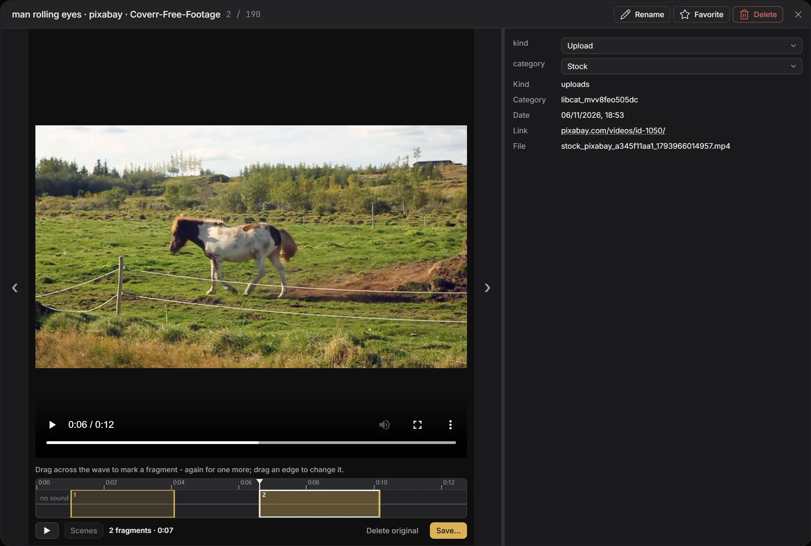
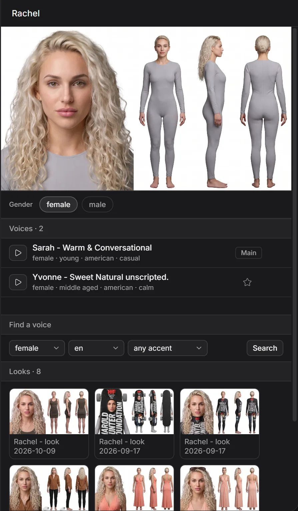
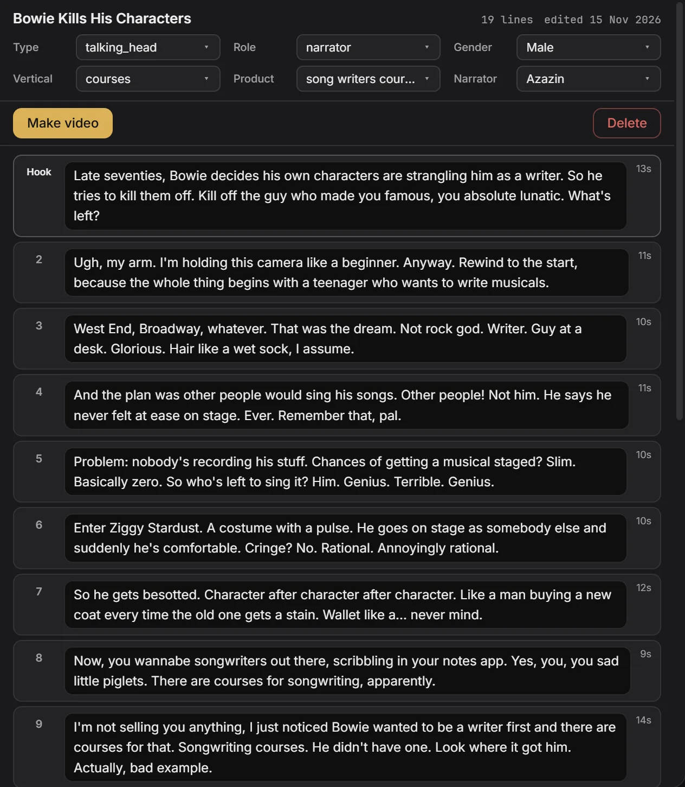

# The Library

The Library is everything the app keeps - and the way in for everything you bring. Merge has the same media in its
Library panel; this page is where you sort them, look at them closely, cut them and make the things your videos are
built from.

## The shelves

On the left: **Characters**, **Media**, **Voices**, **Scenarios**, **Renders**. Each keeps its own buttons in the bar
above it - **New Character** on Characters, **New scenario** and **Narrators** on Scenarios, **Upload** and **From a link**
on Media.

## Media - the tree

Media opens on its four roots, as folder tiles:

- **REFERENCES** - what your Telegram bot brought in (a post is one tile), and the YouTube videos downloaded as sources.
- **IMAGES** - **Environments**, **Lookbooks** and **Props** first, then **Generated**, **Screenshots**, **Stock** and your
  own folders.
- **VIDEO** - **Generated** (a folder for every video model, and Talking heads), **Hooks**, **Uploads**.
- **AUDIO** - **Music** (with **highlights** moods and **Lyrics**), **SFX** (**Favorites**, **Built-in**, **My sounds**),
  and sounds of your own.

The same tree stands on the right: press a root to open it; deeper, a press selects a folder and a double press (or ▸)
opens it. Only one path is open at a time - opening a folder folds the others. The word **Media** at the start of the
path leads back to the roots.

The gold names are where something can be made: **generate** beside IMAGES, VIDEO and AUDIO opens that generator's
window; **create** beside Environments, Lookbooks and Props opens their makers.

## Folders

- **New folder** - the **+** of a kind, or the right button on a folder or on the gallery's empty space (the new folder
  goes inside the one you pressed).
- The right button on a folder: rename it, or delete it - with what is in it moved one level up, or with everything in it.
- Drag a folder onto another folder of its kind to put it inside.
- A folder with a lock is filled by the app - Generated, Screenshots, the references of Environments and Lookbooks: it
  can hold folders of yours, but it is never renamed, moved or deleted.

## Tiles

- **Ctrl** + press and **Shift** + press pick several tiles; a band drawn over the gallery picks a group; **Escape** lets
  go.
- Drag the picked tiles onto a folder in the tree to move them; **Delete** deletes them (asked first - and the question
  names the projects that use them).
- The right button on ONE tile opens a chat with it, in a window over the Library: on a picture **Animate…** (the video
  chat, the picture as the first frame) and **Change…** (the pictures chat, the picture to change); on a clip
  **Continue…** and **As a reference…**.

- The right button on SEVERAL picked tiles: **Move to…** (a small tree to choose the folder - its **+** makes a new
  folder right there), **★ Add to favorites**, **Delete N** (asked first).
- One tile's own **★**, **Rename** and **Delete** are in its viewer, and its ✕ in the corner under the pointer.

**Upload** brings files from this computer into the folder that is open; **From a link** downloads videos from YouTube,
TikTok, Instagram and other sites into it (one link per line) - or let a link go over the shelf.

## The viewer - and cutting a video

A press on a tile opens it large. A picture shows its name and what is known about it; a video plays, with a **bar of
fragments** under it.

- Sweep over the bar - a wave of the video's sound - to draw a fragment; drag its edges or its middle; press to pick one,
  **Delete** to remove it, **Ctrl+Z** to undo. **Alt + wheel** zooms the bar.
- **▶** plays only the fragments, one after another - as they will be joined.
- **Scenes** finds where the shots change and lays every scene as a fragment.
- **Save…** joins the fragments into ONE new clip, next to the video; the video itself is untouched. **Delete original**
  beside it deletes the video once the clip is saved - unless a timeline or a project still uses it.
- The right button on the video: **Save audio** (its sound into AUDIO) and **Save video as…**; on a fragment: save it
  alone, or its audio.

A clip cut from a video remembers it: **show the whole video** in the viewer opens the original with this clip's
fragments on its bar, to cut another piece.

## Characters

A character is a person of your own: a portrait, then a **4K sheet** - the same face and figure from many sides, which
every frame of a talking head keeps to.

- **New Character** opens its window: describe the person (or start from a preset, a random face or your own photo),
  make the portrait, then the sheet. The sheet takes a few minutes - it is a row of Alerts, and the window can be closed
  meanwhile.
- A character can have several **looks** - outfits - dressed from a lookbook (IMAGES → Lookbooks).
- Its **voices** are ElevenLabs voices; the one chosen is what the talking head reads with.

## Environments, lookbooks and props

They live in IMAGES, first in the list:

- **Environments** - places, made by **create** from a photo and a sentence ("evening, the lamps on").
- **Lookbooks** - outfits a character is dressed in.
- **Props** - your products. **create** opens **New prop**: a photo of the product, its name and what you know about it;
  the app reads the photo and writes the product's description. In a talking head's frames, a product is drawn exactly
  as on its picture.

Opened in the viewer, each shows what the app knows about it - an environment's description, a lookbook's gender, a
product's description - and you can correct it there.

## Music and sounds

AUDIO keeps the sounds:

- **Music** - your tracks and the generated ones. A track pressed plays in the **player** under the gallery; its right
  button has **Cut…** (a piece of it as a new track), **Rename**, **Move to …** (AUDIO, My sounds), **Delete**. **highlights** holds the moods
  the highlights projects draw their music from; **Lyrics** keeps the texts written for songs.
- **SFX** - **Favorites** (★), **Built-in** (the app's own set of sound effects), **My sounds** (generated and your own).
  **find online…** searches free CC0 sound effects.

Sounds move between Music, My sounds and AUDIO by a drag, **Move to…** or their right button.

## Voices

Every voice the app knows - each with the characters that use it. A voice comes from ElevenLabs: from a character's
making, or from the ElevenLabs library through a talking head's or a voiceover's voice menu.

## Scenarios

Scripts for talking heads and voiceovers. The list is on the left (drag its border to widen it); a scenario pressed
shows its lines on the right as cards.

- **New scenario** is a menu: **blank** - a window to write one yourself - or **narrator** - the generator.
- **The generator** writes a script in a narrator's voice: pick a narrator, a source of topics (a YouTube video or a file
  you add) and hooks - forty types, one to ten at a press, each remade alone. A draft is saved before every paid step.
- **Narrators** - a narrator is a voice made from samples of someone's writing or speech; adding samples only adds to it.
- A scenario's lines are edited right there, card by card - they save themselves when you stop typing.
- **Make video** makes a talking-head project from the scenario and opens it in Merge.
- A scenario's right button: **Archive** - it leaves the list for **▸ Archive** at the bottom, and **Restore** brings it
  back.

## Renders

Every finished video, by project, newest first. A press plays it; the right button offers **Show in folder** (Explorer,
the file picked) and **Delete** (pressed twice).

## REFERENCES and the Telegram bot

What you send your bot from the phone - a link to a post, photos, videos - arrives in **REFERENCES**, one tile a post,
sorted by where it came from. A post opens in the viewer whole; its pictures and clips can be attached in the chats,
moved into folders of their own, cut like any video. The bot is set up on Admin → API keys (see Getting started).
