# Merge

Merge is the editor. Every kind of project - a blank one, a talking head, a voiceover, highlights - ends up here as a
timeline: clips, sounds, captions and effects laid on lanes, rendered into one video. This chapter goes through the
page from top to bottom.

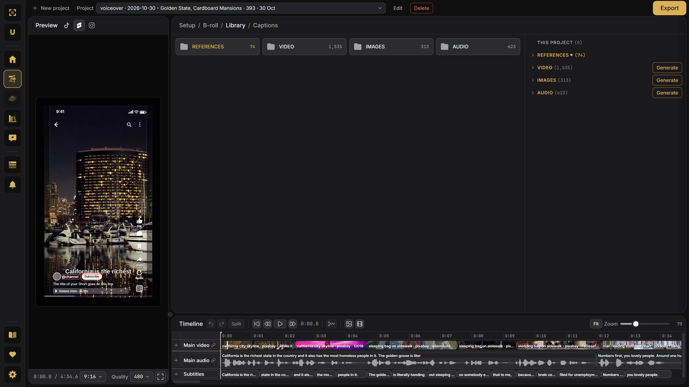

## The page at a glance

- **The project bar** across the top: **+ New project**, the **Project** you are in, **Edit**, **Delete**, and the gold
  **Export** at the right end.
- **The preview** on the left: the frame as it will be rendered, at the playhead.
- **The Library panel** in the middle: everything in your library, ready to be dragged onto the timeline - and, in its
  other views, the captions and a clip's settings.
- **The timeline** at the bottom: the lanes and their clips.

The borders between them can be dragged. A double press on the border above the timeline fits it to its lanes again.

## Projects and the draft

The **Project** list opens a list of every project, newest first. The chips on top show one kind at a time - **All**,
**Talking head**, **Voiceover**, **Highlights** - and the list remembers the one you chose.

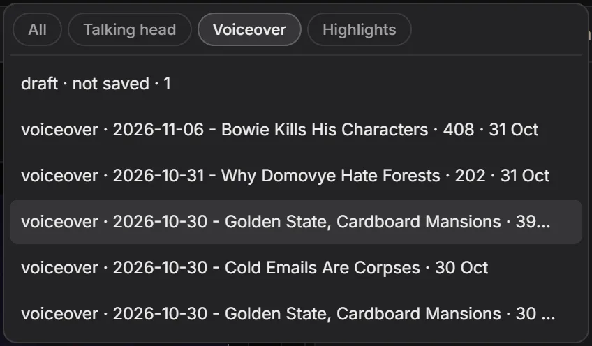

**+ New project** offers four kinds:

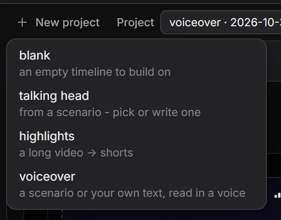

- **blank** - an empty timeline to build on;
- **talking head** - a character speaks a scenario (see the Talking head chapter);
- **highlights** - a long video cut into vertical shorts (see the Highlights chapter);
- **voiceover** - a scenario or your own text read in a voice, with stock B-roll under it.

**Edit** renames the project; **Delete** deletes its timeline and asks whether its files go too.

### The draft

When no project is open you are in **the draft** - it is always there, first in the list. Its bar reads differently:
**Save** gives it a name and makes it a project (a new empty draft takes its place), and **Clear** empties its lanes -
**Ctrl+Z** brings the clips back. Anything you try out without a project lands in the draft, so nothing is lost.

## The Library panel

The panel shows your library as folders. On the left, the four roots - **REFERENCES**, **VIDEO**, **IMAGES**,
**AUDIO** - as tiles; on the right, the same as a tree, with **THIS PROJECT** first: the project's own folders of
links to files that stay where they lie in the library.

- Press a folder to open it; its files appear as tiles.
- **Generate** beside VIDEO, IMAGES and AUDIO opens that generator's window (the video chat, the pictures chat, the
  sound window). What they make lands in the library - drag it onto a lane.
- Drag a tile onto a lane to put it on the timeline. A lane takes only what it can play: pictures and clips on video
  lanes, sounds on audio lanes.
- Files dragged in from Explorer are copied into the library first (VIDEO → Uploads, IMAGES, AUDIO → Music), then laid
  where you let go.

The words over the panel - **Library / Captions**, and **Setup / B-roll** in a voiceover - switch what the panel shows.
The one in white is where you are.

## The preview

The preview plays the timeline exactly as it will be rendered.

- **TikTok**, **Shorts** and **Instagram** beside "Preview" lay that app's screen over the frame, so you see what its
  buttons and captions cover. They are never rendered.
- At the bottom: the time, the frame's shape (**9:16**, **16:9** …), **Quality** - the preview's own resolution, not the
  render's -, **Enlarge the preview**, and the camera, which saves the frame at the playhead into IMAGES → Screenshots.
- Things on the frame can be moved right there: drag a caption to place it, drag a picture-in-picture or an insert to
  move it, its corner to size it, its knob to turn it.

## The timeline

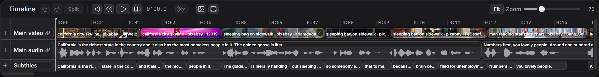

A new timeline has three lanes: **Main video**, **Main audio** and **Subtitles**. More appear as you need them - let a
clip go above the top lane or below the bottom audio lane and a new lane is made there (a ghost shows where). The **+**
at the left of Main video or Main audio adds another lane of its kind, and a lane made that way has a **−** that takes
it away again. The **+** of Subtitles adds a text lane - for words you type yourself, which a new hearing never
overwrites (two at most).

- **The playhead** moves only by the **ruler** - press or drag on the numbers.
- **The transport** in the timeline's head: **Undo**, **Redo**, **Split** (cuts the picked clip at the playhead), back to
  the start, back 5 seconds, **Play** (Space), forward 5 seconds, the time, **Cut silence**, and two frame buttons that
  send the frame at the playhead to the pictures chat or to the video chat.
- **Fit** shows the whole timeline; **Zoom** and **Alt + the wheel** zoom toward the playhead.
- A lane's name opens the lane's own settings - what goes for every clip on it.

## Picking and cutting clips

- **Press** a clip to pick it. **Shift + press** adds clips to the pick one at a time. **Press and sweep** on the lanes
  draws a stretch. **Escape**, or a press beside the clips, lets go.
- **Delete** removes the picked clips. With a stretch drawn over a sound's wave, **Delete** cuts that stretch out of
  every lane and moves the rest left - a quick way to drop a stumble from a read.
- **Split** cuts the picked clip in two at the playhead.
- Several clips in a row picked: Merge offers **Merge N clips into one?** - one file instead of many pieces, one undo
  step.
- **Ctrl+C / Ctrl+V** copy the picked clips and paste them at the playhead - on this timeline or another project's.
- **Space** plays; with clips picked it plays only them and comes back to where it started.
- **Ctrl+Z** undoes, **Ctrl+Y** (or Ctrl+Shift+Z) redoes.

## Cut silence

**Cut silence** - the scissors button in the timeline's head, or the key **S** - shortens the pauses of main audio.
First draw a stretch over the wave, or pick clips; with nothing drawn or picked the button only asks you to.

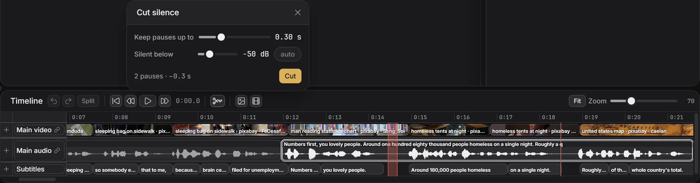

- **Keep pauses up to** - how long a pause may stay.
- **Silent below** - how quiet counts as silence; **auto** reads it from the stretch itself (the default each time).
- The line under them says how many pauses will go and how much time that saves; the pauses are marked on the lanes.
- **Cut** shortens them on every lane at once, in one undo step. Music under the film is neither cut nor moved; a
  sound effect moves whole with its picture.

## A clip's settings

Press a clip and its settings open on the right, in groups - one group open at a time.

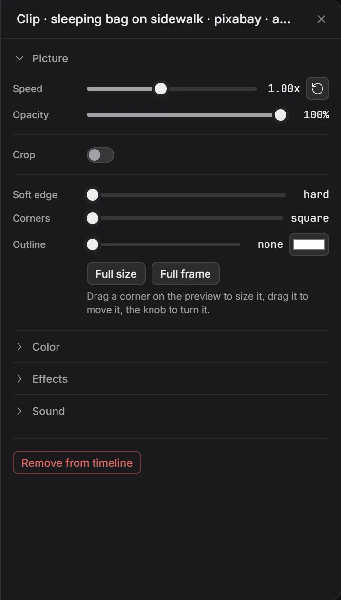

- **Picture** - **Speed**, **Opacity**, **Crop**, and for a cropped or inset picture **Soft edge**, **Corners**,
  **Outline**, **Full size** and **Full frame**. With **Crop** on, drag a side of the clip on the preview to cut its
  edge; **Alt** + drag its middle slides the picture inside. On Main video a cropped clip becomes a picture-in-picture
  over its own blur.
- **Color** - **Brightness**, **Contrast**, **Saturation**, **Gamma**, live on the preview. Several picked clips, or a
  whole lane (its name), take one setting together.
- **Blend** - for a clip on a lane above Main video: screen, multiply, overlay and others; the list shows each mode as
  you point at it.
- **Effects** - below.
- **Sound** - **Volume**, **Fade in** and **Fade out**, and **Pitch**: −12 to +12 semitones, the voice's timbre kept or
  not.
- **Remove from timeline** takes the clip off; the file stays in the library.

## Effects

**+ Effect** in a clip's Effects group opens the effects panel. It stays open while you try them.

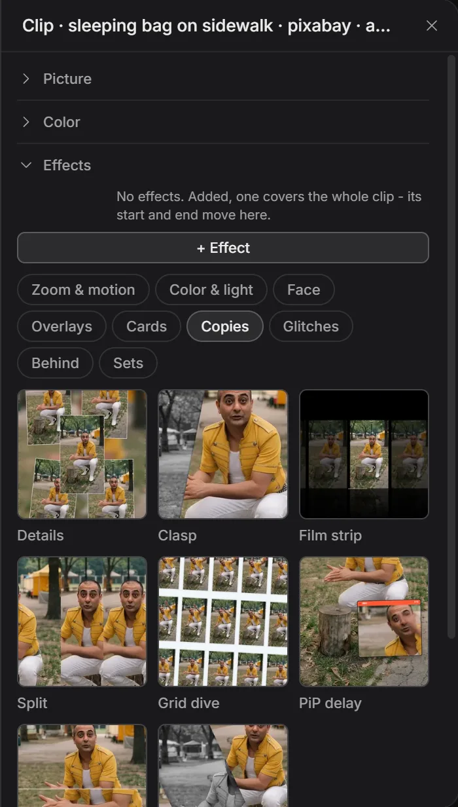

- The chips are the groups: **Zoom & motion**, **Color & light**, **Face**, **Overlays**, **Cards**, **Copies**,
  **Glitches**, **Behind**, **Sets**. Point at a tile to see it move; press it to add it.
- An effect covers the whole clip when added; **Start** and **End** in its row move its part. A clip with effects is
  outlined in violet on the timeline.
- Overlays and cards take their own colours, words and fonts in their row. **Behind** effects put things between the
  person and the background; **Face** effects follow the face.
- Several clips picked get the same effect, each as if alone.
- A few effects are drawn by the app itself and are **baked** into a copy after you save; **Export** waits for them.

## The right button on a clip

The right button on a clip offers what can be made from it:

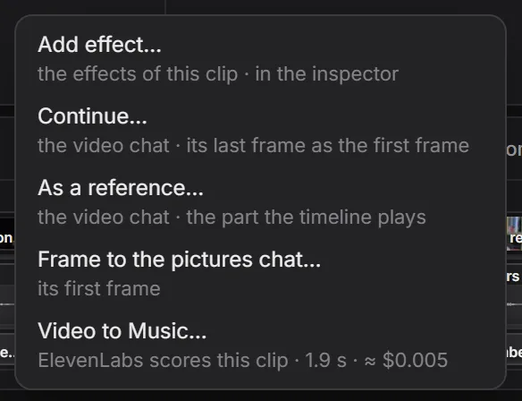

- **Add effect…** - the effects panel for this clip.
- **Continue…** - the video chat with the clip's last frame as the first frame of a new clip.
- **As a reference…** - the video chat with the part of the clip the timeline plays.
- **Frame to the pictures chat…** - the clip's first frame in the pictures chat.
- **Video to Music…** - ElevenLabs scores the clip; the price is said before anything is paid.

On a picture the menu offers **Animate** and **Change**. A result made this way has a button that lays it back on the
timeline - in the clip's place, after it, or above it - in one undo step.

## Captions

**Captions** over the Library panel opens the captions view for the Subtitles lane (or the text lane you picked).

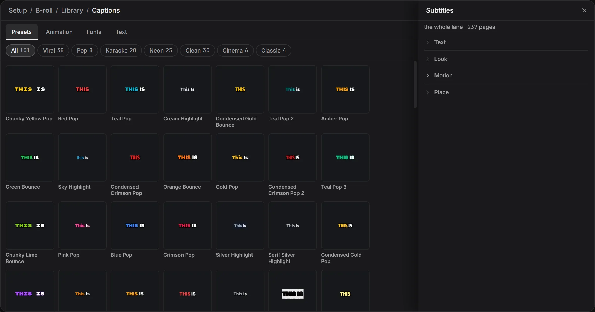

- **Presets** - ready looks, in groups (Viral, Pop, Karaoke, Neon, Clean, Cinema, Classic). **Shift** + press mixes
  several: each page takes one of them.
- **Animation** - how a page comes in and goes out.
- **Fonts** - one font for every page, or several with Shift; a font with no Russian letters draws Russian in its twin.
- **Text** - every line as one document.

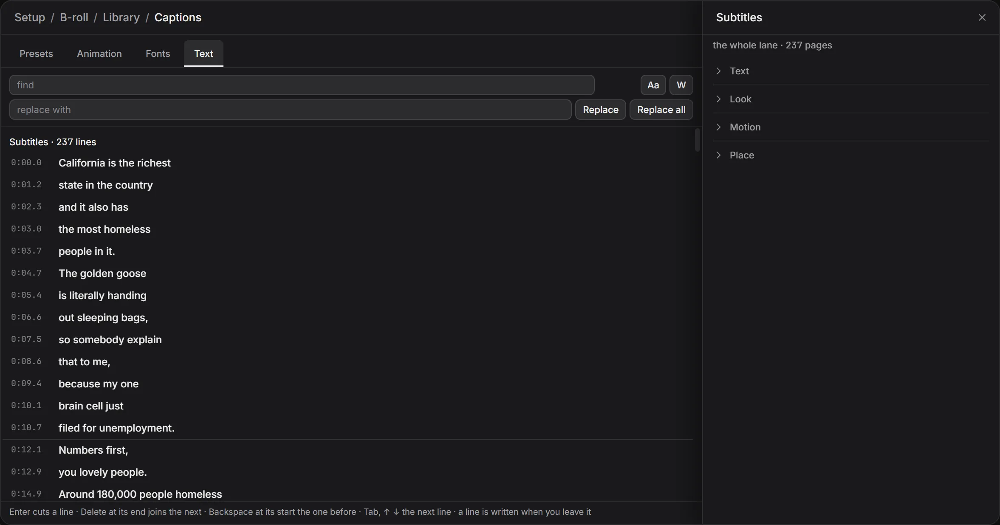

In **Text**, correct a word in place; **Enter** cuts a line, **Delete** at its end joins the next, **Backspace** at its
start joins the one before. **Find** and **Replace** work over the whole lane (**Aa** - the same case, **W** - whole
words). A word keeps its moment wherever it ends up.

The lane's own settings - **Text**, **Look**, **Motion**, **Place** - are on the right. **Rows: two** shows the next
page in a second row while the first is spoken. Drag a caption on the preview to place it; it is written when you
let go.

Captions are heard by Groq when its key is set, or by whisper on this computer (Admin → This computer) - free, slower.
A line you typed or corrected is never overwritten by a new hearing.

## Patterns

Press **Main video** (the lane's name): under its settings, **Patterns** opens a set of tiles. Tick a pattern to lay it
over the whole video, above every video lane and under the words. Ticked patterns are listed with their own opacity,
blend mode, scale, colour and motion; ↑ ↓ change their order.

## Rendering

**Export** opens the render window.

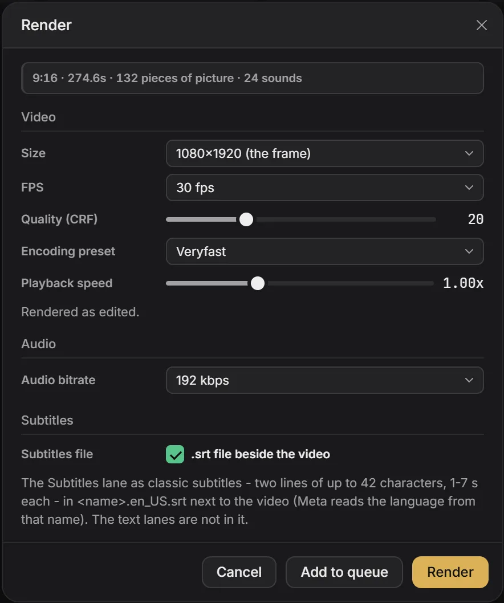

- **Video**: **Size** (the frame by default), **FPS**, **Quality (CRF)** - lower is better and larger -, **Encoding
  preset**, **Playback speed**.
- **Audio**: **Audio bitrate**.
- **Subtitles**: **.srt file beside the video** - the Subtitles lane also as a file, for the platforms that read one.
- **Render** starts now; **Add to queue** puts it in **Queue** (the top strip) to run later, one after another.

The video goes into the project's renders folder - Library → **Renders**. The right button on a render offers **Show in
folder**. A render is refused while a clip on the timeline points at a deleted file - those clips are red; let a tile go
onto one to replace it.

## Keys

| Key | What it does |
|---|---|
| Space | Play / stop; with clips picked, only them |
| S | Cut silence in the stretch or the picked clips |
| Delete | Delete the picked clips; with a stretch drawn, cut it out of every lane |
| Shift + press | Add a clip to the pick |
| Escape | Let go of the pick, or close the window on top |
| Ctrl+C / Ctrl+V | Copy / paste the picked clips |
| Ctrl+Z / Ctrl+Y | Undo / redo |
| Alt + wheel | Zoom the timeline toward the playhead |
