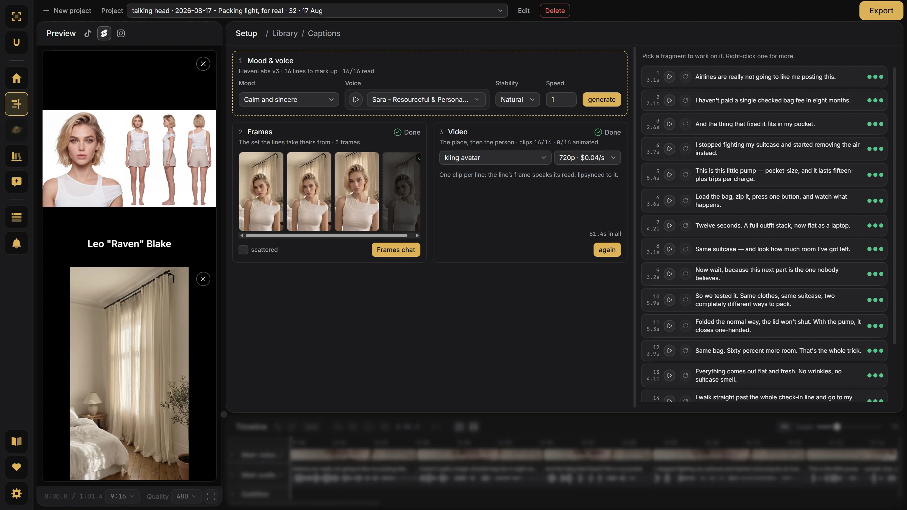
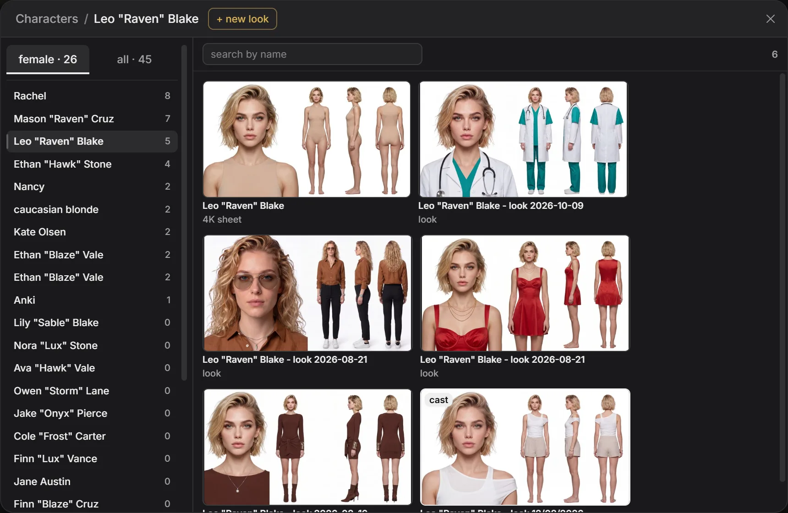
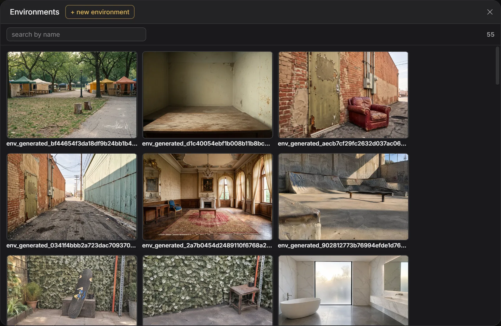
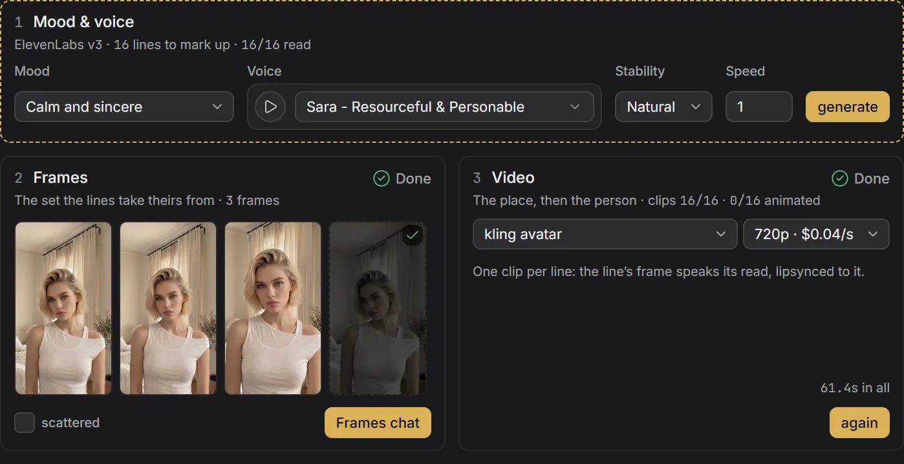
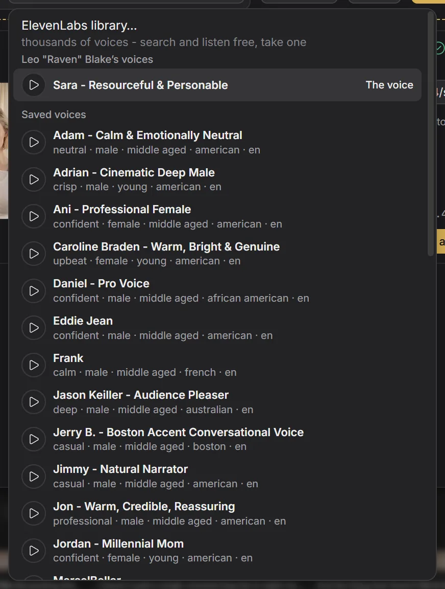
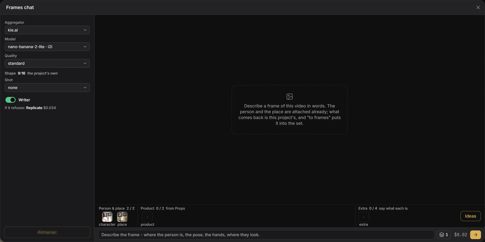
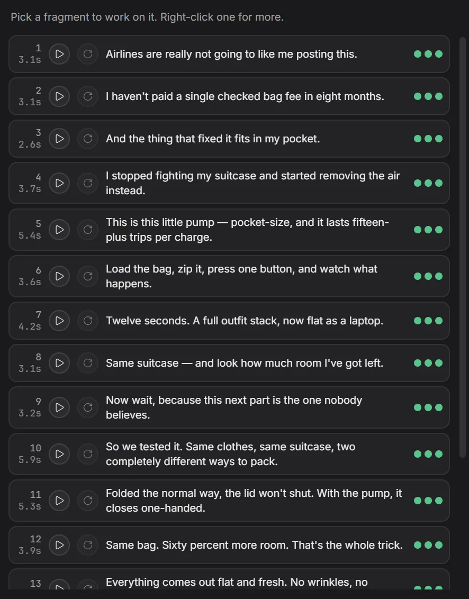
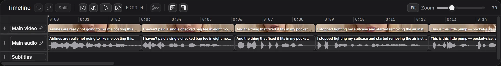

# Talking head

A talking head is a character of yours speaking a script in a place: every line read in a voice, a frame of the person
for every line, and a clip of the person saying it. The clips land on the timeline in order, ready for captions and a
render.

## Starting one

- **Merge → + New project → talking head** - pick a scenario, or write one.
- **Home → Talking head** - a quick start: the script (a scenario, or your own text, one line a paragraph) and who speaks
  it; the project is made and opens in Merge.
- **Library → Scenarios → Make video** on a scenario.

A talking head needs ElevenLabs, kie.ai, Cloudflare and an AI key for the agents - without them it is not started and
its setup is blurred under a lock (see Getting started).

A talking head opens on its **setup** step. **Library** and **Captions** over the panel lead to the timeline once every
line has its clip; the word **Setup**, first on the timeline step, leads back.

## Who and where

The left of the setup is the stage: **who** speaks and **where**. Until both are chosen the fields are blurred and do
nothing.

- **Who** opens a window: the characters (the ones with the most looks first, **female** / **all**), and the chosen
  one's looks on the right. Press a look to cast it - it is marked **cast**. **+ new look** dresses the character in a
  lookbook.
- **Where** opens the environments; press one to set it. **+ new environment** makes one from a photo and a sentence.
- Casting a look of ANOTHER character asks first ("Change to …?"): the reads, frames and clips made so far are put aside
  in the project, not deleted - cast the first character again and they come back. **↺ <name>** on the stage casts the
  first look again. **New project** makes a new talking head with the same script and the new character instead.
- The ✕ on the stage takes the choice away; the stage's halves wait for their own work while it is being made.

## 1 · Mood & voice

- **Mood** - how the script is spoken (calm and sincere, excited, …). The script is marked up for it before it is read.
- **Voice** - a menu: **ElevenLabs library…** (thousands of voices, searched and listened to for free, one taken into the
  app), the character's own voices, and the voices saved before.
- **Stability** - **Creative** (more expressive, may stray from the words), **Natural** (as the voice was recorded),
  **Robust** (very even). **Speed** - how fast.
- **generate** marks the script up for the mood and reads every line. The field says how many lines are read.

## 2 · Frames

The frames are the pictures the lines are spoken from - the person, in the place, close up, medium or wide.

- The set shows the frames; the lines take theirs from it in turn - the first line the first frame, the second the
  second, and round again. **scattered** gives each line one frame drawn by its number instead. Drag a frame to put it
  elsewhere in the turn; the ✕ in its corner takes it out of the turn (✓ brings it back); the right button opens it large.
- **Frames chat** opens a chat window for the frames: say what the person does and how it is framed; a frame made there
  goes into the set. It keeps the person's face and clothes, and up to two **products** of IMAGES → Props, held exactly
  as on their picture.
- On an open line, pick which frame of the set it is spoken from; **Back to the rule** returns it to the set in turn.
  **Crop** reframes a picture as a frame of its own.

## 3 · Video

- **kling avatar** - the line's frame speaks its read, lipsynced. **omnihuman 2.0** - the face, head, hands and body move
  with the read (720p; a read under 4 seconds is billed as 4).
- The quality and price per second are beside the model; the total is said before anything is paid.
- The field stays red until every line has been read once. **make clip** on a line makes that line's clip; the field's
  **generate** makes every clip still missing - it shows the price and waits for a second press (**… · go?**).
- Each clip is a row of Alerts: the place is read, the line is read, the clip is rendered. Close the window - the work
  goes on.

## The lines

The right column is the script, a line a row: its words, its length, ▶ to hear the read, and three dots - read, frame,
clip - green when done.

- Press a line to open it on the stage: its frame, its read, its clip.
- Change a line's words, then read it again - the line keeps its frame.
- The right button on a line: **Read again**, take it off the script, or add a new line after it. A line taken off keeps
  its place and its number - nothing else moves.

## The timeline

Each clip is laid on the timeline in the order of its line - the timeline MIRRORS the lines.

- A line without its clip lies nowhere yet; the timeline waits for the first clip.
- What you lay on the timeline yourself - B-roll, music, a picture - is yours: the app never touches it.
- **Cut silence** and a stretch deleted over a line are kept with the line: a new take of the line is cut the same way.
- Several whole lines picked can be merged into one clip.
- The look you gave a line's picture - fit, crop, a picture-in-picture - stays when its clip is made again.

Captions, effects and the render work as in any project - see the Merge chapter.

## What it costs

The reads cost ElevenLabs characters (the balance is on Home → The app). Frames are pictures - a few cents each. Clips are
paid by the second: kling avatar from about $0.04, omnihuman 2.0 $0.07. Every paid press says its price first; nothing is
paid twice for the same work.
