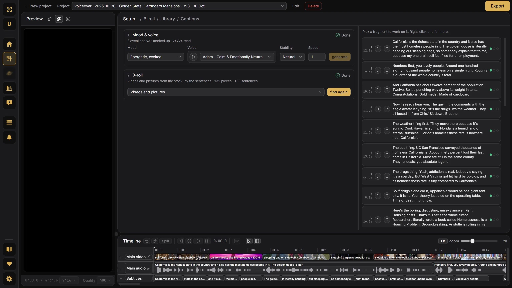
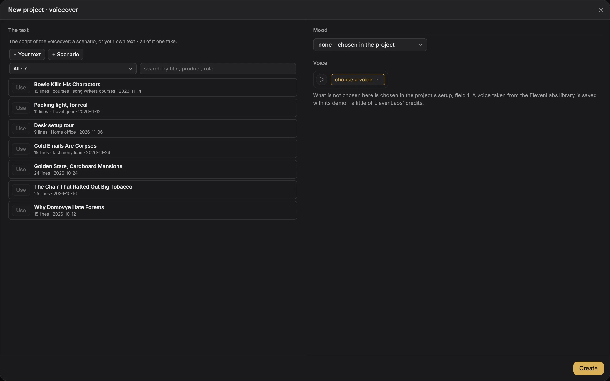
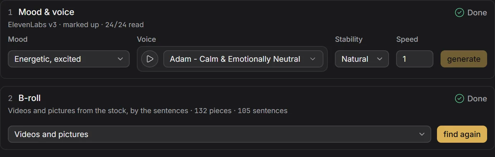
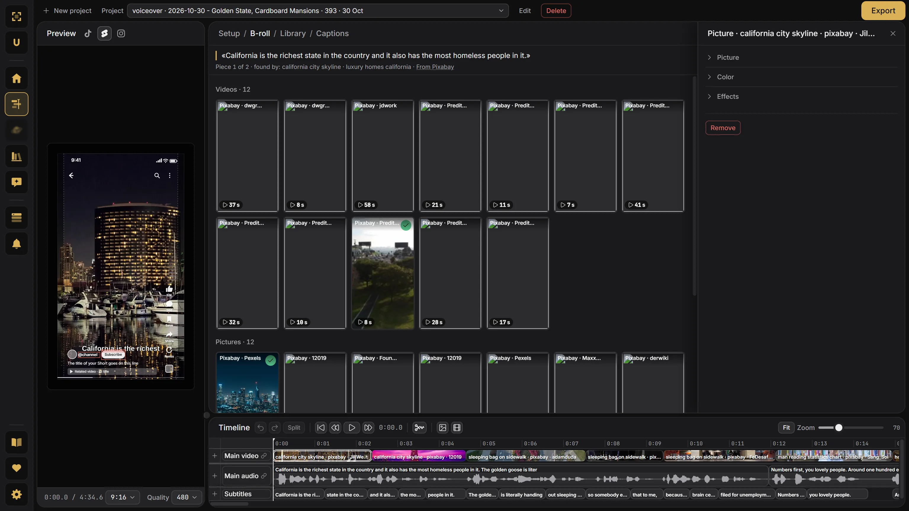
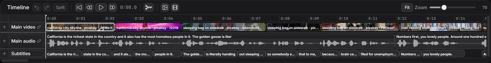

# Voiceover and B-roll

A voiceover is your script read in a voice, with stock footage laid over it sentence by sentence. It has no character, no
place and no frames - its picture is the B-roll. The app reads the script, hears its words, finds videos and pictures for
every sentence and lays them on the timeline over the voice.

## Starting one

- **Home → Voiceover** - a quick start: the script (a scenario, or your own text), the mood and the voice. **create** puts
  them into the voiceover draft and opens it in Merge, on its setup.
- **Merge → + New project → voiceover** - opens the voiceover draft.
- **Merge → Scenarios** (the crumb left of **Library**, in the draft or a blank project): the right button on a
  scenario → **voiceover**.

A voiceover needs ElevenLabs, Pixabay and an AI key for the agents - without them it is not started (see Getting
started).

## The draft and its script

There is always one voiceover draft - **draft · voiceover** in the project list. While it is the draft, its right column
is where the script is chosen:

- a scenario - **Use** puts its lines in, each a line of the voiceover;
- **+ Your text** - paste or type any text, in any language: the whole of it is ONE line, read in one take in the
  language it is written in - up to 4,500 characters (ElevenLabs reads 5,000 at a time; the rest is left for the mood's
  tags);
- **+ Scenario** - write a new scenario; it is kept in the Library.

Nothing is translated: every line is read in its own language. **Other script** over the lines takes them off again.
The first line read makes the draft a project of its own - its script stays its own, and the next voiceover starts a new
draft.

## 1 · Mood & voice

As in a talking head: **Mood** (the script is marked up with its tags, sentence by sentence), **Voice**, **Stability**,
**Speed**, and **generate** reads every line. The voice menu has **ElevenLabs library…** and the voices saved before - a
voiceover has no character of its own.

**ElevenLabs library…** opens the **Voices** window: ElevenLabs' voices, searched by a name or a word from the description
and filtered by gender, age, style, use case, accent and language (set to the script's language), 20 a page; ▶ plays a
demo. Taking a voice costs nothing - it becomes this project's voice and is saved for the next time.

## 2 · B-roll

The field waits until every line is read and its words are heard - the captions are heard by themselves, by Groq or by
this computer.

- **find B-roll** - an agent writes two English search queries for every sentence of the voice; the app fetches 12 videos
  and 12 pictures per sentence from Pixabay and lays them on **main video**, edge to edge through the voice, a piece about
  every 2.5 seconds. Only what is laid is downloaded - into VIDEO → Uploads → Stock and IMAGES → Stock.
- The menu beside it: **Videos and pictures** (mixed at random), **Only videos**, **Only pictures**. Changed, every piece
  is laid again - except the ones you chose yourself.
- The field says how many pieces are laid for how many sentences. A line read again or added: **find again** finds the
  B-roll of the new sentences.

## Swapping a piece

Press a piece on main video - or the crumb **B-roll** right of **Setup** - and the Library panel shows that piece:

- its sentence, in gold; which piece of the sentence it is (**Piece 1 of 2**) and the queries it was **found by**;
- what was found for the sentence - **Videos** and **Pictures**: the one in this piece outlined, the ones laid anywhere
  on the timeline marked ✓, a video with its length;
- a press puts a tile into the piece. Chosen by hand, it stays when the menu of field 2 is changed.

**From Pixabay** links to where the footage comes from; each tile names its author.

## The timeline

The reads lie on main audio in the order of the lines, the B-roll on main video over them, the captions on Subtitles.
When a line is read again or the captions are heard again, the B-roll's pieces are timed to the words anew.

Once something lies on the timeline, it shows under the setup, and the crumbs lead on: **Setup / B-roll / Library /
Captions**. Bring B-roll of your own from the Library, or generate clips, and lay them on the timeline like in any
project; captions, effects and the render are as in Merge.

## Tips

A voiceover shows four tips over the page, one at a time: the script, mood & voice, **find B-roll**, and the clip once
the B-roll is laid. A press anywhere else closes a tip, so does its red ✕; **don't show again** puts them away for good.

## What it costs

The reads cost ElevenLabs characters. The B-roll is free - Pixabay's footage; the agent's queries cost a fraction of a
cent. Hearing the captions costs little with Groq and nothing on this computer.
