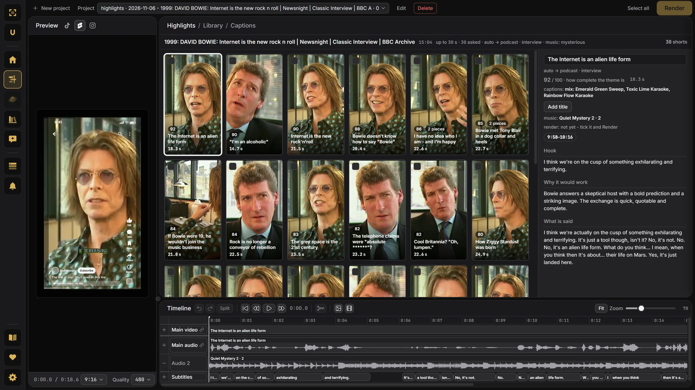
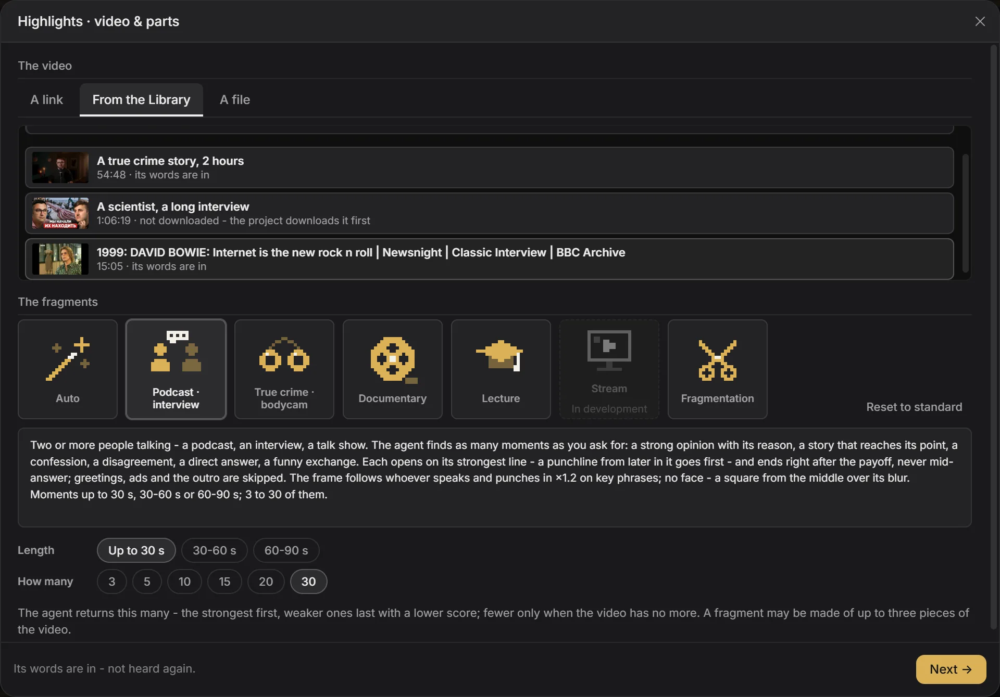
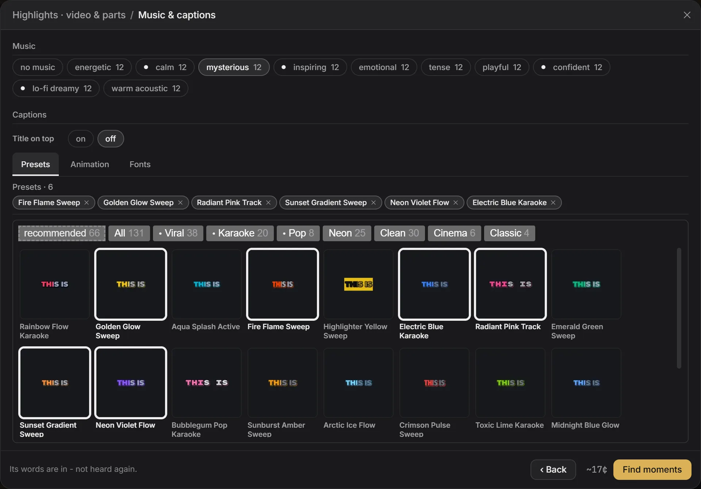
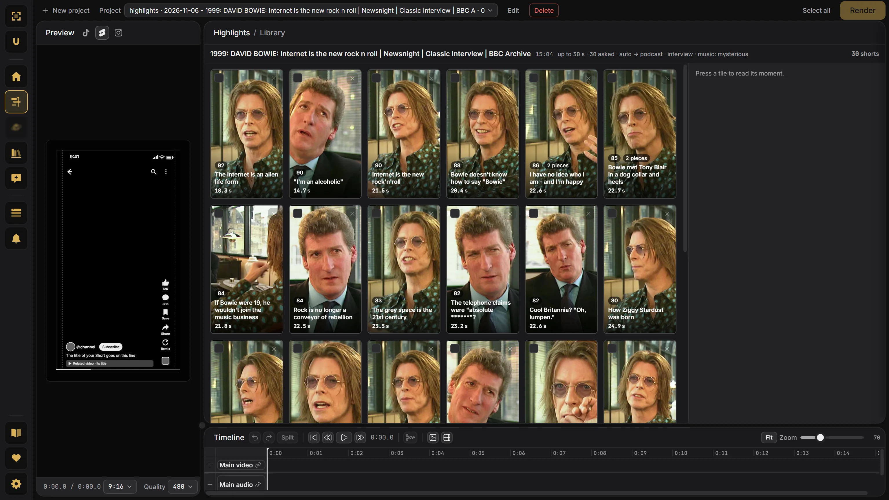
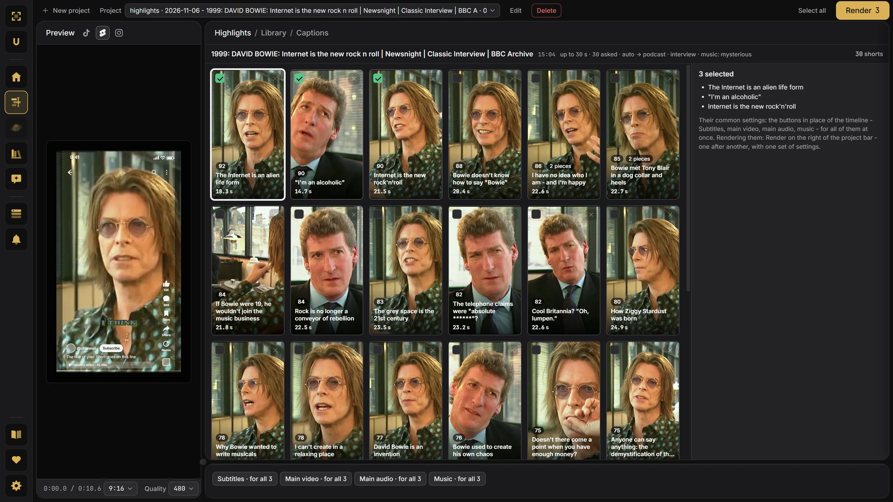

# Highlights

Highlights cut a long video - a podcast, an interview, a lecture, a documentary - into vertical shorts. The app hears its
words, an agent finds the strongest moments, and every moment becomes a 9:16 fragment with its own timeline: the frame
following the faces, captions in the style you chose, music under it. You look them over, change them together or one by
one, and render the ones you want in one go.

## Starting one

- **Home → Highlights**, or **Merge → + New project → highlights** - a window of two steps opens. Nothing is made until
  its last press.
- A highlights project with no video yet offers **+ Add video** - the same window.

Highlights need an AI key for the agents, and Groq or the free speech model on this computer to hear the words (see
Getting started).

## Step 1 · the video and the fragments

**The video** - three ways in:

- **A link** - one video on YouTube or another site; it is downloaded first.
- **From the Library** - the videos in REFERENCES → YouTube → Videos. One not downloaded yet is downloaded by the project;
  one whose words were heard before is not heard again.
- **A file** - **Choose a video file…**, or let a file go anywhere on the window. The file is NOT copied into the library:
  it is read where it lies. Moved later, the project says it is not where it was, and you point at it again. A file with
  more than one sound track (a dub and the original) offers the choice - **Sound**.

**The fragments** - what kind of video it is, so the agent cuts it by that kind's rules:

| Kind | What it finds | The frame |
|---|---|---|
| **Auto** | Reads the words first, decides which kind it is, then cuts it as that kind does | That kind's |
| **Podcast · interview** | Opinions with their reasons, stories, confessions, disagreements, funny exchanges - each opens on its strongest line | Follows whoever speaks, punches in ×1.2 on key phrases |
| **True crime · bodycam** | Confessions, lies falling apart, turns, the arrest | Follows who speaks or reacts, punches in on key lines |
| **Documentary** | A fact with its why, a question and its answer, a reveal | A square from the middle over its blur, a title on top |
| **Lecture** | One idea told whole - a definition with its example, a paradox, an answer from the room; pauses shortened | The speaker in a square, a slide whole |
| **Fragmentation** | The WHOLE video, start to end, in parts by meaning - an episode as a run of shorts | Follows the most active one, no blur |

**Stream** is still in development. The words under the buttons say what the chosen kind does.

- **Length** - up to 30 s, 30-60 s or 60-90 s (fragmentation's parts: 30-60 s, 1-2 min, 2-3 min).
- **How many** - 3 to 30. The agent returns that many - the strongest first, weaker ones last with a lower score; fewer
  only when the video has no more. A fragment may be made of up to three pieces of the video. Fragmentation has no
  count: as many parts as the video comes to.
- **Reset to standard** - the kind's own settings. Every kind remembers what you chose for it.

**Next →** leads on once a video and a kind are chosen.

## Step 2 · music and captions

- **Music** - **no music**, or one mood or more of Music → highlights (energetic, calm, mysterious, …; the number is how
  many tracks it has), **yours** for the tracks in its root. The moods marked with a dot suit the kind. Every fragment gets
  one track of the moods chosen, quietly under the speech - none twice while there are enough.
- **Captions** - **Title on top** on or off (the fragment's headline for its first 3 seconds); then **Presets**,
  **Animation** and **Fonts**. Shift + a press picks several - each page of captions takes one of them. The groups that suit
  the kind come first. A caption style must be chosen - the window says so in red until it is.

The foot says who will hear the words (Groq, this computer, or "its words are in" - not heard again) and the price -
a few cents for the agent and the hearing. **Find moments** starts it; **‹ Back** returns to step 1.

## While it works

The window closes and the project opens in Merge. One row of Alerts follows it, and the field shows its steps -
downloading, hearing the words, finding the moments, cutting the fragments - with one bar and the time left. **stop**
stops it: what was paid for is kept. **retry** goes on from where it stopped; the step it was cut at is paid for again
only when it says so.

## The fragments

The line over the tiles says the video, its length and what was asked for - "up to 30 s · 30 asked · auto → podcast ·
interview · music: mysterious" - and how many shorts there are. Each tile is a fragment: its score out of 100, its title,
its length, "2 pieces" when it is made of more than one piece.

- **Press a tile** to open it: its own timeline below, the preview on the left, its card on the right - its name (edit it
  there: it is the timeline's and the render file's name too), the kind, the score, the captions and the music it has,
  **Add title**, its render, and the agent's notes: the hook, why it would work, what is said.
- The ✕ on a tile deletes the fragment; **Ctrl+Z** in the field brings it back.
- A fragment's timeline is an ordinary one: trim it, move its captions, swap its music, add effects - everything in the
  Merge chapter works on it.

**The frame follows the faces.** After a fragment is cut, its faces are counted and its window planned - the largest face
per shot, a jump at a cut, the whole frame over its blur where there is no face. The **Tracking** row of a clip's inspector
changes it: fixed, follow the face, middle, whole + blur, two faces, the speaker - and **Offset** shifts it. **Punch-ins** switches the
×1.2 zooms on key phrases.

## Several fragments at once

Tick fragments - the box in a tile's corner, or **Select all** in the project bar. With two or more ticked, the timeline
gives way to four buttons, each **· for all N**:

- **Subtitles** - their place, size, words per page, lines, two rows, the title on top. A place set for several holds
  over presets. The **Captions** crumb gives all the ticked ones another style at once.
- **Main video** - colour, framing (**By the kind** puts the app's frame back), punch-ins, patterns, clip effects.
- **Main audio** - the volume and the pitch of the speech.
- **Music** - its volume; deal the tracks again from moods, or change one fragment's track.

The open fragment changes on the page, the others on the server; a change made to several has no Ctrl+Z.

## Rendering

**Render N** in the project bar renders the ticked fragments one after another, with one set of settings (the Render
window of Merge, for N). **✕ stop** stops them; the ones made stay. Each render is named after its fragment, in the
project's folder of renders (with its **.srt** beside it when the Render window writes one); rendering a fragment again
replaces its file. The card says how its
render stands - **Show in folder**, play it, "changed since" when its timeline was edited after - and Queue shows the
project as one row.

## What it costs

Hearing the words: Groq costs a little, this computer nothing; a video heard once is never heard again. The agent that
finds the moments: a few cents. Music is the Library's own; cutting, framing and rendering are done on this computer, for
nothing.
