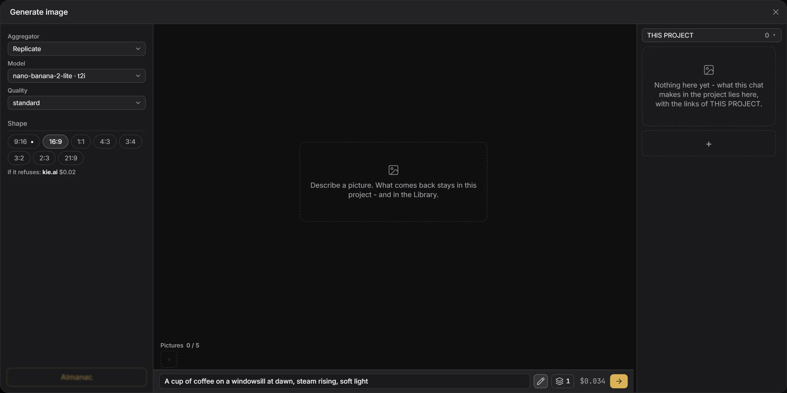
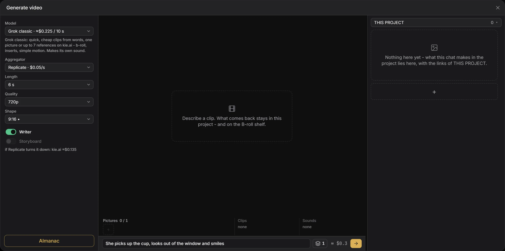
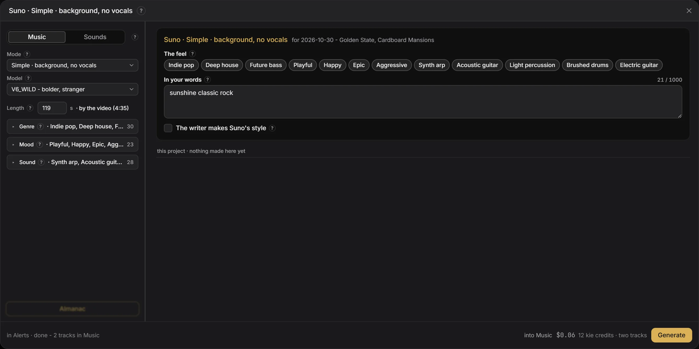
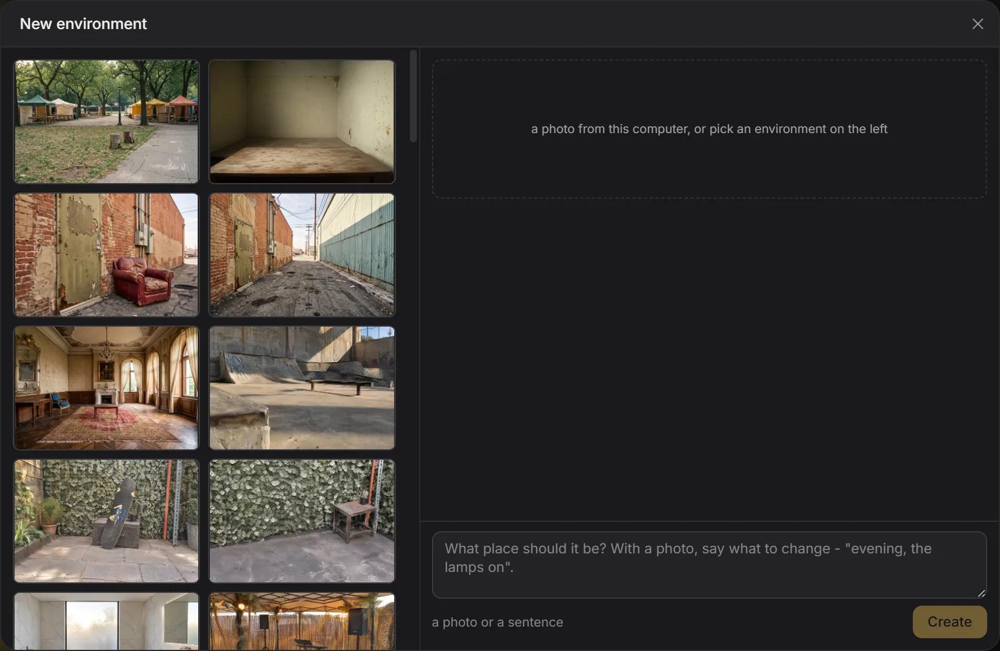

# Generating

The generators are windows over the page - the same window in Merge, in the Library and on Home: the pictures chat, the
video chat, the sound window, and the makers of environments, lookbooks and props. Every paid press says its price
first and becomes a row of Alerts; close the window and the work goes on. What is made goes into the Library - and, in
Merge, into **THIS PROJECT** too.

## Where they open

- The tree: **generate** beside IMAGES, VIDEO and AUDIO; **create** beside Environments, Lookbooks and Props.
- **Home → Generate**: **Pictures**, **Video**, **Music & sounds**; **Home → Library**: **Character**, **Prop**, **Look**,
  **Environment**.
- The right button on a lane, on a tile of the Library (**Animate…**, **Change…**, **Continue…**, **As a reference…**) or on
  a picture or a clip of the timeline - the chat opens with it attached.

## The pictures chat

- **On the left** - **Aggregator** (kie.ai or Replicate), **Model** (nano-banana-2, nano-banana-2-lite, seedream-4.5,
  gpt-image-2.5-sunburst, grok-imagine-image-2), **Quality** (1K, 2K, 4K - as the model offers), **Shape** (9:16, 16:9, 1:1 and
  more). "If it refuses" names the other aggregator and its price: a refused picture is asked there.
- **In the middle** - the conversation. **Pictures 0 / 5** above the box are the pictures attached: **+** opens a window to
  pick them - characters and their looks, REFERENCES, IMAGES, or a file from this computer (it goes into IMAGES first).
- **The box** - say what you want, in any language. The pen beside it is **the writer**: on, your words are rewritten
  into the prompt this model wants and the message stops for a look before anything is paid; off, your words go as typed
  and a send is one press. The layers button is how many pictures at once (each its own attempt); then the price and
  the send (Enter; Shift+Enter is a new line).
- **On the right** - a folder of the Library (THIS PROJECT, REFERENCES, IMAGES): a press on a picture attaches it.

A picture made lies in the conversation: ⤢ in its corner opens it large, **To reference** attaches it to carry on from
it, and you drag it onto a lane. It is filed in **IMAGES → Generated**.

## The video chat

The same three columns. The models - each says what it is under the list:

| Model | What it is for |
|---|---|
| **Grok classic**, **Grok 1.5** | Quick, cheap clips from words, a picture or references - B-roll, inserts; they make their own sound |
| **Seedance 2.0 mini**, **2.0**, **2.5** | Words, a first frame, first and last frames, or references - pictures, clips and sounds; 2.5 up to 30 s, the dearest |
| **Kling 2.6 / 3.0 motion control** | Your character copies the moves of a person in a clip, in your picture's scene: one full-body picture + one clip of 3-30 s |

- **Aggregator**, **Length**, **Quality**, **Shape** - with their prices. One reference clip for Seedance decides the
  length and the shape: "as the clip".
- **Writer** - on, it writes the prompt from your message and attachments; Seedance's clips are watched second by second
  first. Its prompt stands in the message as a field you can change, **Write it again** writes another, **Make the video**
  pays for the clip. Off, your words go as typed (translated into English when they are not).
- **Storyboard** (Seedance) - first a sheet of numbered panels drawn from your words, then the video made with it.
- **Kling motion control** - the writer writes the first frame's prompt: you see the prompt, then the picture, then the
  video, each paid by its own press.

A message shows the request on the left and the video's place on the right; the clip plays in place under the pointer
and ▶ opens it large. Clips are filed in **VIDEO → Generated → <the model>**. The **Almanac** at the foot of the left
column keeps notes on prompting - a chip of it goes into your words.

## The sound window

**Music | Sounds** on top, the mode under it:

- **Simple** (Suno) - background music with no voice, for a video where somebody talks: the feel by chips, your words if
  you like; the writer makes Suno's style. Two tracks.
- **Custom** (Suno) - you write the title, the style and the lyrics ([Verse], [Chorus]…), or tick it instrumental. Two
  tracks.
- **Lyrics** (Suno) - song lyrics from an idea; **use in custom** or **save** into Music → Lyrics. Text only.
- **Music from a description** (ElevenLabs) - music from your words, instrumental unless you untick it.
- **Video to Music** (ElevenLabs) - music made for a video up to 10 minutes: pick it in the VIDEO folders on the right
  (in Merge also a clip of the timeline, by its right button - the track is laid under it).
- **Sounds** (Suno) - a sound or a loop from a description. **Sound effects** (ElevenLabs) - up to 30 s.

**Model** and **Length** (in Merge "by the video"); every row has its "?". The foot says where it goes - music into Music
(the folder open in the Library), sounds into SFX → My sounds → Generated - the price, and **Generate**.

## Environments, lookbooks and props

- **New environment** - a place for talking heads: on the left the environments made before (one pressed is the base to
  change), on the right a photo from this computer and a sentence - "evening, the lamps on". **Create**. It is filed in
  IMAGES → Environments, the photo in its references.
- **New lookbook** - an outfit, the same way; into IMAGES → Lookbooks.
- **New prop** - a product photo with its name and your words; the app reads the photo and writes the product's
  description. Nothing is generated. Into IMAGES → Props.
- **New Character** - see The Library.

## Paid once

Every paid generation is a row of Alerts from the press until its file is filed. A request that got no answer is never
paid again by itself: it says it "may have been paid for", and **retry** in Alerts asks again only when you press it. A
picture or a clip refused by the model's moderation is not retried.
