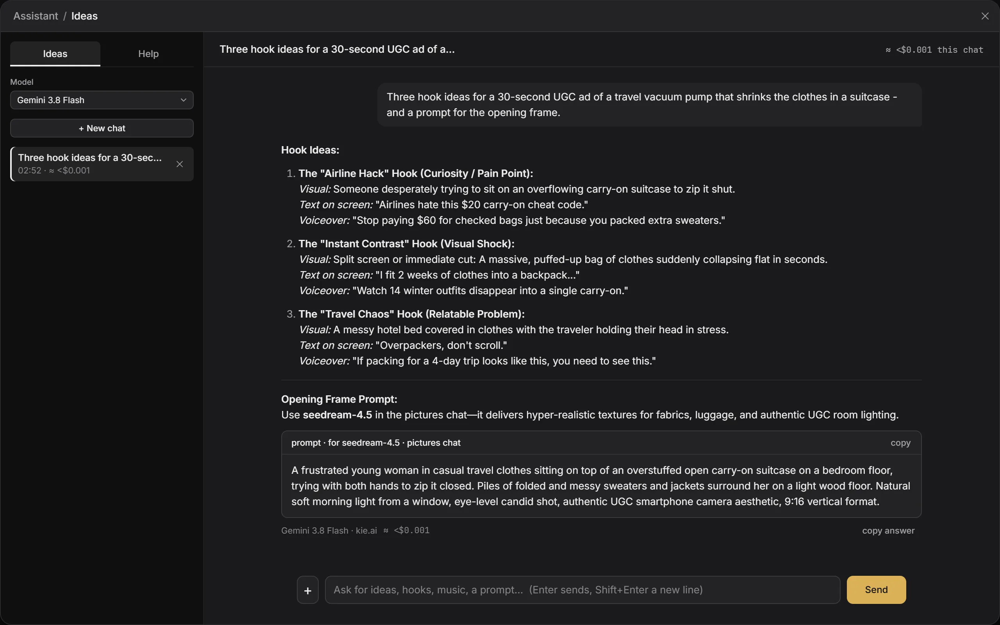
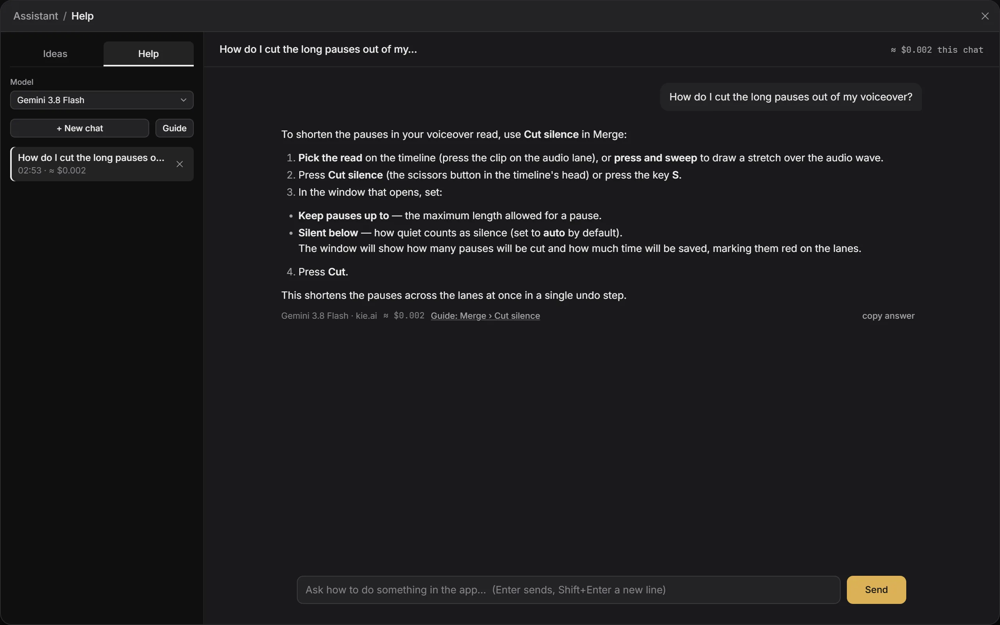
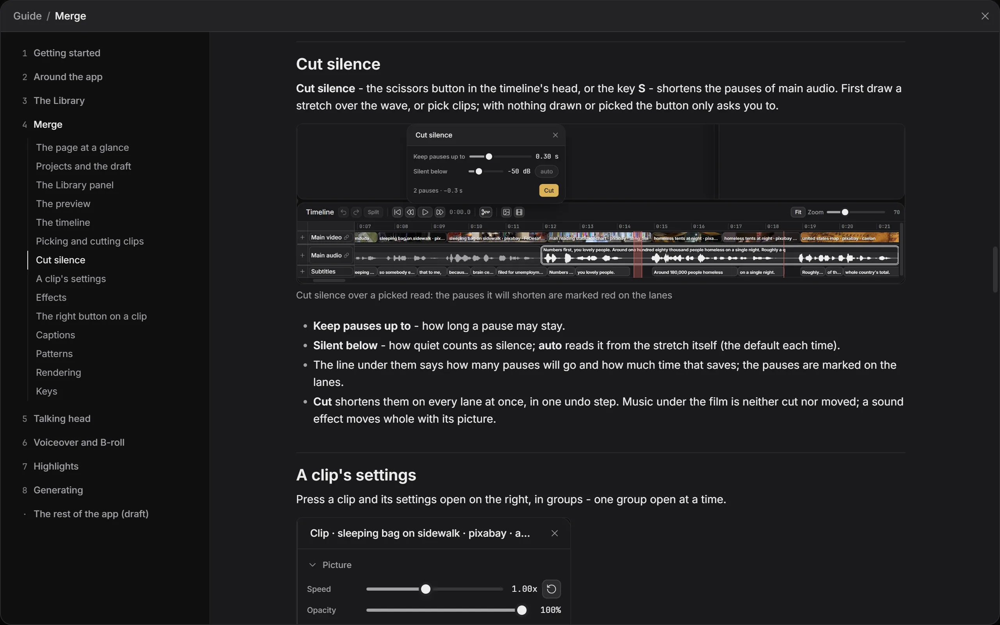

# The Assistant

The Assistant is a chat with an AI model, on every page but the 3D Studio's: **Ideas** to think up videos, hooks, music
and prompts for the app's generators; **Help** to ask how to do something in the app - it answers by this guide. It
generates nothing itself, so it has no row in Alerts; it costs what the model takes for its words - usually a fraction
of a cent.

## Opening it

**Assistant**, right of Library in the top strip, opens its window over the page. It needs an AI key for the agents -
kie.ai, Replicate, Claude or OpenRouter (see Getting started). The window can be moved and stretched; closing it does
not stop an answer being written - the answer is kept and shows when the chat is opened again.

## The window

- **Ideas | Help** on top of the left column - each mode keeps its own chats.
- **Model** - who answers: the models your keys can ask, the steps of the agents' ladder (Admin → AI settings) first.
  A new chat takes the one chosen; a chat keeps its model.
- **+ New chat**, then the mode's chats, newest first, each with what it cost. A double press on a chat's name renames
  it; its ✕ pressed twice deletes it.
- On the right: the chat's name and its cost ("≈ $0.002 this chat"), the conversation, and the field - **Enter** sends,
  **Shift+Enter** is a new line; while an answer is written **Send** turns into **Stop**.
- An empty chat offers ready starts - pressed, the words go into the field; nothing is sent until you send it.
- Under every answer: the model that wrote it, its cost, and **copy answer**.

## Ideas

Ask for what a video needs: hooks, a script, a scene by scene plan, a style of music, captions. The Assistant knows the
app's generators - their models, what each is good at, how prompts are written for them - and when it writes a prompt,
the prompt comes in a block of its own, named for its generator (**prompt · for seedream-4.5 · pictures chat**), with
**copy**. Paste it into that chat.

**+** beside the field attaches what your idea is about: a character's look, a product of IMAGES → Props, a scenario. The
model reads them as words - the look's and the product's descriptions, the scenario's lines - not as pictures.

## Help

Ask in your own words - "how do I cut the long pauses out of my voiceover?". Help first finds the chapters of this
guide that answer the question, then answers by them alone, so its answer is the app as it is. Under the answer,
**Guide: <chapter › section>** opens the guide at the place the answer came from.

**Guide**, beside **+ New chat** in Help, opens the guide where you stopped reading. Help needs an AI key; the guide
itself needs none - it also opens from **Guide** at the right end of the top strip and from Home's **Guide** block.

## The guide

The guide is this book: the chapters on the left - the open one with its sections -, the page with its pictures on the
right. A press on a section goes there; a link in the text leads to another chapter. The window remembers where you
were.

## What it costs

Each answer says its price; a chat sums its answers. A Help answer is two short calls - one to pick the chapters, one
to answer by them. With the cheaper models an answer costs a fraction of a cent; Claude's models cost more, and say
so the same way.
