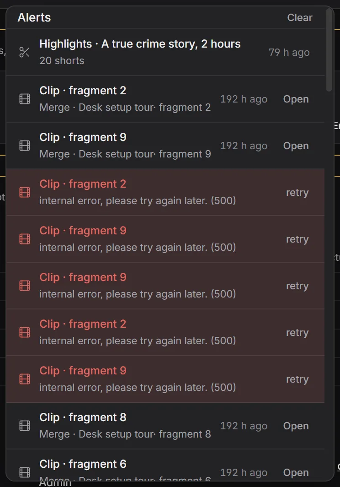

# When something goes wrong

What the app says when a thing did not work, and what to do about it. Nothing here costs anything unless it says so.

## Messages in the corner

An error comes as a message in the top right corner. It stays until its ✕ or its button; the same message again shows
×2 instead of a second one, and at most five stand at once. Calm news goes by itself. What a message says is the
reason - read it first: most of the time it names the key, the file or the step that failed.

## A generation that failed

Every paid generation is a row of **Alerts**. A row in red says why under its title.

- **retry** asks again. If it costs something, the first press turns it into **spend again?** - press it again within a
  few seconds to pay; a retry that costs nothing (a download going on, a step already paid for) goes at once.
- **"It may have been paid for"** - the request went out and no answer came (the network dropped, the app was closed
  at that moment). The app never asks again by itself, so you are never charged twice: look at the service's own
  history (kie.ai, Replicate, ElevenLabs) first, then **retry** if nothing was made.
- **Refused** - the model's moderation turned the request down. A retry would be refused the same way: change the words
  or the pictures.
- A generation that had started is followed to its end by the app itself - closing the window, or the app, does not
  lose it: it is filed when the app is open again.

## A key that does not work

A place that needs a key you have not given - or one its service refused - is closed: a popup says which key and why,
with **Open API keys**. On **Admin → API keys** the line under a key says what its service answered; **Check again**
asks every service anew. A key refused with 401 is wrong or revoked - make a new one at the service. kie.ai's credits
and ElevenLabs' characters are on Home → **The app**: a balance at zero refuses too.

## A link that does not download

Sites change, and the downloader with them: **Admin → This computer → yt-dlp** updates it. A private post, or one that
needs a sign-in, cannot be downloaded - save it on the phone and send the file to your bot instead.

## Captions that are not heard

Captions are heard by Groq, or by whisper on this computer when Groq has no key or cannot be asked. Without either -
no Groq key and no speech model - nothing is heard: the lines read by themselves wait, and the model is never
downloaded behind your back. Download it once on **Admin → This computer** (574 MB). A word misheard is corrected in
**Captions → Text**; a line you corrected is never heard over again.

## Red clips on the timeline

A clip is red when its file was deleted from the Library. The render is refused while any red clip is left. Let a tile
of the Library go onto the red clip to replace its file, or delete the clip. Before a file is deleted, the question
names the projects that use it.

## A file that is not where it was

A highlights video brought from a file of this computer stays where it lies. Moved or renamed, the project says it "is
not where it was": **Point at the file…** - the same file in its new place; its heard words are kept.

## A render that stopped

**Queue** in the side menu lists the renders. One that was running when the app closed is **interrupted** - **Render
all** starts it over; one that **failed** has **Try this one again**. A highlights project's renders are one row with
its own **Continue**. Closing the app while a render runs asks first.

## The app itself

- **The window freezes or the page goes blank** - the app restarts its own server when it stops, and a page that
  crashed is reloaded once; reload it yourself with **F5** (or **Ctrl+R**), or close the app and open it again. Nothing is lost: every list is written whole or not at all.
- **"UGC Studio cannot open this library"** - the library was last opened by a newer version of the app. Open it with
  that version, or update this one.
- **An update that does not start** - after two failed starts the launcher goes back to the version before, by itself.
- Before the first start of every new version, the app copies the lists of your library into
  `library\backups\<day> before <version>.zip` (the last five are kept).

## Where things are on disk

The library folder holds `projects/` (each project's files and timelines), `media/` (everything made or brought in, by
kind), `data/` (the app's lists), `cache/` (made again when missing),
`backups/` and `logs/`. Renders are in `media/renders/<project>/` - Library → **Renders**, the right button on a render
→ **Show in folder** opens them. The app's log is `logs/app.log`: when you ask someone for help, it is the file to send.

## Asking

The **Assistant → Help** answers how-to questions by this guide ([Help](09-the-assistant.md#help)). For anything the
guide does not cover - an error that keeps coming - send the app's log and the message in the corner, word for word.
