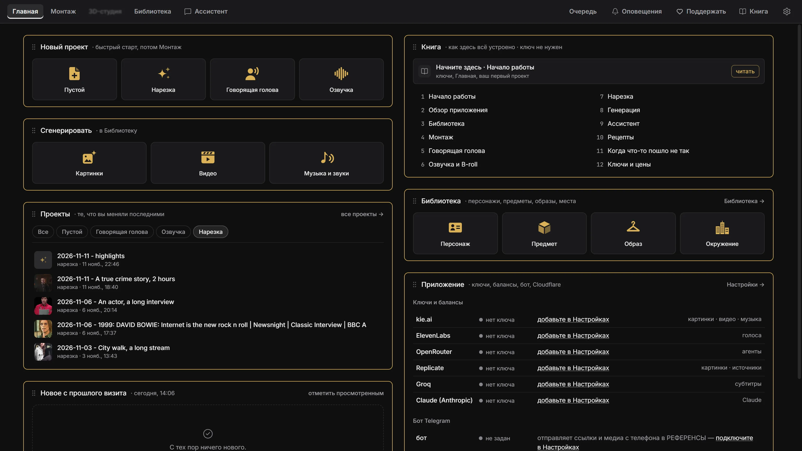
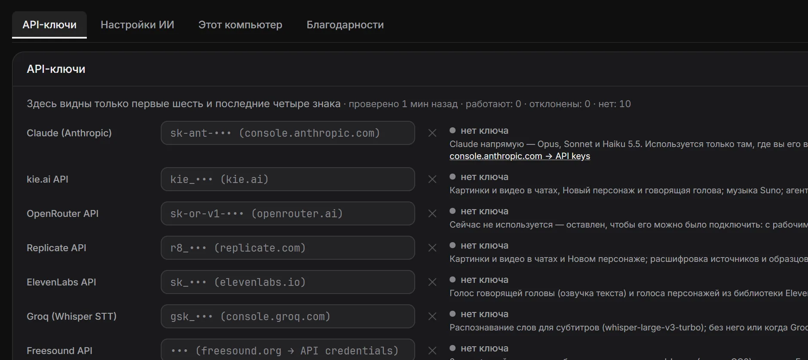
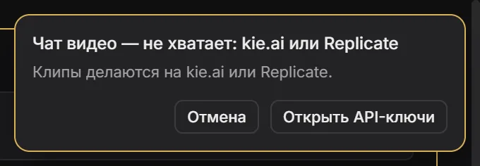
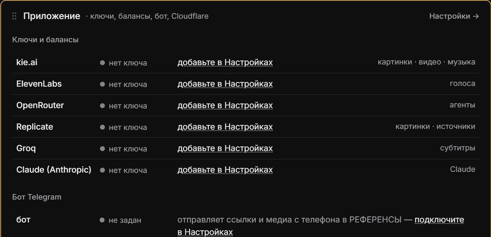
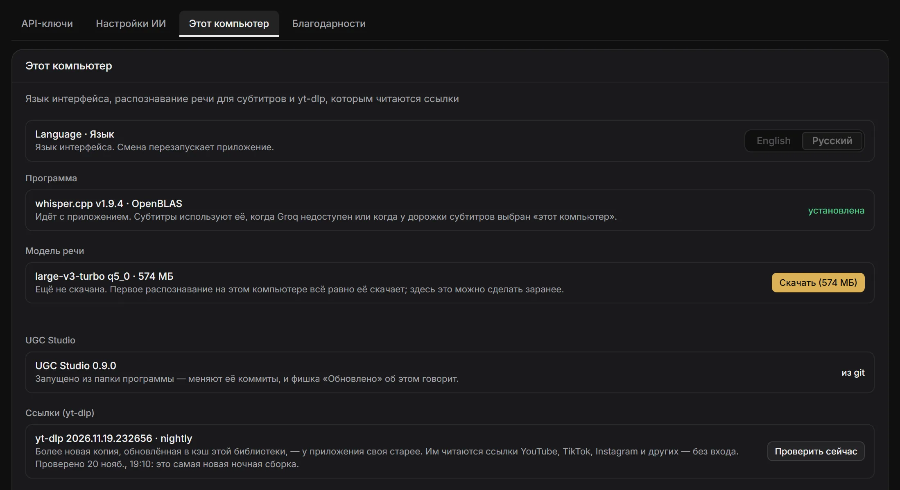

# Начало работы

UGC Studio делает UGC-рекламу и короткие вертикальные видео — TikTok, Shorts, Reels — прямо на вашем компьютере.
Эта глава о том, что делать в первый день: открыть приложение, дать ему ключи и найти дорогу к первому видео.

## Что делает UGC Studio

- **Говорящие головы** — ваш персонаж произносит ваш сценарий в выбранном месте, реплика за репликой: его голос, его
  кадры, говорящий клип на каждую реплику.
- **Озвучка** — ваш сценарий, прочитанный голосом, со стоковым B-roll, найденным для каждой фразы.
- **Нарезка** — длинное видео (подкаст, стрим, лекция), нарезанное на вертикальные шортсы, с субтитрами, музыкой и
  кадром, который следует за говорящим.
- **Всё остальное** — картинки, клипы, музыка и звуки, сделанные генераторами приложения, и ваши собственные файлы,
  смонтированные на таймлайне с субтитрами и эффектами и отрендеренные в одно видео.

Монтаж и рендер приложение делает само, на этом компьютере. Генерацию — картинки, видео, голоса, музыку, агентов, которые
пишут промпты, — делают ИИ-сервисы, за которые вы платите своими ключами. Каждый платный шаг называет свою цену до того,
как что-либо будет оплачено.

## Первый запуск

**UGC Studio.exe** открывает приложение в собственном окне на весь экран. **F11** (или кнопка в правом конце верхней
полосы) переключает полноэкранный режим и обратно.

Всё, что приложение делает или хранит, лежит в его **библиотеке** — папке `library` рядом с программой. Проекты,
персонажи, картинки, клипы, музыка, рендеры, списки приложения и резервные копии — всё там, и больше ничего нигде не
записывается. Чтобы перенести работу на другой компьютер, скопируйте эту папку.

На одной библиотеке может быть открыто только одно окно приложения. Если закрыть его во время рендера, приложение
сначала спросит.

Эта книга есть с первого запуска, ещё до того, как добавлен хоть один ключ: блок **Книга** на Главной — первый в правой
колонке — и **Книга** в правом конце верхней полосы, на каждой странице. Её окно открывается поверх страницы и помнит,
где вы остановились.

## Ключи

Ключ — это то, по чему сервис узнаёт, что работа ваша, и выставляет за неё счёт. Ключи вводятся на странице
**Настройки → API-ключи** (Настройки — это шестерёнка в правом конце верхней полосы): вставьте ключ, нажмите
**Сохранить**, и приложение спросит сервис, работает ли ключ, — зелёная строка под ним значит «да», красная говорит,
почему нет. **Проверить снова** спрашивает все сервисы заново. Ключ показывается только первыми шестью и последними
четырьмя знаками.

Что делает каждый ключ:

| Ключ | Для чего он | Без него |
|---|---|---|
| **kie.ai** | Главный: картинки и видео в чатах, кадры и клипы говорящей головы, окружения и лукбуки, музыка Suno, агенты, которые пишут промпты | Большая часть генерации останавливается; часть может взять на себя Replicate |
| **Replicate** | Новый персонаж (портрет, потом его лист 4K); картинки и видео как второй путь; агенты; расшифровка источников | Нет Нового персонажа; чаты идут только через kie.ai |
| **ElevenLabs** | Голоса — говорящая голова и озвучка читают ими свои сценарии; музыка по описанию, «Видео в музыку», звуковые эффекты | Нет говорящей головы и озвучки — ничего не читается |
| **Claude (Anthropic)** | Claude как один из агентов («Настройки ИИ») и Ассистент | Отвечают другие агенты |
| **Groq** | Быстрое распознавание слов для субтитров | Их распознаёт этот компьютер (бесплатно, медленнее — см. ниже) |
| **Cloudflare** | Один ключ для R2 — места, откуда модели забирают ваши картинки и клипы-референсы; ещё хранит сообщения вашего бота Telegram, пока приложение закрыто | Моделям нельзя передать референс — нет говорящей головы, нет Нового персонажа |
| **Pixabay** | Бесплатные стоковые видео и фото — B-roll озвучки | Нет озвучки |
| **Freesound** | Бесплатные звуковые эффекты в сети («Звуки → найти в сети…») | Нет поиска в сети |
| **Токен бота Telegram** | Ваш собственный бот: шлите ему с телефона ссылки, фото и видео — они приходят в РЕФЕРЕНСЫ | Нет бота; РЕФЕРЕНСЫ закрыты |
| **OpenRouter** | Сейчас не используется | — |

Начните с **kie.ai**, **ElevenLabs** и **Cloudflare** — с этими тремя работают генераторы, говорящие головы и агенты.
Новому персонажу нужен ещё **Replicate**, озвучке — **Pixabay**, нарезке — **Groq** или бесплатная модель речи на этом
компьютере (см. ниже), РЕФЕРЕНСАМ — **Бот Telegram**.

### Место без ключа

Часть приложения, которой нужен ещё не добавленный ключ, закрыта, пока вы его не добавите. Окно генератора — чат картинок
или видео, музыка и звуки, Новое окружение, Новый лукбук, Новый персонаж, Новый предмет, Ассистент, **найти в сети…** в
Звуках — не открывается: окошко в правом верхнем углу говорит, какой ключ нужен и зачем. Подготовка говорящей головы или
озвучки размыта под замком; нарезка не запускается; РЕФЕРЕНСЫ закрыты без бота. Внутри открытого чата прикрепление
картинки или клипа ждёт ключа Cloudflare, а автор промпта — ключа ИИ.

**Открыть API-ключи** в окошке открывает Настройки с нужными полями, подсвеченными золотым; **← Назад** там возвращает
туда, где вы были. Где подойдёт один из нескольких ключей — kie.ai или Replicate, любой ключ лестницы агентов, — окошко
называет их все. Нарезка и субтитры могут ещё и распознавать слова на этом компьютере бесплатно: **Этот компьютер** в
окошке ведёт к модели речи. Ключ, который его сервис отклонил, считается отсутствующим; окошко говорит, почему он
отклонён.

### Cloudflare по шагам

Под полем Cloudflare есть инструкция: сделайте API-токен в своём аккаунте Cloudflare, вставьте его, **Сохранить**.
Затем приложение находит ваш аккаунт, находит или создаёт бакет и пробует загрузку — у каждого шага своя галочка. R2
один раз просит карту, хотя то, что приложение там хранит, небольшое и недолговечное.

### Бот Telegram

Сделайте бота у **@BotFather** в Telegram, вставьте его токен, потом отправьте боту код, который покажет приложение, —
с этого момента бот слушает только вас.

## Первые шаги

Блок **Первые шаги** на Главной перечисляет, что ещё осталось сделать, — у каждой строки своя кнопка — и отмечает
сделанное: эта глава прочитана, три главных ключа, бот, первый персонаж, первая говорящая голова, модель речи.
**скрыть** убирает его, когда он вам больше не нужен.

Блок **Приложение** показывает каждый ключ с тем, что он делает, — «нет ключа · добавьте в Настройках», пока ключа нет, —
и его баланс, если сервис его сообщает: кредиты kie.ai, оставшиеся символы ElevenLabs.

## Распознавание речи на этом компьютере

Субтитрам нужны слова, которые произносятся. С ключом Groq их за секунды распознаёт Groq. Без него — или когда Groq
недоступен — их распознаёт этот компьютер, бесплатно, с помощью **whisper**. Его модель речи (574 МБ) скачивается один
раз — когда вы впервые просите этот компьютер распознать речь, или заранее на странице **Настройки → Этот компьютер**
(или по строке в блоке «Первые шаги»); распознавание, которое идёт само, никогда её не скачивает. Ещё её один раз
предлагает Монтаж, когда вы впервые его открываете.

Та же страница обновляет **yt-dlp** — программу, которая скачивает видео по ссылке, — и показывает, какая у вас версия
приложения.

## Обновления

Когда готова новая версия приложения, в верхней полосе слева от Оповещений появляется золотой чип **Обновление …**.
Нажмите его, посмотрите, что нового, и нажмите **Перезапустить и обновить**: приложение закроется, новая версия
откроется на той же библиотеке. **Настройки → Этот компьютер → Проверить сейчас** спрашивает сразу; иначе приложение
спрашивает само через минуту после запуска и раз в шесть часов.

Перед первым запуском новой версии приложение копирует все списки вашей библиотеки в `library\backups`.

## Куда дальше

- **Обзор приложения** — верхняя полоса, Главная, окна, Оповещения и Очередь.
- **Монтаж** — редактор, в котором оказывается каждый проект.
- **Говорящая голова**, **Озвучка**, **Нарезка** — по главе на каждую.
