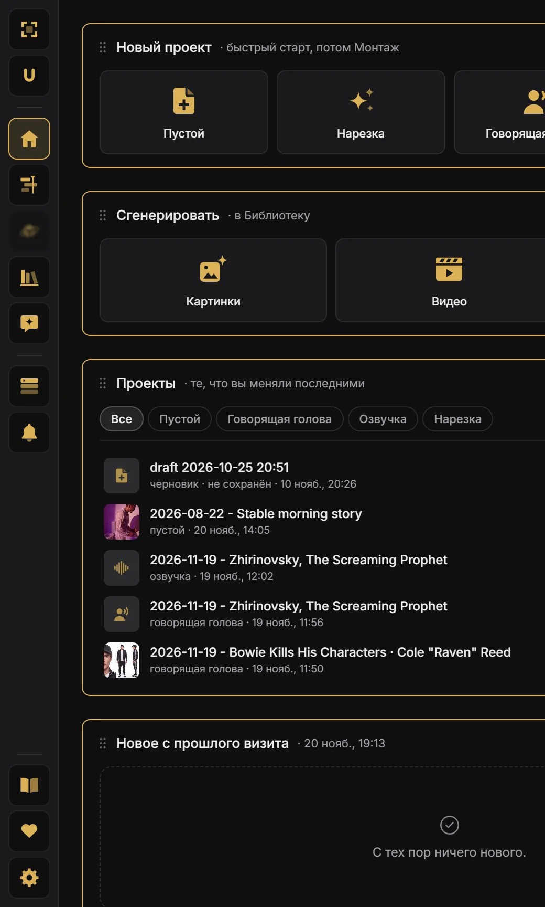
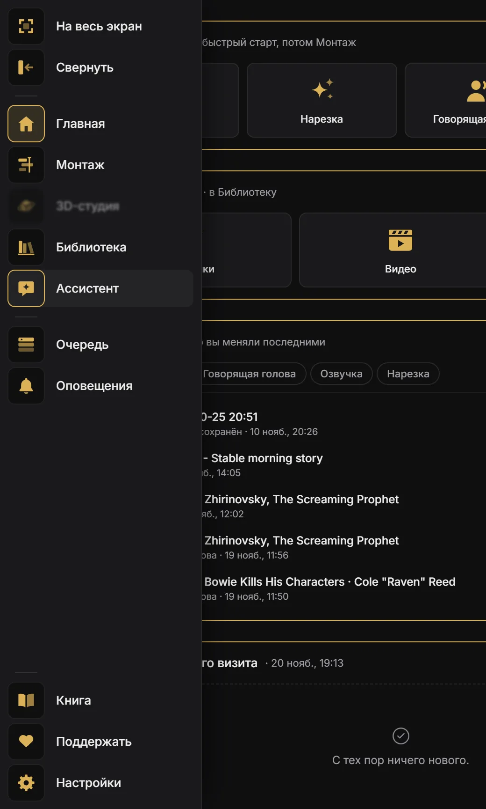
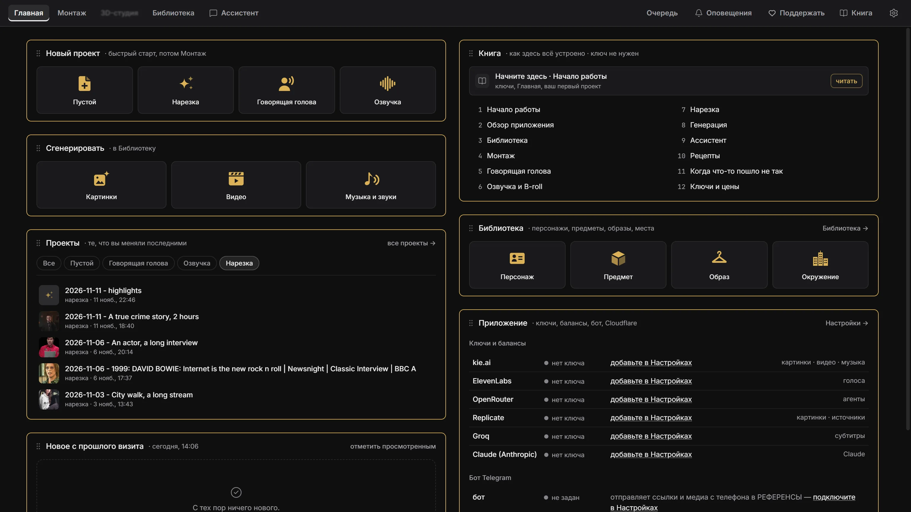
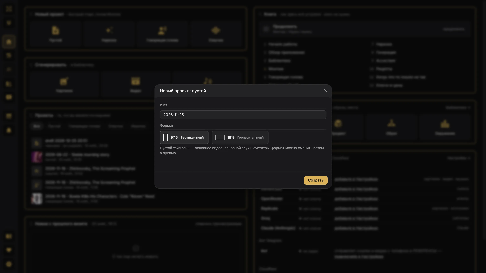
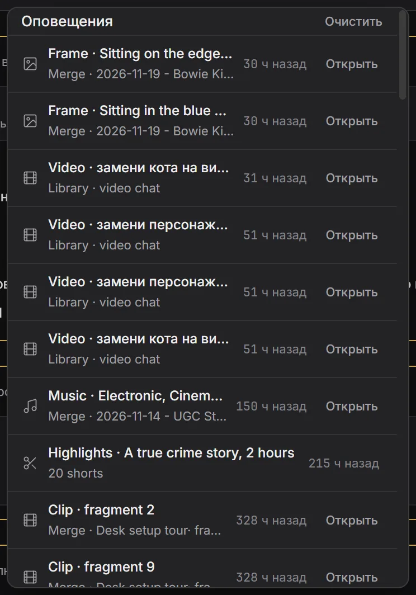
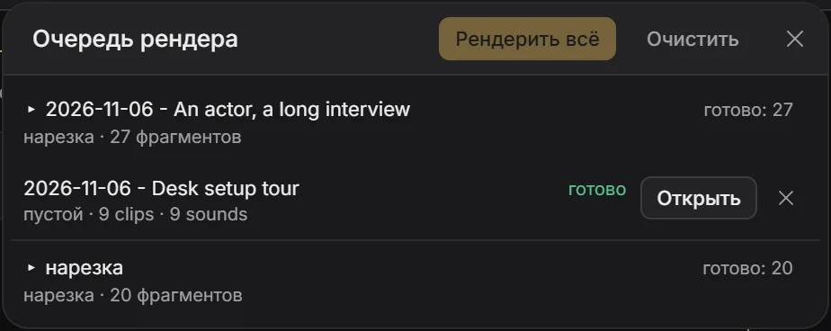

# Обзор приложения

Четыре страницы, одно меню у левого края каждой и окна, которые открываются поверх них. Эта глава — карта: где что находится
и как части приложения ведут себя везде.

## Боковое меню

На каждой странице одно и то же меню у левого края окна: столбик квадратных плиток, по одной на каждое место. Задержите
на нём курсор — оно раскроется поверх страницы, у каждой плитки появится название, а страница останется на месте.
Свернётся оно само через секунду после того, как курсор уйдёт, или сразу — кнопкой **Свернуть** в его верху.

- В самом верху: **На весь экран** — в полноэкранном режиме она называется **В окно**, как и F11; под ней значок
  приложения, который в раскрытом меню становится кнопкой **Свернуть**.
- **Главная** — стартовая страница: быстрые старты, генераторы, ваши последние проекты, ваши ключи.
- **Монтаж** — редактор: каждый проект, его таймлайн и его рендер.
- **3D-студия** — размыта: она ещё строится.
- **Библиотека** — всё, что хранит приложение: персонажи, медиа, голоса, сценарии, рендеры.
- **Ассистент** — чат с ИИ: **Идеи** — придумывать видео и промпты, **Помощь** — спросить, как здесь что-то сделать.
- **Очередь** (рендеры, которые ждут запуска) и **Оповещения** (каждая генерация): число на плитке — сколько ждёт или
  идёт, а под названием Оповещений — сколько ещё займёт идущая работа.
- **Обновление …** — золотая плитка над нижними, когда готова новая версия.
- Внизу: **Книга** (эта книга — на каждой странице, ключ не нужен), **Поддержать** (страница, где можно поблагодарить
  автора приложения) и **Настройки** (ключи и параметры).

Страница, на которой вы находитесь, — в золотой рамке. Не во весь экран у окна свои кнопки Windows; во весь экран их
возвращает F11 или **В окно**, а Alt+F4 закрывает приложение.

## Главная

Главная состоит из блоков:

- **Новый проект** — быстрые старты: **Пустой**, **Нарезка**, **Говорящая голова**, **Озвучка**. Каждый открывает
  небольшое окно — название и формат, видео, сценарий, голос — и создаёт проект, когда вы нажимаете его кнопку; затем
  проект открывается в Монтаже.
- **Сгенерировать** — **Картинки**, **Видео**, **Музыка и звуки**: окна генераторов открываются прямо поверх Главной. То,
  что они делают, попадает в Библиотеку.
- **Библиотека** — **Персонаж**, **Предмет**, **Образ**, **Окружение**: здесь создаётся то, из чего строятся ваши
  видео.
- **Проекты** — по пять последних изменённых проектов каждого вида; задержите курсор на проекте — появится его карточка.
- **Книга** — эта книга. **Начните здесь** открывает «Начало работы»; когда вы уже начали читать, **Продолжить**
  открывает книгу там, где вы остановились. Нажатие на одну из её частей ниже открывает эту главу.
- **Первые шаги** и **Приложение** — что осталось настроить, и ваши ключи с их балансами (см. «Начало работы»).
- **Новое с прошлого визита** — что сделано, пока вас не было.

Перетащите блок за его заголовок, чтобы поставить куда угодно; **Сбросить раскладку** внизу возвращает все блоки на
место.

## Окна

Окна приложения открываются поверх страницы и затемняют её, чтобы было ясно, чем вы сейчас заняты.

- **Escape** закрывает верхнее окно; то же делают его ✕ и нажатие на затемнённую страницу вокруг.
- Большие окна — чаты, окно звука, Новый персонаж, Ассистент, Книга — двигаются за заголовок и растягиваются за края и
  углы. Каждое помнит свой размер и место. Двойное нажатие на заголовок возвращает окно на место.
- Пока открыто окно, собственные клавиши страницы (Пробел, Delete, Ctrl+Z) ничего не делают — набор текста в окне
  никогда не запускает таймлайн под ним.
- То, что сделано в чате, можно вытащить из его окна на страницу — пока вы тянете, окна расступаются.

## Оповещения — всё, что генерируется

Каждая платная генерация — картинка, клип, кадры и клипы говорящей головы, музыка, звуки, персонаж, окружение, лукбук,
длинное видео, превращённое в нарезку, — это строка **Оповещений** с того момента, как вы нажали её кнопку.

- Строка в работе называет свой этап («Рисую место…», «kie.ai делает клип») и сколько осталось; плитка Оповещений в меню
  складывает их.
- Работа принадлежит приложению, а не странице: уйдите со страницы, закройте окно — результат всё равно будет скачан и
  разложен туда, где ему место.
- У готовой строки есть **Открыть** — кнопка ведёт туда, куда ушёл результат, и файл там обведён.
- Строка с ошибкой словами говорит почему, и у неё есть **повторить**. Работа строки с пометкой «возможно, уже
  оплачено» сама никогда не запрашивается снова.
- **Очистить** забывает готовые строки; то, что ещё идёт, остаётся.

Когда что-то готово, об этом говорит окошко в углу.

## Очередь — рендеры в ожидании

**В очередь** в окне рендера Монтажа ставит рендер в **Очередь** вместо того, чтобы запускать его.

**Рендерить всё** запускает ждущие рендеры один за другим. У готовой строки есть **Открыть** (видео в просмотре
Библиотеки), у строки с ошибкой — **повторить**, а ✕ убирает строку из очереди; **Стоп** останавливает идущий,
**Очистить** забывает готовые. Проект нарезки — одна строка на все его фрагменты, раскрывается кнопкой ▸.

## Сообщения в углу

Приложение говорит окошками справа вверху.

- **Ошибка** остаётся, пока вы не закроете её ✕ (или не нажмёте её кнопку, если она есть). Одна и та же ошибка дважды —
  одно окошко с «×2».
- **Новости** — что-то готово, что-то сохранено — уходят сами.

Ничего не говорится в окне посреди страницы, и ничто не прерывает то, что вы делаете.

## Клавиши везде

| Клавиша | Что делает |
|---|---|
| Escape | Закрыть верхнее окно или меню; снять выбор |
| F11 | Полный экран и обратно |
| Enter | Отправить — в чатах и в Ассистенте (Shift+Enter — новая строка) |
| Ctrl+Z / Ctrl+Y | Отменить / повторить — в Монтаже и в тексте субтитров |

У Монтажа есть свои клавиши — смотрите его главу.
