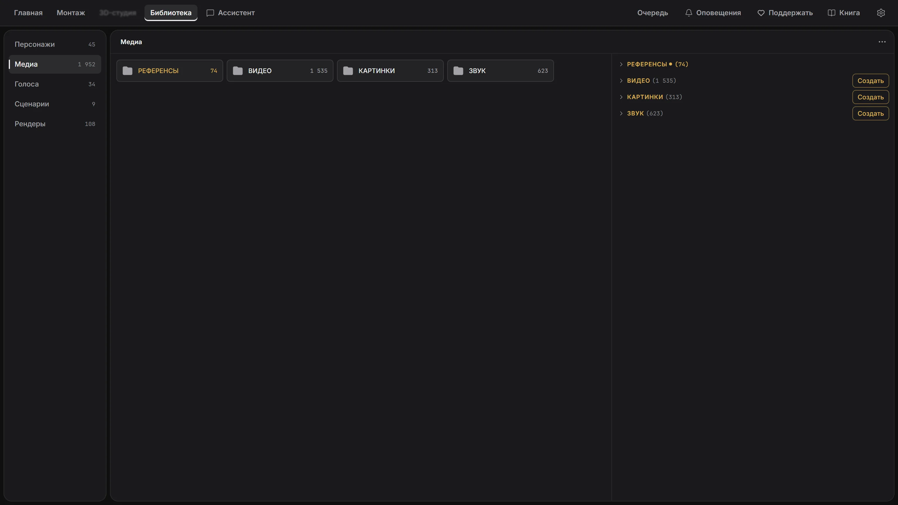
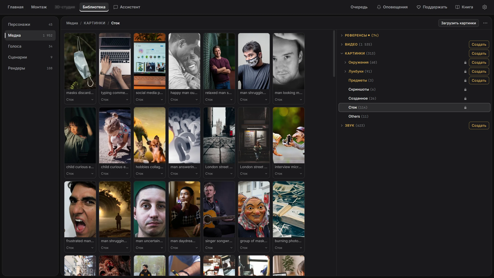
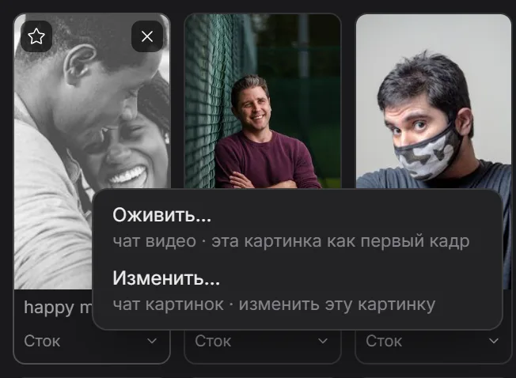
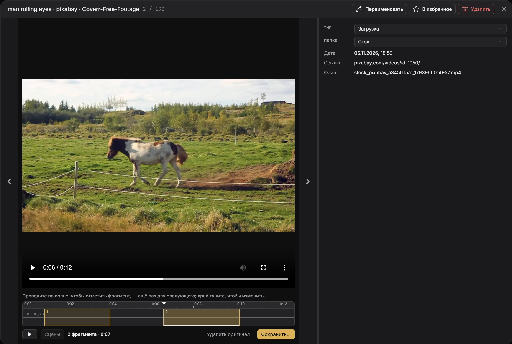
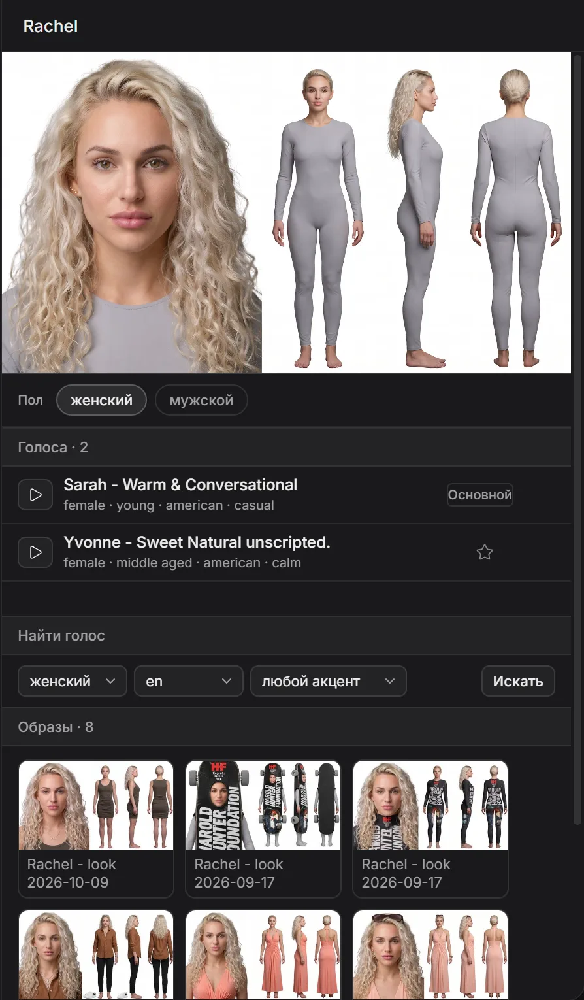
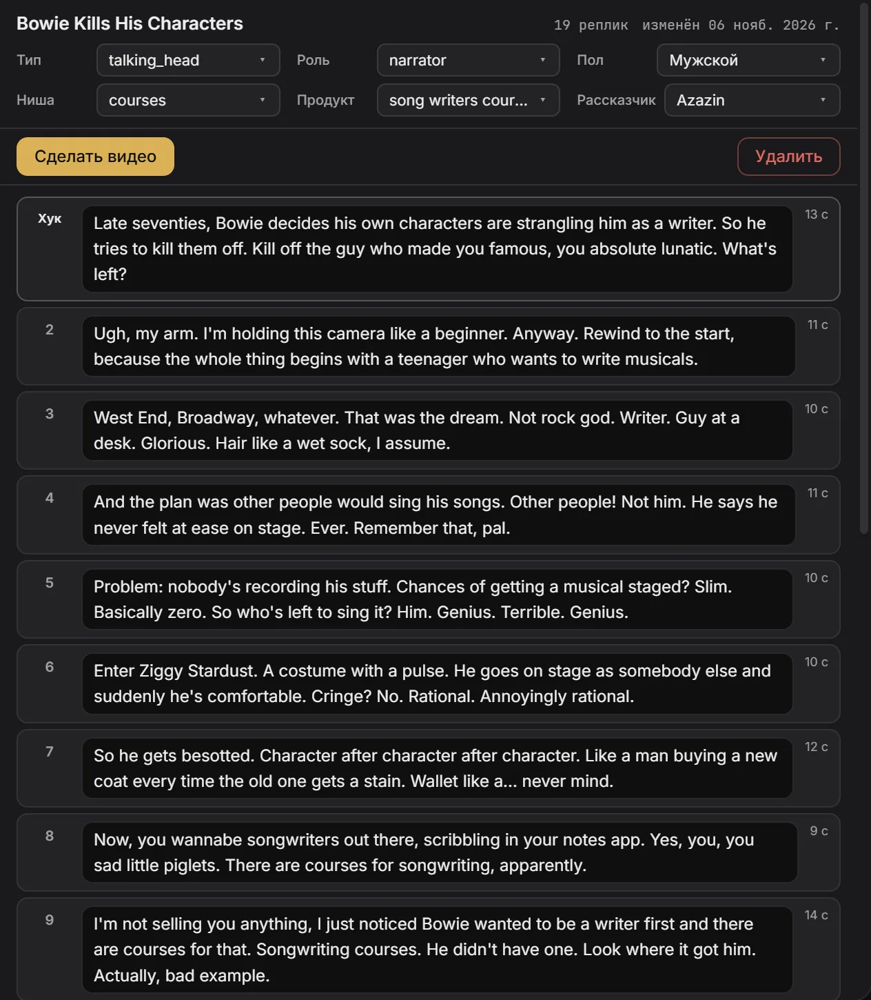

# Библиотека

Библиотека — это всё, что хранит приложение, и вход для всего, что вы приносите. У Монтажа те же медиа в его панели
Библиотеки; эта страница — место, где их раскладывают, разглядывают вблизи, режут и создают то, из чего строятся ваши
видео.

## Полки

Слева: **Персонажи**, **Медиа**, **Голоса**, **Сценарии**, **Рендеры**. У каждой свои кнопки на панели над ней —
**Новый персонаж** у Персонажей, **Новый сценарий** и **Рассказчики** у Сценариев, **Загрузить** и **По ссылке**
у Медиа.

## Медиа — дерево

Медиа открывается на четырёх корнях, плитками папок:

- **РЕФЕРЕНСЫ** — то, что принёс ваш бот Telegram (пост — одна плитка), и видео с YouTube, скачанные как источники.
- **КАРТИНКИ** — сначала **Окружения**, **Лукбуки** и **Предметы**, потом **Созданное**, **Скриншоты**, **Сток** и ваши
  собственные папки.
- **ВИДЕО** — **Созданное** (по папке на каждую модель видео и «Говорящие головы»), **Хуки**, **Загрузки**.
- **ЗВУК** — **Музыка** (в ней настроения папки **нарезка** и папка **Тексты**), **Звуки** (**Избранное**,
  **Встроенные**, **Мои звуки**) и ваши собственные звуки.

То же дерево стоит справа: нажмите на корень, чтобы открыть его; глубже нажатие выбирает папку, а двойное нажатие (или
▸) открывает её. Открыт только один путь за раз — открытие папки сворачивает остальные. Слово **Медиа** в начале пути
ведёт обратно к корням.

Золотые названия — там, где можно что-то создать: **Создать** рядом с КАРТИНКАМИ, ВИДЕО и ЗВУКОМ открывает окно этого
генератора, а **Создать** рядом с Окружениями, Лукбуками и Предметами — их генераторы.

## Папки

- **Новая папка** — **+** у вида или правая кнопка на папке или на пустом месте галереи (новая папка появится внутри
  той, на которой вы нажали).
- Правая кнопка на папке: переименовать её или удалить — с переносом её содержимого на уровень выше или вместе со всем,
  что в ней.
- Перетащите папку на другую папку того же вида, чтобы положить её внутрь.
- Папку с замком наполняет приложение — Созданное, Скриншоты, референсы Окружений и Лукбуков: в ней могут быть ваши
  папки, но её саму никогда не переименовывают, не переносят и не удаляют.

## Плитки

- **Ctrl** + нажатие и **Shift** + нажатие выбирают несколько плиток; рамка, проведённая по галерее, выбирает группу;
  **Escape** снимает выбор.
- Перетащите выбранные плитки на папку в дереве, чтобы перенести их; **Delete** удаляет их (сначала спросит — и в вопросе
  названы проекты, которые их используют).
- Правая кнопка на ОДНОЙ плитке открывает чат с ней, в окне поверх Библиотеки: на картинке **Оживить…** (чат видео,
  картинка как первый кадр) и **Изменить…** (чат картинок, картинка, которую нужно изменить); на клипе **Продолжить…** и
  **Как референс…**.

- Правая кнопка на НЕСКОЛЬКИХ выбранных плитках: **Перенести в…** (маленькое дерево для выбора папки — его **+** создаёт
  новую папку прямо там), **★ Добавить в избранное**, **Удалить N** (сначала спросит).
- У одной плитки её **★**, **Переименовать** и **Удалить** — в её просмотре, а ✕ — в её углу, когда на ней курсор.

**Загрузить** приносит файлы с этого компьютера в открытую папку; **По ссылке** скачивает в неё видео с YouTube,
TikTok, Instagram и других сайтов (по одной ссылке в строке) — или бросьте ссылку на полку.

## Просмотр — и как резать видео

Нажатие на плитку открывает её крупно. Картинка показывает своё название и то, что о ней известно; видео играет, а под
ним — **полоса фрагментов**.

- Проведите по полосе — это волна звука видео, — чтобы нарисовать фрагмент; тяните его края или середину; нажмите, чтобы
  выбрать его, **Delete** — убрать, **Ctrl+Z** — отменить. **Alt + колесо** масштабирует полосу.
- **▶** играет только фрагменты, один за другим — так, как они будут склеены.
- Кнопка **Сцены** находит, где меняются планы, и кладёт каждую сцену фрагментом.
- **Сохранить…** склеивает фрагменты в ОДИН новый клип рядом с видео; само видео не меняется. **Удалить оригинал**
  рядом удаляет видео, когда клип сохранён, — если только его не использует таймлайн или проект.
- Правая кнопка на видео: **Сохранить звук** (его звук — в ЗВУК) и **Сохранить видео как…**; на фрагменте: сохранить
  его отдельно или его звук.

Клип, вырезанный из видео, помнит его: **показать всё видео** в просмотре открывает оригинал с фрагментами этого клипа
на полосе, чтобы вырезать ещё кусок.

## Персонажи

Персонаж — это ваш человек: портрет, потом **лист 4K** — одно и то же лицо и фигура со многих сторон; их держится
каждый кадр говорящей головы.

- **Новый персонаж** открывает своё окно: опишите человека (или начните с пресета, случайного лица или своего фото),
  сделайте портрет, потом лист. Лист делается несколько минут — это строка Оповещений, и окно тем временем можно
  закрыть.
- У персонажа может быть несколько **образов** — нарядов, — в которые его одевают из лукбука (КАРТИНКИ → Лукбуки).
- Его **голоса** — голоса ElevenLabs; выбранный — тот, которым читает говорящая голова.

## Окружения, лукбуки и предметы

Они лежат в КАРТИНКАХ, первыми в списке:

- **Окружения** — места, сделанные кнопкой **Создать** из фото и фразы («вечер, горят лампы»).
- **Лукбуки** — наряды, в которые одевают персонажа.
- **Предметы** — ваши товары. **Создать** открывает **Новый предмет**: фото товара, его название и то, что вы о нём
  знаете; приложение читает фото и пишет описание товара. В кадрах говорящей головы товар рисуется точно таким, как на
  его картинке.

В просмотре у каждого видно, что о нём знает приложение, — описание окружения, пол лукбука, описание товара, — и там же
это можно поправить.

## Музыка и звуки

В ЗВУКЕ хранятся звуки:

- **Музыка** — ваши треки и сгенерированные. Нажатый трек играет в **плеере** под галереей; в меню его правой кнопки есть
  **Вырезать…** (кусок как новый трек), **Переименовать**, **Перенести в …** (ЗВУК, Мои звуки), **Удалить**. В папке **нарезка** лежат
  настроения, из которых проекты нарезки берут музыку; в папке **Тексты** хранятся тексты, написанные для песен.
- **Звуки** — **Избранное** (★), **Встроенные** (собственный набор звуковых эффектов приложения), **Мои звуки**
  (сгенерированные и ваши). **найти в сети…** ищет бесплатные звуковые эффекты CC0.

Звуки переходят между Музыкой, Моими звуками и ЗВУКОМ перетаскиванием, через **Перенести в…** или меню их правой кнопки.

## Голоса

Все голоса, которые знает приложение, — у каждого персонажи, которые им говорят. Голос приходит из ElevenLabs: при
создании персонажа или из библиотеки ElevenLabs через меню голоса говорящей головы или озвучки.

## Сценарии

Сценарии для говорящих голов и озвучки. Список слева (потяните его край, чтобы расширить); нажатый сценарий показывает
свои реплики справа карточками.

- **Новый сценарий** — это меню: **пустой** — окно, чтобы написать сценарий самому, — или **рассказчик** — генератор.
- **Генератор** пишет сценарий голосом рассказчика: выберите рассказчика, источник тем (видео с YouTube или файл,
  который вы добавите) и хуки — сорок типов, от одного до десяти за нажатие, каждый переделывается отдельно. Перед
  каждым платным шагом сохраняется черновик.
- **Рассказчики**: рассказчик — это голос, сделанный из образцов чьих-то текстов или речи; новые образцы только
  дополняют его.
- Реплики сценария правятся прямо там, карточка за карточкой, — они сохраняются сами, когда вы перестаёте печатать.
- **Сделать видео** делает из сценария проект говорящей головы и открывает его в Монтаже.
- Правая кнопка сценария: **В архив** — он уходит из списка в **▸ Архив** внизу, а **Восстановить** возвращает его
  обратно.

## Рендеры

Каждое готовое видео, по проектам, новые сверху. Нажатие проигрывает его; правая кнопка предлагает **Показать в папке**
(Проводник, файл выделен) и **Удалить** (нажать дважды).

## РЕФЕРЕНСЫ и бот Telegram

То, что вы шлёте боту с телефона, — ссылку на пост, фото, видео, — приходит в **РЕФЕРЕНСЫ**, по плитке на пост,
разложенное по тому, откуда пришло. Пост открывается в просмотре целиком; его картинки и клипы можно прикреплять в
чатах, переносить в собственные папки, резать как любое видео. Бот настраивается на странице **Настройки → API-ключи**
(см. «Начало работы»).
