# Монтаж

Монтаж — это редактор. Любой проект — пустой, говорящая голова, озвучка, нарезка — в итоге оказывается здесь как
таймлайн: клипы, звуки, субтитры и эффекты, разложенные по дорожкам и отрендеренные в одно видео. Эта глава проходит по
странице сверху вниз.

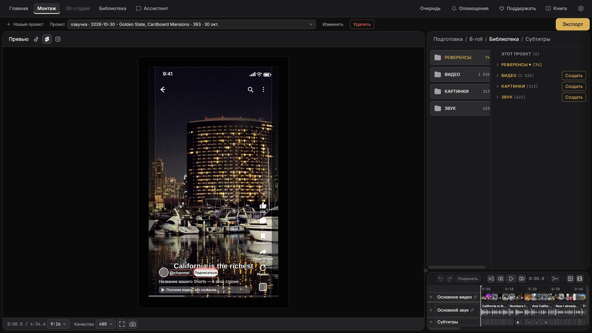

## Страница в целом

- **Панель проекта** вдоль верха: **+ Новый проект**, **Проект**, в котором вы находитесь, **Изменить**, **Удалить** и
  золотая кнопка **Экспорт** в правом конце.
- **Превью** слева: кадр под указателем — таким, каким он будет отрендерен.
- **Панель Библиотеки** посередине: всё, что есть в вашей библиотеке, готовое к перетаскиванию на таймлайн, — а в
  других её видах субтитры и настройки клипа.
- **Таймлайн** внизу: дорожки и их клипы.

Границы между ними можно тянуть. Двойное нажатие на границу над таймлайном снова подгоняет его под дорожки.

## Проекты и черновик

Список **Проект** открывает перечень всех проектов, новые сверху. Чипы вверху показывают по одному виду за раз — **Все**,
**Говорящая голова**, **Озвучка**, **Нарезка**, — и список запоминает выбранный.

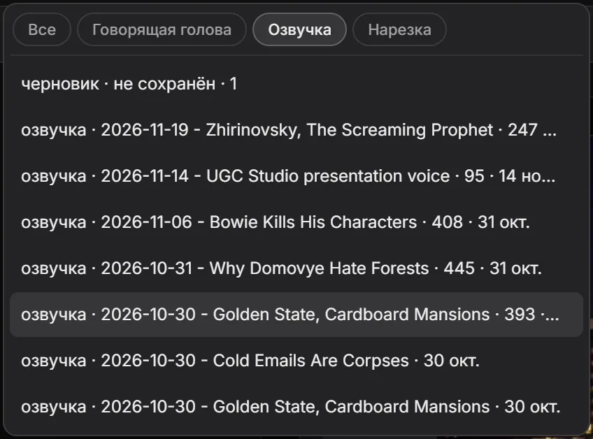

**+ Новый проект** предлагает четыре вида:

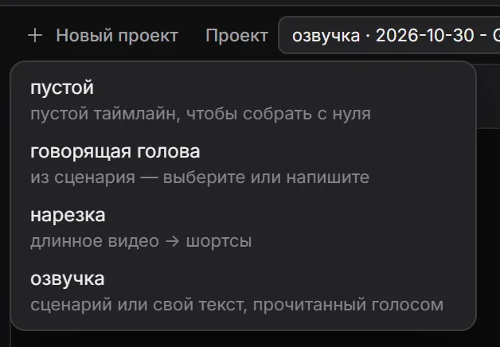

- **пустой** — пустой таймлайн, чтобы собрать с нуля;
- **говорящая голова** — персонаж произносит сценарий (см. главу «Говорящая голова»);
- **нарезка** — длинное видео, нарезанное на вертикальные шортсы (см. главу «Нарезка»);
- **озвучка** — сценарий или ваш собственный текст, прочитанный голосом, со стоковым B-roll под ним.

**Изменить** переименовывает проект; **Удалить** удаляет его таймлайн и спрашивает, удалять ли и его файлы.

### Черновик

Когда никакой проект не открыт, вы в **черновике** — он есть всегда, первым в списке. Его панель выглядит иначе:
**Сохранить** даёт ему имя и делает его проектом (его место занимает новый пустой черновик), а **Очистить** опустошает
его дорожки — **Ctrl+Z** возвращает клипы. Всё, что вы пробуете без проекта, попадает в черновик, так что ничего не
теряется.

## Панель Библиотеки

Панель показывает вашу библиотеку папками. Слева — четыре корня, **РЕФЕРЕНСЫ**, **ВИДЕО**, **КАРТИНКИ**, **ЗВУК**,
плитками; справа — то же самое деревом, где первым идёт **ЭТОТ ПРОЕКТ**: собственные папки проекта со ссылками на
файлы, которые остаются на своих местах в библиотеке.

- Нажмите на папку, чтобы открыть её; её файлы появятся плитками.
- **Создать** рядом с ВИДЕО, КАРТИНКАМИ и ЗВУКОМ открывает окно этого генератора (чат видео, чат картинок, окно звука). То,
  что они создают, попадает в библиотеку, — перетащите это на дорожку.
- Перетащите плитку на дорожку, чтобы положить её на таймлайн. Дорожка принимает только то, что может воспроизвести:
  картинки и клипы — на видеодорожки, звуки — на звуковые.
- Файлы, перетащенные из Проводника, сначала копируются в библиотеку (ВИДЕО → Загрузки, КАРТИНКИ, ЗВУК → Музыка), а
  затем кладутся туда, где вы их отпустили.

Слова над панелью — **Библиотека / Субтитры**, а в озвучке ещё и **Подготовка / B-roll** — переключают то, что
показывает панель. Белым написано то, где вы сейчас.

## Превью

Превью воспроизводит таймлайн точно так, как он будет отрендерен.

- **TikTok**, **Shorts** и **Instagram** рядом с «Превью» накладывают на кадр экран этого приложения, чтобы было видно,
  что закрывают его кнопки и подписи. В рендер они никогда не попадают.
- Внизу: время, формат кадра (**9:16**, **16:9** …), **Качество** — собственное разрешение превью, не рендера, —
  **Увеличить превью** и камера, которая сохраняет кадр под указателем в КАРТИНКИ → Скриншоты.
- То, что на кадре, можно двигать прямо там: тяните субтитр, чтобы поставить его на место, тяните картинку в картинке
  или вставку, чтобы сдвинуть её, её угол — чтобы изменить размер, её ручку — чтобы повернуть.

## Таймлайн

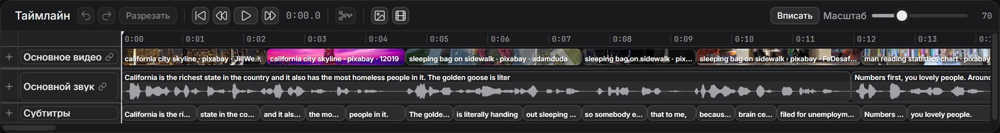

У нового таймлайна три дорожки: **Основное видео**, **Основной звук** и **Субтитры**. Остальные появляются по мере
надобности — отпустите клип над верхней дорожкой или под нижней звуковой, и там появится новая дорожка (где именно —
покажет её призрак). **+** слева от «Основного видео» или «Основного звука» добавляет ещё одну дорожку того же вида, а у дорожки,
созданной так, есть **−**, который снова её убирает. **+** у «Субтитров» добавляет текстовую дорожку — для слов, которые
вы набираете сами и которые новое распознавание никогда не перезаписывает (не больше двух).

- **Указатель** передвигается только **линейкой**: нажмите на цифры или тяните по ним.
- **Кнопки управления** в шапке таймлайна: **Отменить**, **Повторить**, **Разрезать** (режет выбранный клип по
  указателю), в начало, назад на 5 секунд, **Воспроизвести** (Пробел), вперёд на 5 секунд, время, **Убрать тишину** и
  две кнопки кадра, которые отправляют кадр под указателем в чат картинок или в чат видео.
- **Вписать** показывает весь таймлайн; **Масштаб** и **Alt + колесо** приближают его к указателю.
- Имя дорожки открывает её собственные настройки — то, что действует на каждый клип на ней.

## Выбор и резка клипов

- **Нажмите** на клип, чтобы выбрать его. **Shift + нажатие** добавляет клипы к выбору по одному. **Нажмите и
  протяните** по дорожкам — выделится отрезок. **Escape** или нажатие рядом с клипами снимает выбор.
- **Delete** удаляет выбранные клипы. Если на волне звука выделен отрезок, **Delete** вырезает этот отрезок из всех
  дорожек и сдвигает остальное влево — быстрый способ убрать оговорку из начитки.
- **Разрезать** режет выбранный клип надвое по указателю.
- Если выбрано несколько клипов подряд, Монтаж предлагает **Склеить N клипов в один?** — один файл вместо многих
  кусков, один шаг отмены.
- **Ctrl+C / Ctrl+V** копируют выбранные клипы и вставляют их по указателю — на этот таймлайн или на таймлайн другого
  проекта.
- **Пробел** воспроизводит; если выбраны клипы — только их, и указатель возвращается туда, откуда начал.
- **Ctrl+Z** отменяет, **Ctrl+Y** (или Ctrl+Shift+Z) повторяет.

## Убрать тишину

**Убрать тишину** — кнопка с ножницами в шапке таймлайна или клавиша **S** — укорачивает паузы основного звука.
Сначала выделите отрезок на волне или выберите клипы; если ничего не выделено и не выбрано, кнопка только попросит это
сделать.

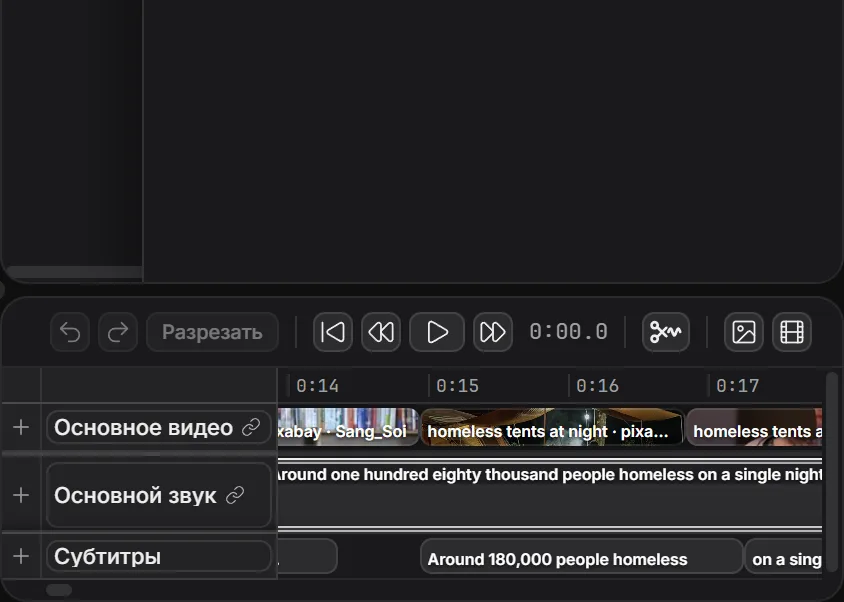

- **Сжать паузы до** — какой длины паузы останутся.
- **Тишина ниже** — насколько тихий звук считать тишиной; **авто** определяет это по самому отрезку (и так каждый раз по
  умолчанию).
- Строка под ними говорит, сколько пауз уйдёт и сколько времени это сэкономит; паузы отмечены на дорожках.
- **Вырезать** укорачивает их на всех дорожках сразу, одним шагом отмены. Музыка под роликом не режется и не
  сдвигается; звуковой эффект сдвигается целиком вместе со своей картинкой.

## Настройки клипа

Нажмите на клип — его настройки откроются справа, по группам; открыта одна группа за раз.

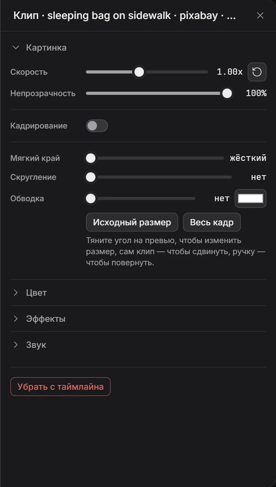

- **Картинка** — **Скорость**, **Непрозрачность**, **Кадрирование**, а для кадрированной или вставленной картинки —
  **Мягкий край**, **Скругление**, **Обводка**, **Исходный размер** и **Весь кадр**. Когда **Кадрирование** включено,
  тяните сторону клипа на превью, чтобы обрезать его край; **Alt** + перетаскивание его середины сдвигает картинку
  внутри. На основном видео кадрированный клип становится картинкой в картинке поверх своего же размытия.
- **Цвет** — **Яркость**, **Контраст**, **Насыщенность**, **Гамма**, вживую на превью. Несколько выбранных клипов или
  вся дорожка (её имя) получают одну настройку вместе.
- **Наложение** — для клипа на дорожке выше основного видео: экран, умножение, перекрытие и другие; список показывает
  каждый режим, когда вы наводите на него курсор.
- **Эффекты** — ниже.
- **Звук** — **Громкость**, **Нарастание** и **Затухание**, а также **Высота тона**: от −12 до +12 полутонов, с
  сохранением тембра голоса или без.
- **Убрать с таймлайна** убирает клип; файл остаётся в библиотеке.

## Эффекты

**+ Эффект** в группе «Эффекты» клипа открывает панель эффектов. Она остаётся открытой, пока вы их пробуете.

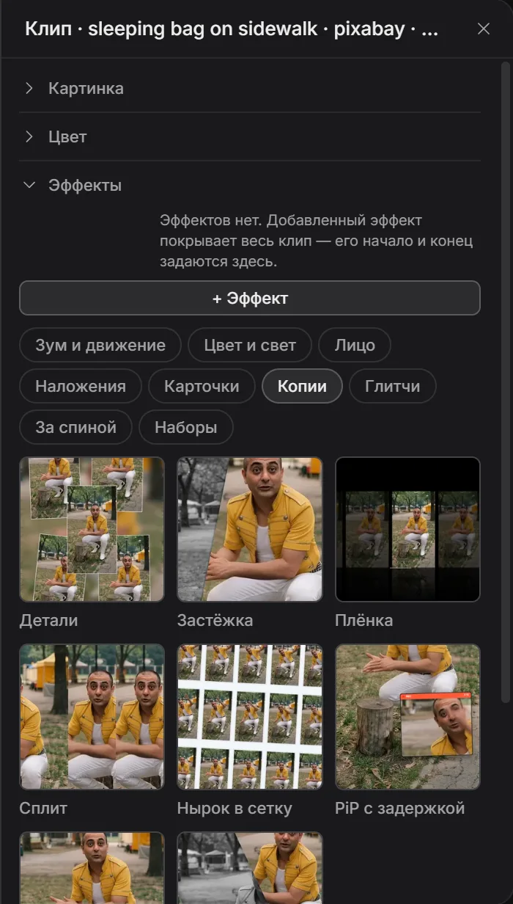

- Чипы — это группы: **Зум и движение**, **Цвет и свет**, **Лицо**, **Наложения**, **Карточки**, **Копии**,
  **Глитчи**, **За спиной**, **Наборы**. Наведите курсор на плитку, чтобы увидеть её в движении; нажмите, чтобы
  добавить.
- Добавленный эффект покрывает весь клип; **Начало** и **Конец** в его строке задают его отрезок. Клип с эффектами
  обведён на таймлайне фиолетовым.
- Наложения и карточки берут свои цвета, слова и шрифты в своей строке. Эффекты группы **За спиной** ставят что-то между
  человеком и фоном; эффекты группы **Лицо** следуют за лицом.
- Несколько выбранных клипов получают один и тот же эффект, каждый — как если бы он был один.
- Некоторые эффекты рисует само приложение, и после сохранения они **запекаются** в копию; **Экспорт** ждёт их.

## Правая кнопка на клипе

Правая кнопка на клипе предлагает то, что из него можно сделать:

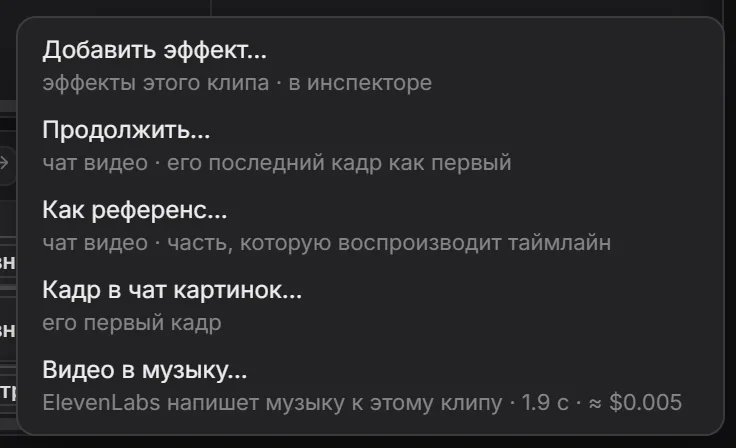

- **Добавить эффект…** — панель эффектов для этого клипа.
- **Продолжить…** — чат видео с последним кадром клипа как первым кадром нового клипа.
- **Как референс…** — чат видео с той частью клипа, которую воспроизводит таймлайн.
- **Кадр в чат картинок…** — первый кадр клипа в чате картинок.
- **Видео в музыку…** — ElevenLabs пишет музыку к клипу; цена называется до того, как что-либо оплачено.

На картинке меню предлагает **Оживить…** и **Изменить…**. У результата, сделанного так, есть кнопка, которая кладёт его
обратно на таймлайн — на место клипа, после него или над ним — одним шагом отмены.

## Субтитры

**Субтитры** над панелью Библиотеки открывают вид субтитров для дорожки «Субтитры» (или для выбранной текстовой
дорожки).

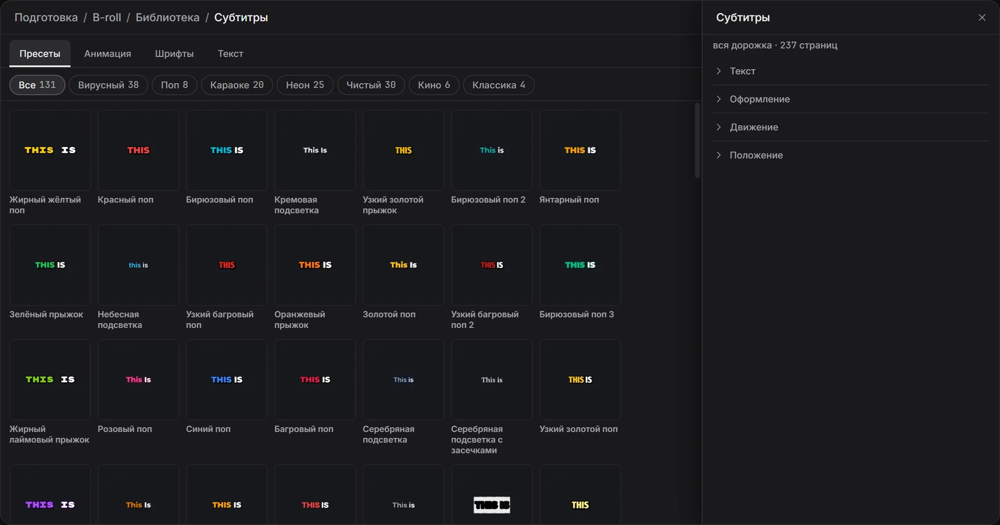

- **Пресеты** — готовые стили по группам («Вирусный», «Поп», «Караоке», «Неон», «Чистый», «Кино», «Классика»).
  **Shift** + нажатие смешивает несколько: каждая страница получает один из них.
- **Анимация** — как страница появляется и исчезает.
- **Шрифты** — один шрифт для всех страниц или несколько с Shift; шрифт без русских букв рисует русский текст своим
  двойником.
- **Текст** — все строки одним документом.

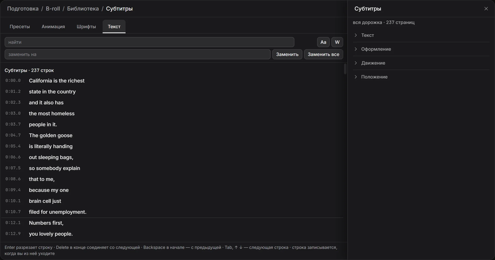

Во вкладке **Текст** исправляйте слово прямо на месте; **Enter** разрезает строку, **Delete** в её конце присоединяет
следующую, **Backspace** в её начале — предыдущую. Поле **найти** и **Заменить** работают по всей дорожке (**Aa** —
с учётом регистра, **W** — только слова целиком). Слово сохраняет свой момент, где бы оно ни оказалось.

Собственные настройки дорожки — **Текст**, **Оформление**, **Движение**, **Положение** — справа. **Ряды**: **Два**
показывает следующую страницу во втором ряду, пока звучит первая. Тяните субтитр на превью, чтобы поставить его на
место; положение записывается, когда вы его отпускаете.

Субтитры распознаёт Groq, если задан его ключ, или whisper на этом компьютере (**Настройки → Этот компьютер**) —
бесплатно, но медленнее. Строку, которую вы набрали или исправили, новое распознавание никогда не перезаписывает.

## Паттерны

Нажмите **Основное видео** (имя дорожки): под её настройками **Паттерны** открывают набор плиток. Отметьте паттерн,
чтобы наложить его на всё видео — над всеми видеодорожками и под текстом. Отмеченные паттерны перечислены со своими
непрозрачностью, режимом наложения, масштабом, цветом и движением; ↑ ↓ меняют их порядок.

## Рендер

**Экспорт** открывает окно рендера.

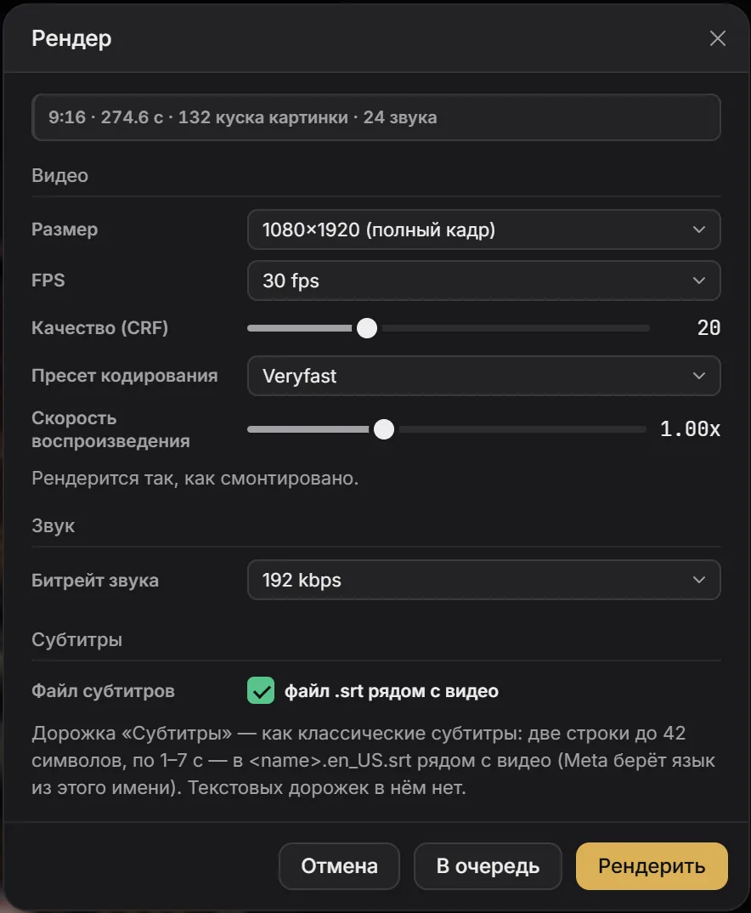

- **Видео**: **Размер** (по умолчанию — полный кадр), **FPS**, **Качество (CRF)** — чем меньше, тем лучше и тем больше
  файл, — **Пресет кодирования**, **Скорость воспроизведения**.
- **Звук**: **Битрейт звука**.
- **Субтитры**: **файл .srt рядом с видео** — дорожка «Субтитры» ещё и отдельным файлом, для платформ, которые его
  читают.
- **Рендерить** запускает рендер сейчас; **В очередь** ставит его в **Очередь** (в верхней полосе) — рендеры из неё
  идут позже, один за другим.

Видео попадает в папку рендеров проекта — Библиотека → **Рендеры**. Правая кнопка на рендере предлагает **Показать в
папке**. Рендер не запускается, пока клип на таймлайне ссылается на удалённый файл, — такие клипы красные; отпустите на
такой клип плитку, чтобы заменить его.

## Клавиши

| Клавиша | Что делает |
|---|---|
| Пробел | Воспроизвести / остановить; если выбраны клипы — только их |
| S | Убрать тишину в отрезке или в выбранных клипах |
| Delete | Удалить выбранные клипы; если выделен отрезок — вырезать его из всех дорожек |
| Shift + нажатие | Добавить клип к выбору |
| Escape | Снять выбор или закрыть верхнее окно |
| Ctrl+C / Ctrl+V | Копировать / вставить выбранные клипы |
| Ctrl+Z / Ctrl+Y | Отменить / повторить |
| Alt + колесо | Масштабировать таймлайн к указателю |
