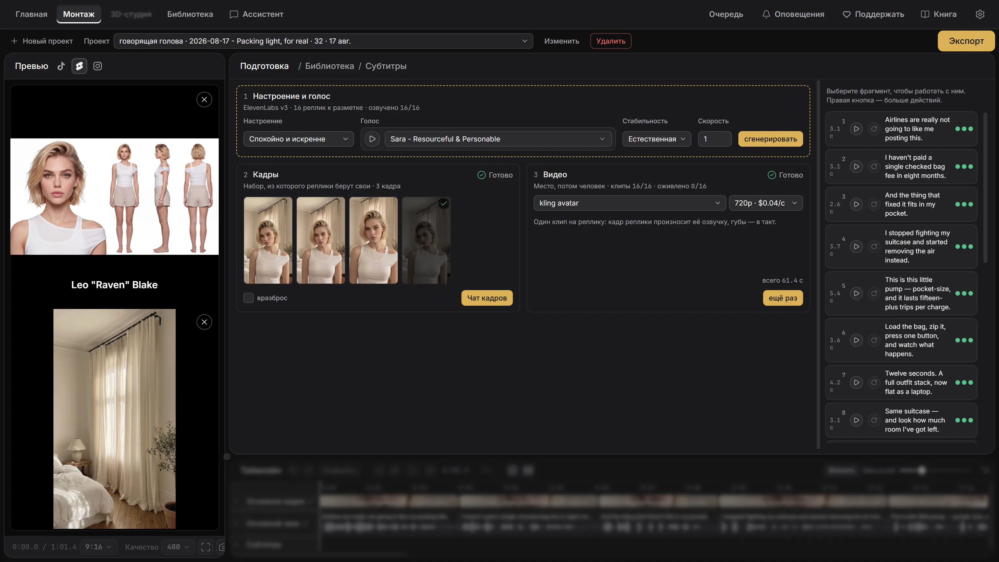
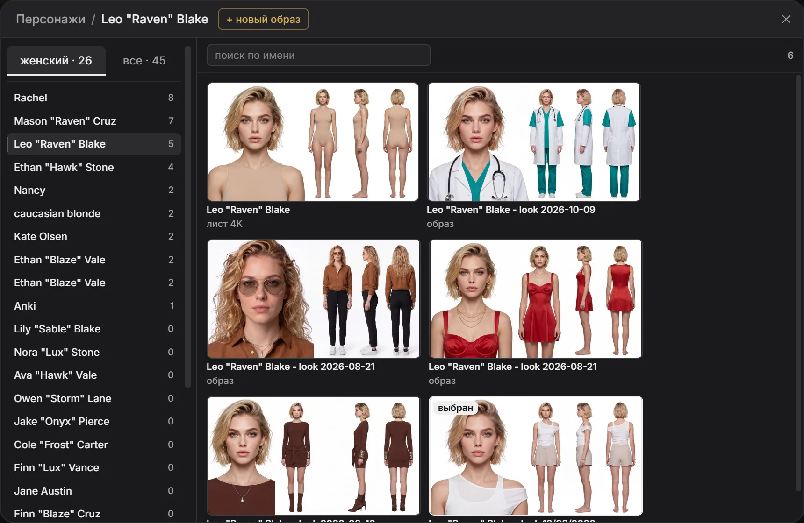
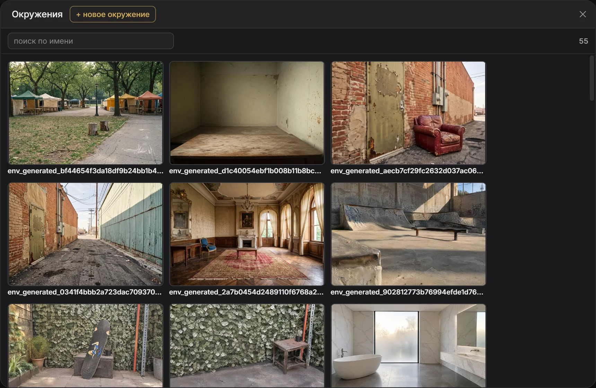
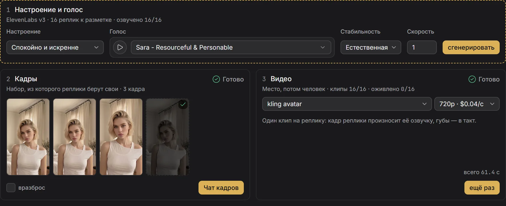
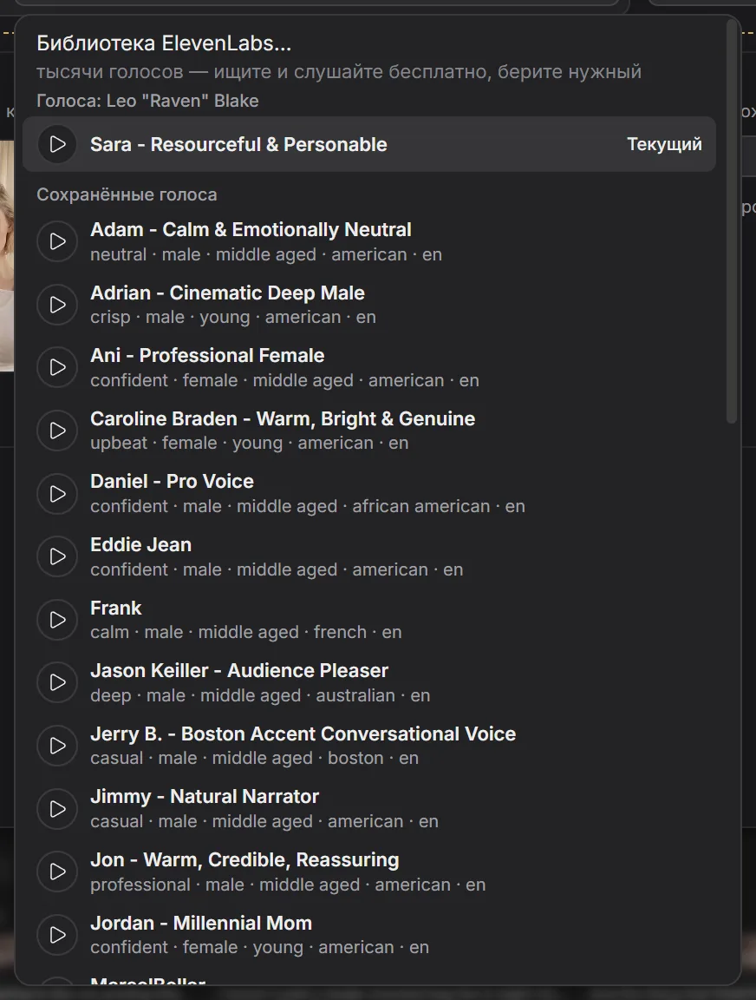
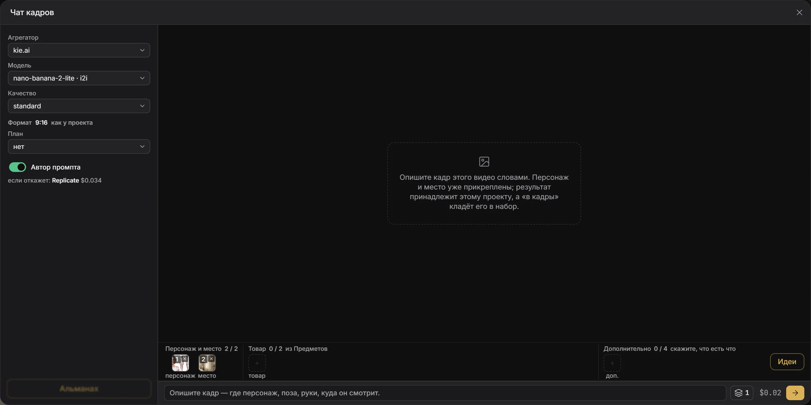
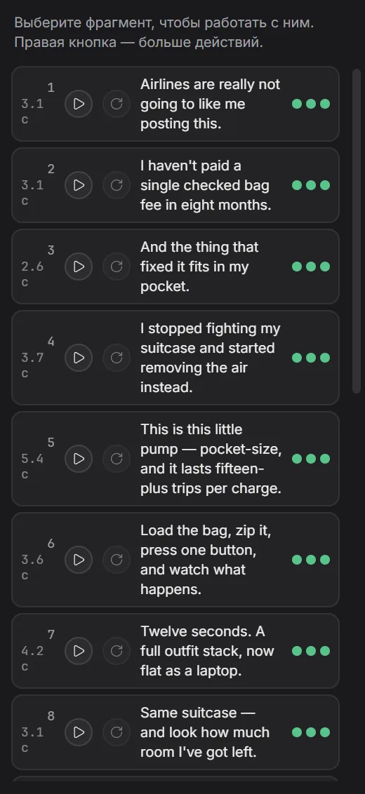
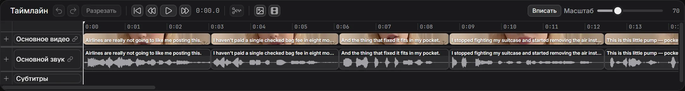

# Говорящая голова

Говорящая голова — ваш персонаж, который произносит сценарий в каком-то месте: каждая реплика озвучена голосом, для
каждой реплики есть кадр с человеком и клип, где он её говорит. Клипы ложатся на таймлайн по порядку — готовые к
субтитрам и рендеру.

## Как начать

- **Монтаж → + Новый проект → говорящая голова** — выберите сценарий или напишите его.
- **Главная → Говорящая голова** — быстрый старт: сценарий (готовый или свой текст, по реплике на абзац) и кто его
  произносит; проект создаётся и открывается в Монтаже.
- **Библиотека → Сценарии → Сделать видео** у сценария.

Говорящей голове нужны ElevenLabs, kie.ai, Cloudflare и ключ ИИ для агентов — без них она не запускается, а её подготовка
размыта под замком (см. «Начало работы»).

Говорящая голова открывается на шаге **Подготовка**. **Библиотека** и **Субтитры** над панелью ведут к таймлайну, когда у
каждой реплики есть клип; слово **Подготовка**, первое на шаге таймлайна, ведёт обратно.

## Кто и где

Слева на подготовке — сцена: **кто** говорит и **где**. Пока не выбрано и то и другое, поля размыты и ничего не делают.

- **Кто** открывает окно: персонажи (сначала те, у кого больше всего образов; **женский** / **все**) и справа — образы
  выбранного. Нажмите образ, чтобы выбрать его, — он помечается **выбран**. **+ новый образ** одевает персонажа в лукбук.
- **Где** открывает окружения; нажмите окружение, чтобы выбрать его. **+ новое окружение** делает новое из фото и фразы.
- При выборе образа ДРУГОГО персонажа приложение сначала спрашивает («Сменить на …?»): сделанные до сих пор озвучки,
  кадры и клипы откладываются в проекте, а не удаляются, — выберите первого персонажа снова, и они вернутся. **↺ <имя>**
  на сцене снова выбирает первый образ. **Новый проект** вместо этого делает новую говорящую голову с тем же сценарием и
  новым персонажем.
- ✕ на сцене снимает выбор; каждая половина сцены ждёт своей работы, пока та делается.

## 1 · Настроение и голос

- **Настроение** — как произносится сценарий (спокойно и искренне, энергично, с восторгом, …). Перед озвучкой сценарий
  размечается под него.
- **Голос** — меню: **Библиотека ElevenLabs…** (тысячи голосов — искать и слушать бесплатно, нужный берётся в
  приложение), собственные голоса персонажа и голоса, сохранённые раньше.
- **Стабильность** — **Творческая** (выразительнее, может отходить от слов), **Естественная** (как голос был записан),
  **Устойчивая** (очень ровная). **Скорость** — как быстро.
- **сгенерировать** размечает сценарий под настроение и озвучивает каждую реплику. Поле показывает, сколько реплик
  озвучено.

## 2 · Кадры

Кадры — это картинки, с которых произносятся реплики: человек в этом месте — крупным, средним или общим планом.

- Набор показывает кадры; реплики берут из него свои по очереди — первая реплика первый кадр, вторая второй, и снова по
  кругу. Галочка **вразброс** вместо этого даёт каждой реплике один кадр, выпавший по её номеру. Перетащите кадр, чтобы
  поставить его в другое место очереди; ✕ в его углу убирает его из очереди (✓ возвращает); правая кнопка открывает его
  крупно.
- **Чат кадров** открывает окно чата для кадров: скажите, что делает человек и как он в кадре; сделанный там кадр
  попадает в набор. Он сохраняет лицо и одежду человека и до двух **товаров** из КАРТИНКИ → Предметы — точно такими, как
  на их картинке. Слева в нём: модель, качество и **План** — селфи, по пояс или в полный рост; формат — как у проекта.
- В открытой реплике выберите, с какого кадра набора она произносится; **Назад к правилу — набор по очереди** возвращает
  её к общему правилу. **Кадрировать** обрезает картинку в новый, отдельный кадр.

## 3 · Видео

- **kling avatar** — кадр реплики произносит её озвучку, с синхронизацией губ. **omnihuman 2.0** — лицо, голова, руки и
  тело двигаются вместе с озвучкой (720p; озвучка короче 4 секунд оплачивается как 4).
- Качество и цена за секунду — рядом с моделью; итог называется до того, как что-то оплачено.
- Поле остаётся красным, пока каждая реплика не озвучена хотя бы раз. Кнопка **сделать клип** в реплике делает клип этой
  реплики; **сгенерировать** в поле делает все клипы, которых ещё нет, — показывает цену и ждёт второго нажатия
  (**… · запустить?**).
- Каждый клип — строка в Оповещениях: «изучаю место», «изучаю этот фрагмент», «kie.ai делает клип». Закройте окно — работа
  продолжится.

## Реплики

Правая колонка — это сценарий, по реплике в строке: её слова, её длина, ▶ — послушать озвучку, и три точки — озвучка,
кадр, клип, — зелёные, когда готово.

- Нажмите реплику, чтобы открыть её на сцене: её кадр, её озвучку, её клип.
- Измените слова реплики, потом озвучьте её заново — кадр у реплики останется.
- Правая кнопка на реплике: **Озвучить заново**, **выбрать клип**, **убрать реплику**; **+** под строкой вставляет новую
  реплику под ней. Убранная реплика уходит в конец сценария, бледная, и сохраняет свой номер — больше ничего не сдвигается.

## Таймлайн

Каждый клип ложится на таймлайн в порядке своей реплики — таймлайн ОТРАЖАЕТ реплики.

- Реплика без клипа пока нигде не лежит; таймлайн ждёт первого клипа.
- То, что вы кладёте на таймлайн сами, — B-roll, музыка, картинка, — ваше: приложение этого никогда не трогает.
- **Убрать тишину** и участок, удалённый поверх реплики, сохраняются вместе с репликой: новый дубль реплики режется так
  же.
- Несколько выбранных целых реплик можно склеить в один клип.
- Вид, который вы дали картинке реплики, — подгонка, кадрирование, картинка в картинке, — остаётся, когда её клип
  делается заново.

Субтитры, эффекты и рендер работают как в любом проекте — см. главу «Монтаж».

## Сколько стоит

Озвучки тратят символы ElevenLabs (баланс виден в блоке «Приложение» на Главной). Кадры — это картинки, по нескольку центов
каждая. Клипы оплачиваются посекундно: kling avatar — примерно от $0.04, omnihuman 2.0 — $0.07. Каждое платное нажатие
сначала называет цену; за одну и ту же работу дважды не платится.
