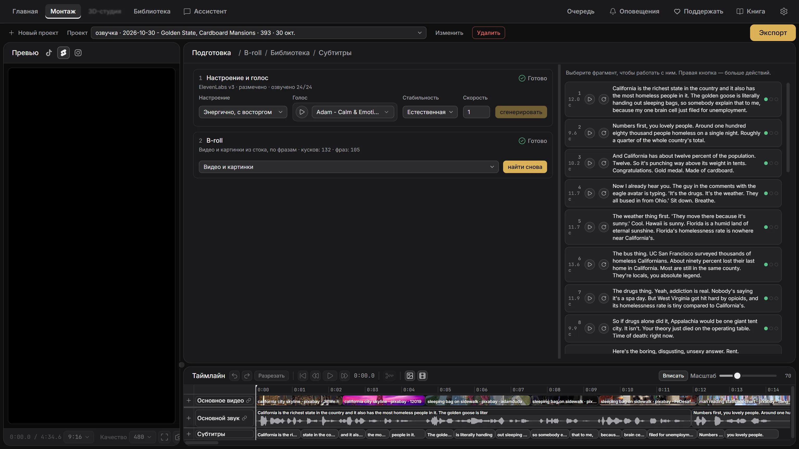
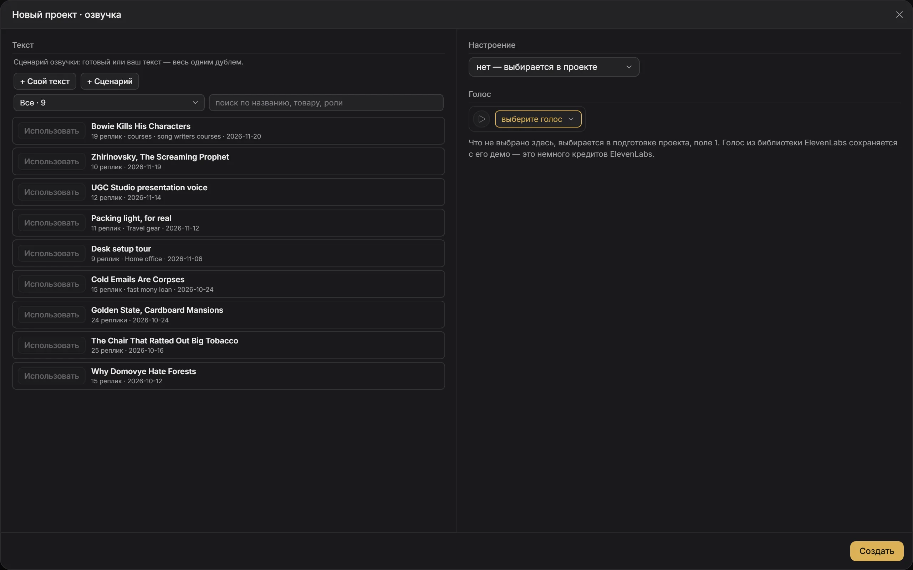
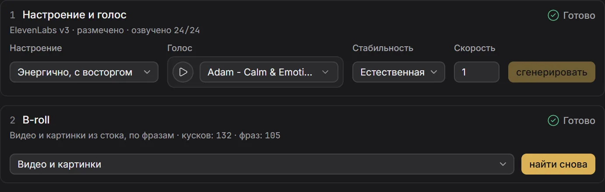
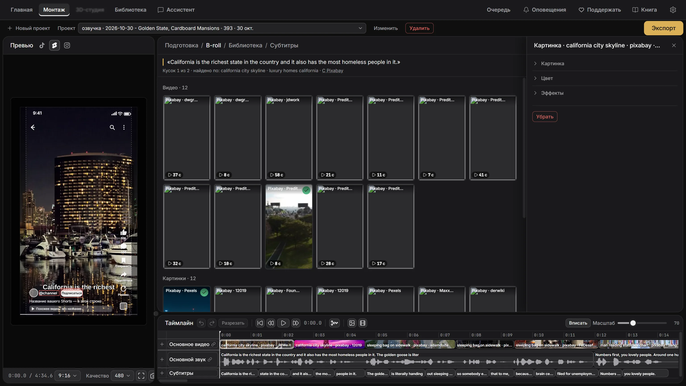
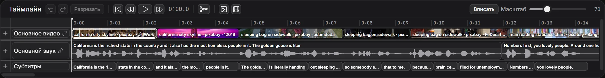

# Озвучка и B-roll

Озвучка — это ваш сценарий, прочитанный голосом, со стоковыми съёмками поверх, фраза за фразой. У неё нет персонажа,
места и кадров: её картинка — это B-roll. Приложение озвучивает сценарий, распознаёт его слова, находит видео и картинки
для каждой фразы и кладёт их на таймлайн поверх голоса.

## Как начать

- **Главная → Озвучка** — быстрый старт: сценарий (готовый или свой текст), настроение и голос. **Создать** кладёт их
  в черновик озвучки и открывает его в Монтаже, на подготовке.
- **Монтаж → + Новый проект → озвучка** — открывает черновик озвучки.
- **Монтаж → Сценарии** (вкладка слева от **Библиотеки**, в черновике или пустом проекте): правая кнопка на
  сценарии → **озвучка**.

Озвучке нужны ElevenLabs, Pixabay и ключ ИИ для агентов — без них она не запускается
(см. «Начало работы»).

## Черновик и его сценарий

Черновик озвучки всегда один — **черновик · озвучка** в списке проектов. Пока это черновик, в его правой колонке
выбирается сценарий:

- сценарий — **Использовать** кладёт его реплики, каждую отдельной репликой озвучки;
- **+ Свой текст** — вставьте или наберите любой текст на любом языке: весь он — ОДНА реплика, озвученная одним дублем
  на том языке, на котором написан, — до 4 500 символов (ElevenLabs озвучивает 5 000 за раз; остальное оставлено для
  тегов настроения);
- **+ Сценарий** — написать новый сценарий; он сохраняется в Библиотеке.

Ничего не переводится: каждая реплика озвучивается на своём языке. **Другой сценарий** над репликами снова убирает их.
Первая озвученная реплика делает черновик отдельным проектом — его сценарий остаётся за ним, а следующая озвучка
начинается с нового черновика.

## 1 · Настроение и голос

Как в говорящей голове: **Настроение** (сценарий размечается его тегами, фраза за фразой), **Голос**, **Стабильность**,
**Скорость**, и **сгенерировать** озвучивает каждую реплику. В меню голоса есть **Библиотека ElevenLabs…** и голоса,
сохранённые раньше, — своего персонажа у озвучки нет.

**Библиотека ElevenLabs…** открывает окно **Голоса**: голоса ElevenLabs, поиск по имени или слову из описания и фильтры
по полу, возрасту, стилю, назначению, акценту и языку (выставлен язык сценария), по 20 на странице; ▶ играет демо. Взять
голос ничего не стоит — он становится голосом этого проекта и сохраняется на следующий раз.

## 2 · B-roll

Поле ждёт, пока каждая реплика не будет озвучена, а её слова — распознаны; субтитры распознаются сами, через Groq или
на этом компьютере.

- **найти B-roll** — агент пишет по два английских поисковых запроса на каждую фразу голоса; приложение берёт с Pixabay
  по 12 видео и 12 картинок на фразу и кладёт их на **основное видео** встык по всему голосу, кусок примерно каждые
  2,5 секунды. Скачивается только то, что положено, — в ВИДЕО → Загрузки → Сток и КАРТИНКИ → Сток.
- Меню рядом: **Видео и картинки** (вперемешку), **Только видео**, **Только картинки**. При смене каждый кусок кладётся
  заново — кроме тех, что вы выбрали сами.
- Поле говорит, сколько кусков положено на сколько фраз. Реплика озвучена заново или добавлена — **найти снова**
  находит B-roll новых фраз.

## Замена куска

Нажмите кусок на основном видео — или вкладку **B-roll** справа от **Подготовки** — и панель Библиотеки покажет этот
кусок:

- его фразу, золотом; какой это кусок фразы (**Кусок 1 из 2**) и запросы, по которым он найден (**найдено по:**);
- что нашлось для фразы — **Видео** и **Картинки**: плитка этого куска обведена, положенные где угодно на таймлайне
  отмечены ✓, у видео — его длина;
- нажатие ставит плитку в кусок. Выбранная вручную, она остаётся, когда меняют меню поля 2.

**С Pixabay** ведёт туда, откуда эти съёмки; на каждой плитке — имя её автора.

## Таймлайн

Озвучки лежат на основном звуке в порядке реплик, B-roll — на основном видео над ними, субтитры — на дорожке
«Субтитры». Когда реплика озвучена заново или субтитры распознаны заново, куски B-roll заново подгоняются по словам.

Как только на таймлайне что-то лежит, он виден под подготовкой, и вкладки ведут дальше: **Подготовка / B-roll /
Библиотека / Субтитры**. Принесите свой B-roll из Библиотеки или сгенерируйте клипы и положите их на таймлайн, как в любом
проекте; субтитры, эффекты и рендер — как в Монтаже.

## Подсказки

Озвучка показывает поверх страницы четыре подсказки, по одной: сценарий, настроение и голос, **найти B-roll** и клип —
когда B-roll положен. Нажатие в любом другом месте закрывает подсказку, как и её красный ✕; **больше не показывать**
убирает их насовсем.

## Сколько стоит

Озвучки тратят символы ElevenLabs. B-roll бесплатный — это съёмки Pixabay; запросы агента стоят долю цента.
Распознавание субтитров стоит немного через Groq и ничего — на этом компьютере.
