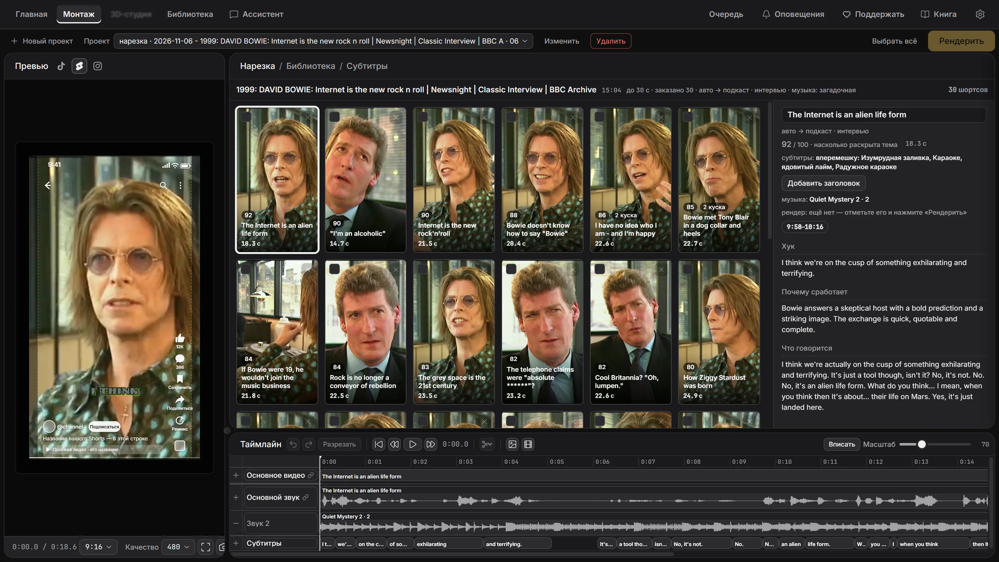
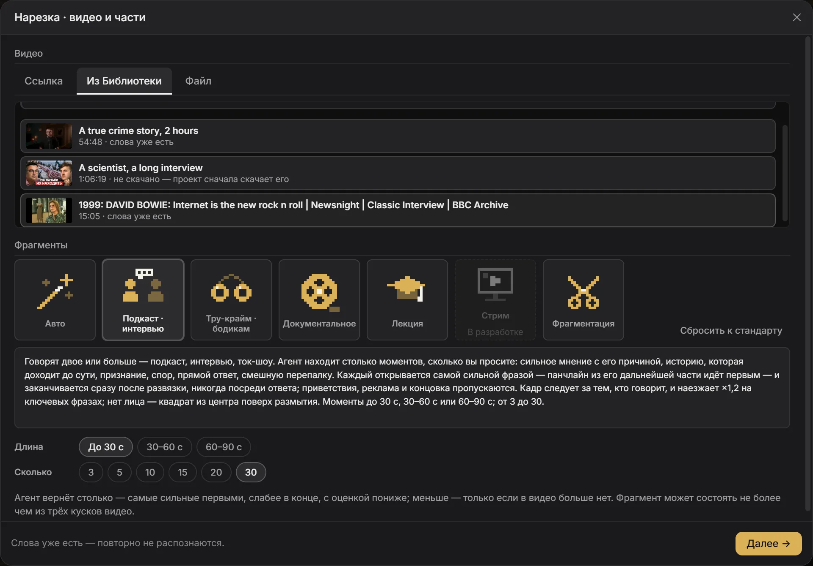
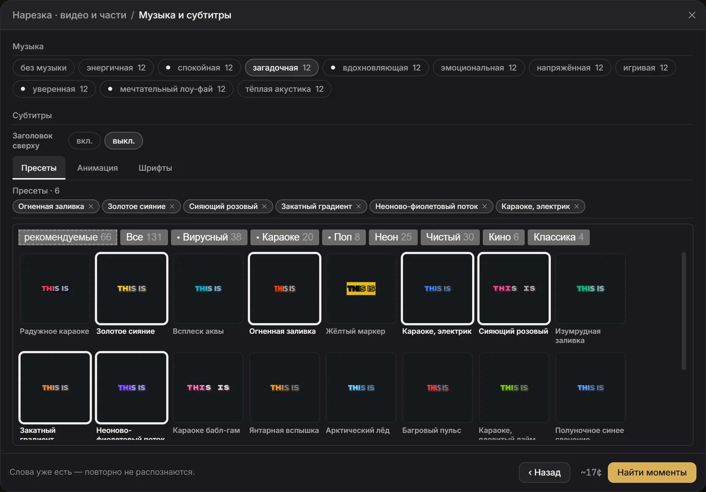
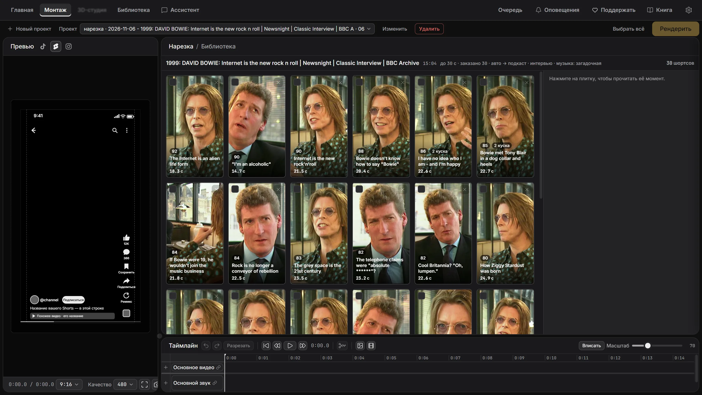
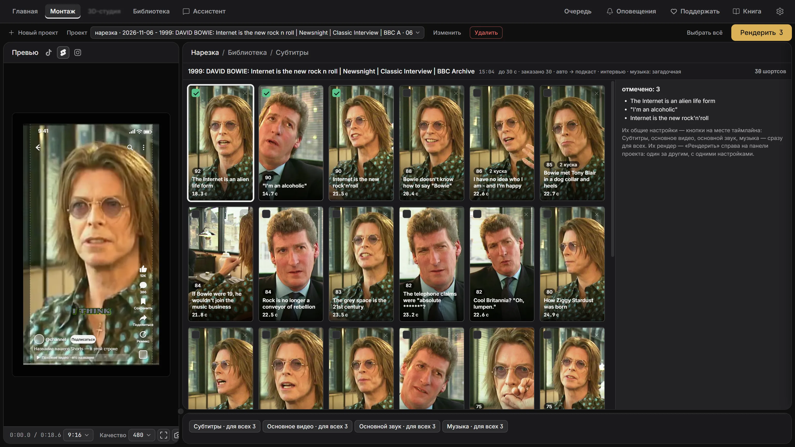

# Нарезка

Нарезка режет длинное видео — подкаст, интервью, лекцию, документальный фильм — на вертикальные шортсы. Приложение
распознаёт его слова, агент находит самые сильные моменты, и каждый момент становится фрагментом 9:16 со своим
таймлайном: кадр следует за лицами, субтитры в выбранном вами стиле, под ними музыка. Вы просматриваете фрагменты, меняете
их вместе или по одному и рендерите нужные за один раз.

## Как начать

- **Главная → Нарезка** или **Монтаж → + Новый проект → нарезка** — открывается окно из двух шагов. Пока не нажата его
  последняя кнопка, ничего не создаётся.
- Проект нарезки, в котором ещё нет видео, предлагает **+ Добавить видео** — то же окно.

Нарезке нужен ключ ИИ для агентов, а чтобы распознать слова — Groq или бесплатная модель речи на этом компьютере
(см. «Начало работы»).

## Шаг 1 · видео и фрагменты

**Видео** — три способа:

- **Ссылка** — одно видео на YouTube или другом сайте; сначала оно скачивается.
- **Из Библиотеки** — видео из РЕФЕРЕНСЫ → YouTube → Видео. Ещё не скачанное скачает проект; видео, слова которого
  уже распознавались, повторно не распознаётся.
- **Файл** — **Выбрать видеофайл…** или перетащите файл в любое место окна. Файл НЕ копируется в библиотеку: он читается
  там, где лежит. Если его потом переместить, проект скажет, что его нет на прежнем месте, и вы укажете его снова. Файл
  с несколькими звуковыми дорожками (дубляж и оригинал) предлагает выбор — **Звук**.

**Фрагменты** — что это за видео, чтобы агент резал его по правилам этого вида:

| Вид | Что находит | Кадр |
|---|---|---|
| **Авто** | Сначала читает слова, решает, какой это вид, потом режет видео так, как режет этот вид | Как у этого вида |
| **Подкаст · интервью** | Мнения с доводами, истории, признания, споры, смешные перепалки — каждый момент открывается самой сильной фразой | Следует за тем, кто говорит, наезжает ×1,2 на ключевых фразах |
| **Тру-крайм · бодикам** | Признания, ложь, которая рушится, повороты, арест | Следует за тем, кто говорит или реагирует, наезжает на ключевых фразах |
| **Документальное** | Факт с его «почему», вопрос и ответ на него, разоблачение | Квадрат из центра поверх размытия, заголовок сверху |
| **Лекция** | Одна мысль целиком — определение с примером, парадокс, ответ на вопрос из зала; паузы укорочены | Говорящий в квадрате, слайд целиком |
| **Фрагментация** | ВСЁ видео от начала до конца, частями по смыслу — эпизод как череда шортсов | Следует за самым активным, без размытия |

**Стрим** пока в разработке. Текст под кнопками объясняет, что делает выбранный вид.

- **Длина** — до 30 с, 30–60 с или 60–90 с (части фрагментации: 30–60 с, 1–2 мин, 2–3 мин).
- **Сколько** — от 3 до 30. Агент вернёт столько — самые сильные первыми, слабее в конце, с оценкой пониже; меньше —
  только если в видео больше нет. Фрагмент может состоять не более чем из трёх кусков видео. У фрагментации нет
  количества: частей столько, сколько выйдет из видео.
- **Сбросить к стандарту** — возвращает собственные настройки вида. Каждый вид помнит, что вы для него выбрали.

**Далее →** ведёт дальше, когда выбраны видео и вид.

## Шаг 2 · музыка и субтитры

- **Музыка** — **без музыки** или одно или несколько настроений из папки Музыка → нарезка (энергичная, спокойная,
  загадочная, …; число — сколько в настроении треков), **ваши** — треки в корне этой папки. Настроения с точкой подходят
  этому виду. Каждый фрагмент получает один трек из выбранных настроений, тихо под речью, — без повторов, пока треков
  хватает.
- **Субтитры** — **Заголовок сверху** вкл. или выкл. (заголовок фрагмента на его первые 3 секунды); потом **Пресеты**,
  **Анимация** и **Шрифты**. Shift + нажатие выбирает несколько — каждая страница субтитров берёт один из них. Группы,
  которые подходят этому виду, идут первыми. Стиль субтитров выбрать обязательно — пока он не выбран, окно говорит об
  этом красным.

Внизу окна сказано, кто распознает слова (Groq, этот компьютер или «слова уже есть» — повторно не распознаются), и цена —
несколько центов за агента и распознавание. **Найти моменты** запускает работу; **‹ Назад** возвращает к шагу 1.

## Пока идёт работа

Окно закрывается, и проект открывается в Монтаже. За работой следит одна строка Оповещений, а поле показывает шаги —
скачивание, распознавание слов, поиск моментов, нарезку фрагментов — с одной полосой и оставшимся временем. Кнопка
**стоп** останавливает работу: оплаченное сохраняется. Кнопка **повторить** продолжает с места остановки; шаг, на котором
работу прервали, оплачивается снова, только если кнопка об этом предупреждает.

## Фрагменты

Строка над плитками называет видео, его длину и то, что было заказано, — «до 30 с · заказано 30 · авто → подкаст ·
интервью · музыка: загадочная», — и сколько получилось шортсов. Каждая плитка — фрагмент: его оценка из 100, название,
длина и «2 куска», если он собран из нескольких кусков.

- **Нажмите на плитку**, чтобы открыть фрагмент: внизу его собственный таймлайн, слева превью, справа карточка — имя
  (его можно изменить прямо там: это заодно имя таймлайна и файла рендера), вид, оценка, субтитры и музыка фрагмента,
  **Добавить заголовок**, его рендер и заметки агента: «Хук», «Почему сработает», «Что говорится».
- ✕ на плитке удаляет фрагмент; **Ctrl+Z** в поле возвращает его.
- Таймлайн фрагмента — обычный таймлайн: обрезайте клипы, двигайте субтитры, меняйте музыку, добавляйте эффекты — всё
  из главы «Монтаж» работает и на нём.

**Кадр следует за лицами.** После нарезки фрагмента в нём считаются лица и планируется окно кадра — самое крупное лицо в
каждом плане, скачок на склейке, весь кадр поверх размытия там, где лица нет. Строка **Слежение** в инспекторе клипа
меняет это: неподвижно, за лицом, по центру, целиком + размытие, два лица, говорящий, — и сдвиг. **Наезды** включают и
выключают приближения ×1,2 на ключевых фразах.

## Несколько фрагментов сразу

Отмечайте фрагменты — квадратик в углу плитки или **Выбрать всё** на панели проекта. Когда отмечено два или больше,
таймлайн уступает место четырём кнопкам, у каждой — **· для всех N**:

- **Субтитры** — их место, размер, слов на странице, строки, два ряда, заголовок сверху. Место, заданное сразу для
  нескольких, сохраняется при смене пресета. Вкладка **Субтитры** даёт всем отмеченным другой стиль за один раз.
- **Основное видео** — цвет, кадр (**По виду** возвращает кадр, который дало приложение), наезды, паттерны, эффекты клипа.
- **Основной звук** — громкость и высота тона речи.
- **Музыка** — её громкость; раздать треки заново из настроений или сменить трек одного фрагмента.

Открытый фрагмент меняется на странице, остальные — на сервере; изменение сразу нескольких не отменяется через Ctrl+Z.

## Рендер

**Рендерить N** на панели проекта рендерит отмеченные фрагменты один за другим, с одними настройками (окно рендера
Монтажа, для N). **✕ стоп** останавливает их; готовые остаются. Каждый рендер назван по своему фрагменту и лежит в папке
рендеров проекта (с **.srt** рядом, когда окно рендера его пишет); повторный рендер фрагмента заменяет его файл. Карточка
показывает, что с рендером, — **Показать в папке**, проиграть его, «изменено после», если таймлайн правили после
рендера, — а Очередь показывает проект одной строкой.

## Сколько стоит

Распознавание слов: Groq стоит немного, этот компьютер — ничего; видео, распознанное один раз, больше никогда не
распознаётся. Агент, который находит моменты: несколько центов. Музыка — своя, из Библиотеки; нарезка фрагментов,
кадрирование и рендер делаются на этом компьютере бесплатно.
