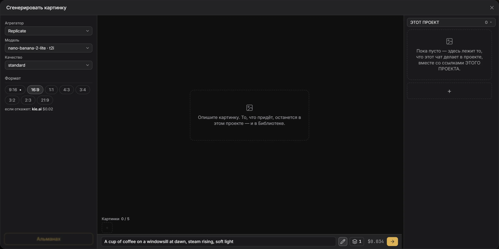
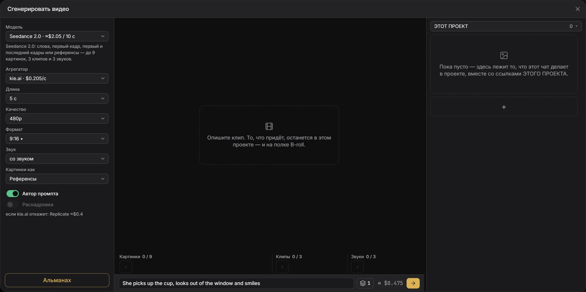
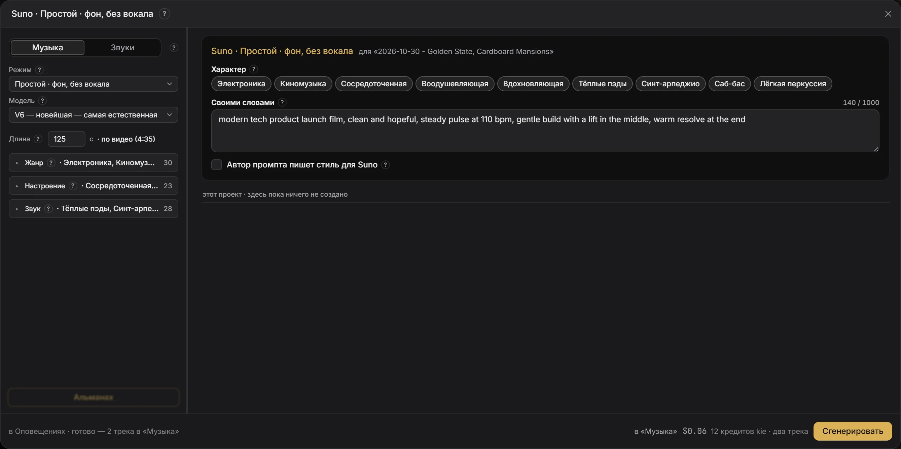
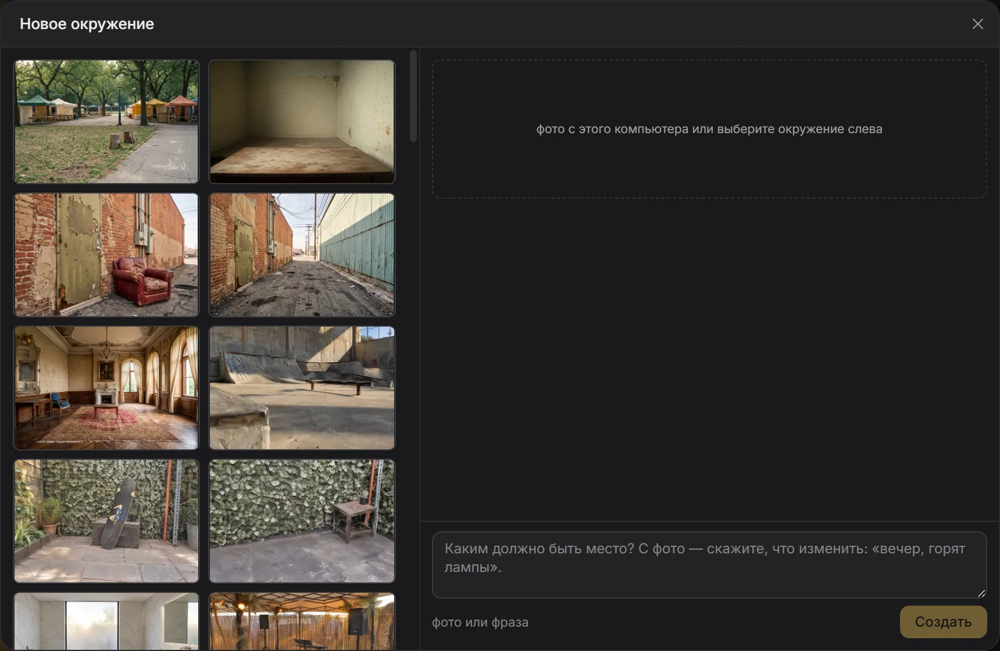

# Генерация

Генераторы — это окна поверх страницы, одно и то же окно в Монтаже, в Библиотеке и на Главной: чат картинок, чат видео,
окно звука и окна создания окружений, лукбуков и предметов. Каждое платное нажатие сначала называет свою цену и
становится строкой Оповещений; закройте окно — работа продолжится. Сделанное ложится в Библиотеку, а в Монтаже ещё и в
**ЭТОТ ПРОЕКТ**.

## Где они открываются

- Дерево: **Создать** у папок КАРТИНКИ, ВИДЕО и ЗВУК, а также у папок Окружения, Лукбуки и Предметы.
- **Главная → Сгенерировать**: **Картинки**, **Видео**, **Музыка и звуки**; **Главная → Библиотека**: **Персонаж**,
  **Предмет**, **Образ**, **Окружение**.
- Правая кнопка на дорожке, на плитке Библиотеки (**Оживить…**, **Изменить…**, **Продолжить…**, **Как референс…**) или
  на картинке или клипе таймлайна — чат открывается уже с этим вложением.

## Чат картинок

- **Слева** — **Агрегатор** (kie.ai или Replicate), **Модель** (nano-banana-2, nano-banana-2-lite, seedream-4.5,
  gpt-image-2.5-sunburst, grok-imagine-image-2), **Качество** (1K, 2K, 4K — смотря что предлагает модель), **Формат**
  (9:16, 16:9, 1:1 и другие). «Если откажет» называет другой агрегатор и его цену: отклонённую картинку запрашивают там.
- **Посередине** — переписка. **Картинки 0 / 5** над полем — прикреплённые картинки: **+** открывает окно, чтобы их
  выбрать, — персонажи и их образы, РЕФЕРЕНСЫ, КАРТИНКИ или файл с этого компьютера (сначала он попадает в КАРТИНКИ).
- **Поле** — скажите, чего хотите, на любом языке. Перо рядом с ним — **автор промпта**: включён — ваши слова
  переписываются в промпт, который нужен этой модели, и сообщение останавливается, чтобы вы посмотрели, прежде чем что-то
  будет оплачено; выключен — ваши слова уходят как написаны, и отправка — одно нажатие. Кнопка со слоями — сколько
  картинок за раз (каждая — отдельная попытка); дальше цена и отправка (Enter; Shift+Enter — новая строка).
- **Справа** — папка Библиотеки (ЭТОТ ПРОЕКТ, РЕФЕРЕНСЫ, КАРТИНКИ): нажатие на картинку прикрепляет её.

Сделанная картинка лежит в переписке: ⤢ в её углу открывает её крупно, **В референс** прикрепляет её, чтобы продолжить
с неё, а на дорожку её просто перетаскивают. Она ложится в **КАРТИНКИ → Созданное**.

## Чат видео

Те же три колонки. Модели — под списком каждая говорит, для чего она:

| Модель | Для чего |
|---|---|
| **Grok classic**, **Grok 1.5** | Быстрые дешёвые клипы по словам, картинке или референсам — B-roll, вставки; звук делают сами |
| **Seedance 2.0 mini**, **2.0**, **2.5** | Слова, первый кадр, первый и последний кадры или референсы — картинки, клипы и звуки; 2.5 — до 30 с, самая дорогая |
| **Kling 2.6 / 3.0 motion control** | Ваш персонаж повторяет движения человека из клипа в сцене вашей картинки: одна картинка в полный рост + один клип на 3–30 с |

- **Агрегатор**, **Длина**, **Качество**, **Формат** — с их ценами. Один клип-референс для Seedance решает длину и формат:
  «Как у клипа».
- **Автор промпта** — включён: пишет промпт по вашему сообщению и вложениям; клипы для Seedance он сначала просматривает
  секунда за секундой. Его промпт стоит в сообщении в поле, которое можно поправить, **Написать заново** пишет другой,
  **Сделать видео** оплачивает клип. Выключен — ваши слова уходят как написаны (с переводом на английский, если они не на
  английском).
- **Раскадровка** (Seedance) — сначала лист пронумерованных панелей, нарисованный по вашим словам, потом видео, сделанное
  по нему.
- **Kling motion control** — автор промпта пишет промпт первого кадра: вы видите промпт, потом картинку, потом видео,
  и каждое оплачивается своим нажатием.

Сообщение показывает запрос слева и место видео справа; клип играет на месте под курсором, а ▶ открывает его крупно.
Клипы ложатся в **ВИДЕО → Созданное → <модель>**. **Альманах** внизу левой колонки хранит заметки о промптах — нажатый
чип из него добавляет свои слова к вашим.

## Окно звука

**Музыка | Звуки** сверху, под ними режим:

- **Простой** (Suno) — фоновая музыка без голоса, для видео, где кто-то говорит: характер — чипами, ваши слова — если
  хотите; автор промпта делает из этого стиль для Suno. Два трека.
- **Свой** (Suno) — вы пишете название, стиль и текст ([Verse], [Chorus]…) или ставите галочку «Инструментал». Два
  трека.
- **Текст песни** (Suno) — тексты песен по идее; **В «Свой»** или **Сохранить** в папку Музыка → Тексты. Только текст.
- **Музыка по описанию** (ElevenLabs) — музыка по вашим словам, инструментал, если не снять галочку.
- **Видео в музыку** (ElevenLabs) — музыка, написанная для видео длиной до 10 минут: выберите его в папках ВИДЕО справа
  (в Монтаже ещё и клип таймлайна, его правой кнопкой, — трек ляжет под него).
- **Звуки** (Suno) — звук или луп по описанию. **Звуковые эффекты** (ElevenLabs) — до 30 с.

**Модель** и **Длина** (в Монтаже — «по видео»); у каждой строки свой «?». Внизу — куда ляжет результат (музыка — в
Музыку, в папку, открытую в Библиотеке; звуки — в Звуки → Мои звуки → Созданное), цена и **Сгенерировать**.

## Окружения, лукбуки и предметы

- **Новое окружение** — место для говорящих голов: слева окружения, сделанные раньше (нажатое становится основой для
  изменений), справа фото с этого компьютера и фраза — «вечер, горят лампы». **Создать**. Окружение ложится в
  КАРТИНКИ → Окружения, фото — в его референсы.
- **Новый лукбук** — наряд, так же; в КАРТИНКИ → Лукбуки.
- **Новый предмет** — фото товара с его названием и вашими словами; приложение читает фото и пишет описание товара.
  Ничего не генерируется. В КАРТИНКИ → Предметы.
- **Новый персонаж** — см. главу «Библиотека».

## Оплата один раз

Каждая платная генерация — строка Оповещений от нажатия до того, как её файл разложен по местам. Запрос, на который не
пришло ответа, сам никогда не оплачивается снова: он говорит «возможно, уже оплачено», а **повторить** в Оповещениях
запрашивает снова, только когда вы его нажмёте. Картинка или клип, отклонённые модерацией модели, повторно не
запрашиваются.
