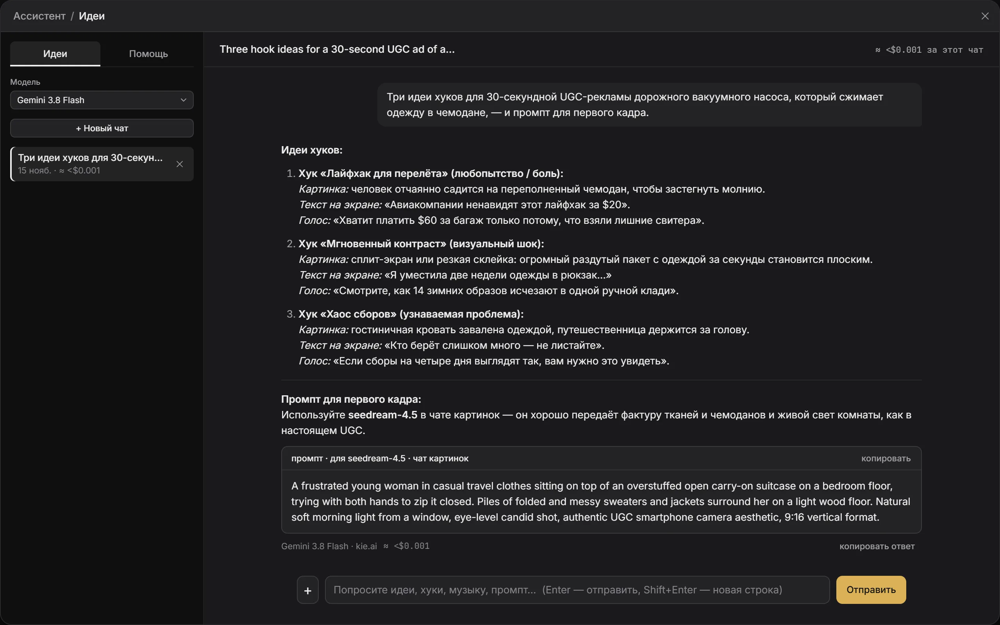
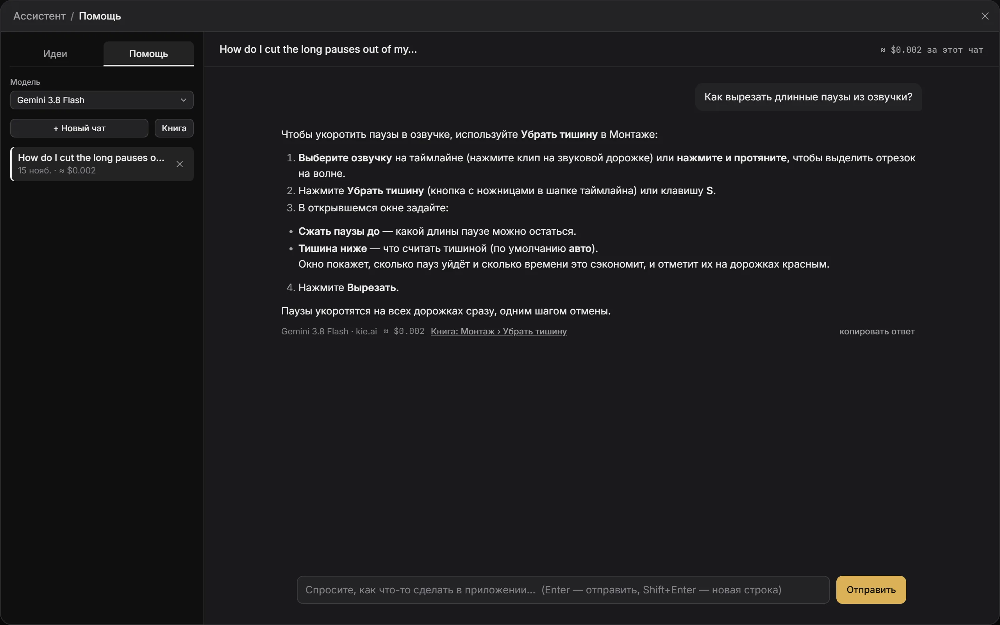
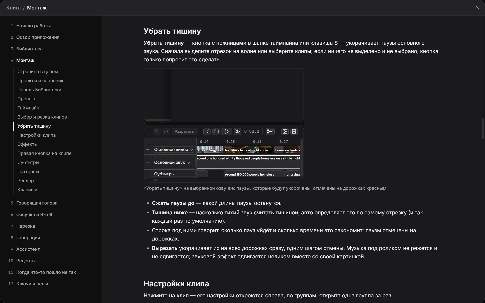

# Ассистент

Ассистент — это чат с ИИ-моделью на каждой странице, кроме 3D-студии: **Идеи** — придумывать видео, хуки, музыку и
промпты для генераторов приложения; **Помощь** — спрашивать, как что-то сделать в приложении, — она отвечает по этой
книге. Сам он ничего не генерирует, поэтому у него нет строки в Оповещениях; он стоит столько, сколько модель берёт за
свои слова, — обычно доли цента.

## Как его открыть

**Ассистент** справа от Библиотеки в верхней полосе открывает своё окно поверх страницы. Ему нужен ключ ИИ для
агентов — kie.ai, Replicate, Claude или OpenRouter (см. «Начало работы»). Окно можно двигать и растягивать; если его
закрыть, ответ всё равно допишется — он сохранится и появится, когда чат откроют снова.

## Окно

- **Идеи | Помощь** вверху левой колонки — у каждого режима свои чаты.
- **Модель** — кто отвечает: модели, которые можно спросить по вашим ключам, первыми — ступени лестницы агентов
  (Настройки → Настройки ИИ). Новый чат берёт выбранную; чат сохраняет свою модель.
- **+ Новый чат**, затем чаты режима, новые сверху, у каждого — сколько он стоил. Двойное нажатие на имя чата
  переименовывает его; ✕ чата, нажатый дважды, удаляет его.
- Справа: имя чата и его стоимость («≈ $0.002 за этот чат»), переписка и поле — **Enter** отправляет, **Shift+Enter** —
  новая строка; пока пишется ответ, **Отправить** превращается в **Стоп**.
- Пустой чат предлагает готовые начала — нажмите на одно, и его слова попадут в поле; ничего не отправляется, пока вы не
  отправите сами.
- Под каждым ответом: модель, которая его написала, его стоимость и **копировать ответ**.

## Идеи

Просите то, что нужно для видео: хуки, сценарий, план по сценам, стиль музыки, субтитры. Ассистент знает генераторы
приложения — их модели, в чём каждая сильна, как для них пишутся промпты, — и когда он пишет промпт, тот приходит
отдельным блоком, названным по своему генератору (**промпт · для seedream-4.5 · чат картинок**), с кнопкой
**копировать**. Вставьте его в этот чат. Отвечает Ассистент на языке, на котором вы пишете, а сам промпт всегда пишет
по-английски — приложение отправляет своим моделям только английский.

**+** рядом с полем прикрепляет то, о чём ваша идея: образ персонажа, товар из КАРТИНКИ → Предметы, сценарий. Модель
читает их как слова — описания образа и товара, реплики сценария, — а не как картинки.

## Помощь

Спрашивайте своими словами — «как вырезать длинные паузы из моей озвучки?»; Помощь отвечает на языке, на котором вы
пишете. Сначала она находит главы этой книги, которые отвечают на вопрос, затем отвечает только по ним, так что её
ответ описывает приложение таким, какое оно есть. Под ответом **Книга: <глава › раздел>** открывает книгу в том месте,
откуда взят ответ.

**Книга** рядом с **+ Новый чат** в Помощи открывает книгу там, где вы остановились. Помощи нужен ключ ИИ; самой книге
он не нужен — она открывается и кнопкой **Книга** в правом конце верхней полосы, и из блока **Книга** на Главной.

## Книга

Книга — это то, что вы сейчас читаете: главы слева — открытая со своими разделами, — страница с картинками справа.
Нажатие на раздел переносит туда; ссылка в тексте ведёт в другую главу. Окно помнит, где вы были.

## Сколько стоит

Каждый ответ называет свою цену; чат складывает цены своих ответов. Ответ Помощи — это два коротких вызова: один
выбирает главы, другой отвечает по ним. С недорогими моделями ответ стоит доли цента; модели Claude стоят дороже и
сообщают свою цену так же.
