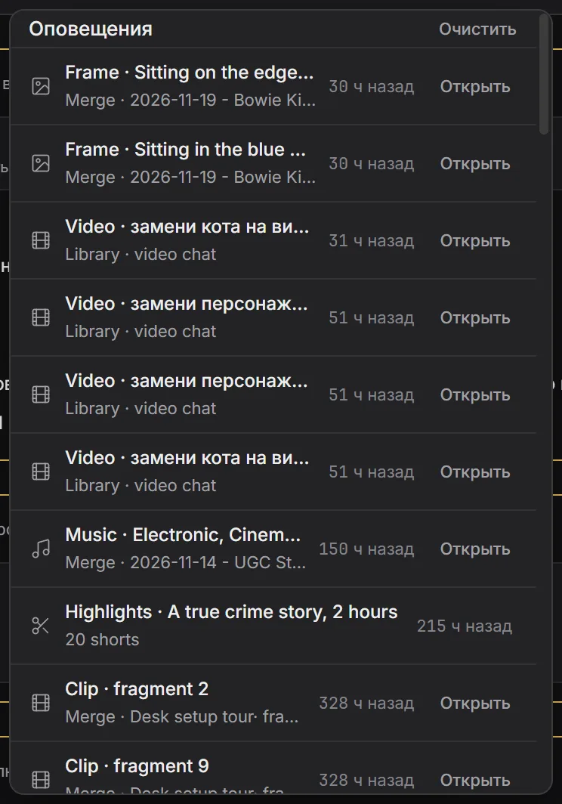

# Когда что-то пошло не так

Что говорит приложение, когда что-то не сработало, и что с этим делать. Ничего из этого не стоит денег, если не сказано
иное.

## Сообщения в углу

Ошибка приходит сообщением в правом верхнем углу. Оно остаётся, пока не нажать его ✕ или его кнопку; такое же сообщение
не появляется второй раз, а показывает ×2, и одновременно их не больше пяти. Спокойные новости уходят сами. В сообщении
сказана причина — прочитайте её первой: чаще всего она называет ключ, файл или шаг, который не сработал.

## Генерация, которая не удалась

Каждая платная генерация — строка **Оповещений**. Красная строка объясняет под своим заголовком, почему.

- **повторить** запрашивает снова. Если это чего-то стоит, первое нажатие превращает кнопку в **потратить снова?** —
  нажмите ещё раз в течение нескольких секунд, чтобы заплатить; повтор, который ничего не стоит (идёт скачивание, шаг
  уже оплачен), срабатывает сразу.
- **«Возможно, уже оплачено»** — запрос ушёл, а ответа не пришло (пропала сеть, приложение закрыли в этот момент).
  Приложение никогда не запрашивает снова само, так что с вас никогда не возьмут дважды: сначала посмотрите историю в
  самом сервисе (kie.ai, Replicate, ElevenLabs), потом нажмите **повторить**, если ничего не было сделано.
- **Отказ** — модерация модели отклонила запрос. Повтор будет отклонён так же: измените слова или картинки.
- Генерацию, которая уже началась, приложение само доводит до конца — закрытие окна или приложения её не теряет: она
  будет разложена по местам, когда приложение снова откроется.

## Ключ, который не работает

Место, которому нужен ключ, которого вы не дали (или который отклонил его сервис), закрыто: всплывающее окно говорит,
какой ключ нужен и почему, и предлагает **Открыть API-ключи**. На странице **Настройки → API-ключи** строка под ключом
говорит, что ответил его сервис; **Проверить снова** заново опрашивает все сервисы. Ключ, отклонённый с кодом 401, неверен
или отозван — создайте новый на сайте сервиса. Кредиты kie.ai и символы ElevenLabs видны на Главной → **Приложение**:
при нулевом балансе запросы тоже отклоняются.

## Ссылка, которая не скачивается

Сайты меняются, а вместе с ними и загрузчик: обновить его можно на странице **Настройки → Этот компьютер → yt-dlp**.
Закрытый пост или пост, для которого нужен вход, скачать нельзя — сохраните его на телефоне и отправьте боту сам файл.

## Субтитры, которые не распознаются

Субтитры распознаёт Groq — или whisper на этом компьютере, когда ключа Groq нет или Groq недоступен. Без того и
другого — без ключа Groq и без модели речи — ничего не распознаётся: озвученные реплики ждут распознавания, а модель
никогда не скачивается без вашего ведома. Скачайте её один раз на странице **Настройки → Этот компьютер** (574 МБ).
Неверно распознанное слово правится в **Субтитры → Текст**; строку, которую вы поправили, новое распознавание никогда не
перезаписывает.

## Красные клипы на таймлайне

Клип красный, когда его файл удалён из Библиотеки. Рендер не запускается, пока остаётся хоть один красный клип.
Перетащите плитку из Библиотеки на красный клип, чтобы заменить его файл, или удалите клип. Прежде чем файл будет удалён,
вопрос об удалении называет проекты, которые его используют.

## Файл не там, где был

Видео нарезки, взятое из файла этого компьютера, остаётся там, где лежит. Если его переместили или переименовали, проект
говорит: «Видео нет там, где оно было». **Указать файл…** — и выберите тот же файл на новом месте; распознанные слова
сохранятся.

## Рендер, который остановился

**Очередь** в верхней полосе показывает рендеры. Тот, что шёл, когда приложение закрылось, — **прервано**:
**Рендерить всё** запускает его заново; у того, что **не вышло**, есть **Попробовать этот снова**. Рендеры проекта
нарезки — одна строка со своей кнопкой **Продолжить**. Если закрыть приложение во время рендера, оно сначала спросит.

## Само приложение

- **Окно зависает или страница становится пустой** — приложение само перезапускает свой сервер, когда тот
  останавливается, а упавшая страница перезагружается один раз; перезагрузите её сами клавишей **F5** (или **Ctrl+R**)
  или закройте приложение и откройте снова. Ничего не теряется: каждый список записывается целиком или не записывается
  вовсе.
- **«UGC Studio не может открыть эту библиотеку»** — эту библиотеку последней открывала более новая версия приложения.
  Откройте её той версией или обновите эту.
- **Обновление, которое не запускается** — после двух неудачных запусков лаунчер сам возвращается к предыдущей версии.
- Перед первым запуском каждой новой версии приложение копирует списки вашей библиотеки в
  `library\backups\<day> before <version>.zip` (хранятся последние пять).

## Где что лежит на диске

Папка библиотеки содержит `projects/` (файлы и таймлайны каждого проекта), `media/` (всё сделанное или принесённое, по
видам), `data/` (списки приложения), `cache/` (то, что создаётся заново, если пропало),
`backups/` и `logs/`. Рендеры лежат в `media/renders/<project>/` — Библиотека → **Рендеры**, правая кнопка на рендере
→ **Показать в папке** открывает их. Лог приложения — `logs/app.log`: когда просите кого-то о помощи, отправляйте этот файл.

## Спросить

**Ассистент → Помощь** отвечает на вопросы «как сделать» по этой книге ([Помощь](09-the-assistant.md#помощь)). Если
книга чего-то не касается — например, ошибка повторяется, — отправьте лог приложения и сообщение из угла слово в слово.
